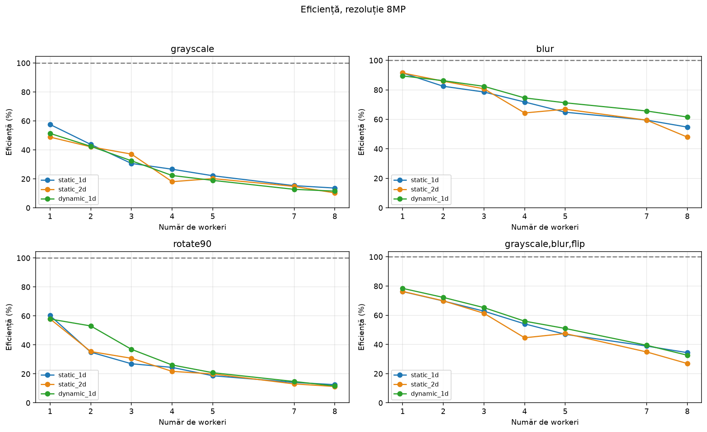

# Studiul experimental al prelucrării paralele de imagini în MPI

## Metodologie

Mediu: `local`. Fiecare configurație rulează de 3 ori. Liniile din graficele timpului arată media, iar benzile semitransparente arată abaterea standard. Speedup-ul folosește raportul mediilor `T_seq / T_par`, iar eficiența este `speedup / număr_workeri`.

Toate cele patru operații folosesc aceleași configurații. Pe imaginea `8MP` testăm strategiile cu `np` în [2, 3, 4, 5, 6, 8, 9]. Pentru variația rezoluției fixăm `np=5`.

## 1. Cum influențează numărul de workeri timpul?

## 2. De la ce dimensiune merită paralelizarea?

Fixăm `np=5` pentru toate strategiile paralele și variem numărul de pixeli.

## 3. Profil Detaliat: Coordonator vs. Workeri Individuali

Analiză detaliată la `8MP` cu `np=5` (4 workeri). Pentru fiecare strategie, prima bară (`C`) arată timpul coordonatorului (cu feliile de Pack/Unpack delimitate per worker), iar barele `W1..W4` arată execuția fiecărui worker (calcul efectiv, alocare/transfer date și timp inactiv de așteptare până la finalizarea timpului total).

## 4. Rezultatul paralel este corect?

Configurații paralele verificate: 120. Eșecuri: 0.

## Date complete

Rezultate pentru small

### Rezultate măsurate pentru rezoluția `small`

Timpii sunt exprimați în milisecunde. `np` include coordonatorul; modurile paralele folosesc `np - 1` workeri. Total arată media ± abaterea standard. Cel mai mic timp mediu din fiecare tabel este marcat cu bold.

#### grayscale

| Mod | np | Total (ms) | Calcul (ms) | Pack (ms) | MPI (ms) | Speedup |
| :--- | ---: | ---: | ---: | ---: | ---: | ---: |
| seq | 1 | **0.5 ± 0.0** | 0.5 | 0.0 | 0.0 | 1.00x |
| static_1d | 5 | 4.3 ± 6.8 | 0.1 | 0.0 | 4.3 | 0.12x |
| static_2d | 5 | 0.5 ± 0.0 | 0.1 | 0.2 | 0.4 | 0.98x |
| dynamic_1d | 5 | 0.5 ± 0.1 | 0.1 | 0.0 | 0.5 | 0.95x |

#### blur

| Mod | np | Total (ms) | Calcul (ms) | Pack (ms) | MPI (ms) | Speedup |
| :--- | ---: | ---: | ---: | ---: | ---: | ---: |
| seq | 1 | 2.4 ± 0.6 | 2.4 | 0.0 | 0.0 | 1.00x |
| static_1d | 5 | **1.0 ± 0.1** | 0.6 | 0.0 | 1.0 | 2.28x |
| static_2d | 5 | 1.2 ± 0.2 | 0.8 | 0.2 | 1.0 | 1.95x |
| dynamic_1d | 5 | 1.4 ± 0.9 | 1.0 | 0.0 | 1.4 | 1.71x |

#### rotate90

| Mod | np | Total (ms) | Calcul (ms) | Pack (ms) | MPI (ms) | Speedup |
| :--- | ---: | ---: | ---: | ---: | ---: | ---: |
| seq | 1 | **0.3 ± 0.1** | 0.3 | 0.0 | 0.0 | 1.00x |
| static_1d | 5 | 0.6 ± 0.1 | 0.1 | 0.0 | 0.5 | 0.52x |
| static_2d | 5 | 0.5 ± 0.0 | 0.1 | 0.1 | 0.3 | 0.64x |
| dynamic_1d | 5 | 0.5 ± 0.1 | 0.1 | 0.0 | 0.5 | 0.56x |

#### grayscale,blur,flip

| Mod | np | Total (ms) | Calcul (ms) | Pack (ms) | MPI (ms) | Speedup |
| :--- | ---: | ---: | ---: | ---: | ---: | ---: |
| seq | 1 | 2.4 ± 0.6 | 2.4 | 0.0 | 0.0 | 1.00x |
| static_1d | 5 | 2.1 ± 1.6 | 1.1 | 0.0 | 2.1 | 1.16x |
| static_2d | 5 | **1.4 ± 0.1** | 0.7 | 0.4 | 1.0 | 1.79x |
| dynamic_1d | 5 | 1.6 ± 0.4 | 0.8 | 0.0 | 1.6 | 1.55x |

Rezultate pentru 1.5MP

### Rezultate măsurate pentru rezoluția `1.5MP`

Timpii sunt exprimați în milisecunde. `np` include coordonatorul; modurile paralele folosesc `np - 1` workeri. Total arată media ± abaterea standard. Cel mai mic timp mediu din fiecare tabel este marcat cu bold.

#### grayscale

| Mod | np | Total (ms) | Calcul (ms) | Pack (ms) | MPI (ms) | Speedup |
| :--- | ---: | ---: | ---: | ---: | ---: | ---: |
| seq | 1 | 5.8 ± 0.5 | 5.8 | 0.0 | 0.0 | 1.00x |
| static_1d | 5 | **5.6 ± 1.0** | 1.9 | 0.0 | 5.6 | 1.03x |
| static_2d | 5 | 7.0 ± 0.6 | 2.0 | 3.4 | 3.5 | 0.82x |
| dynamic_1d | 5 | 6.2 ± 1.5 | 1.8 | 0.0 | 6.2 | 0.94x |

#### blur

| Mod | np | Total (ms) | Calcul (ms) | Pack (ms) | MPI (ms) | Speedup |
| :--- | ---: | ---: | ---: | ---: | ---: | ---: |
| seq | 1 | 39.3 ± 0.1 | 39.3 | 0.0 | 0.0 | 1.00x |
| static_1d | 5 | 15.6 ± 1.1 | 12.1 | 0.0 | 15.6 | 2.51x |
| static_2d | 5 | 15.0 ± 0.3 | 11.0 | 3.3 | 11.7 | 2.61x |
| dynamic_1d | 5 | **14.2 ± 1.4** | 12.2 | 0.0 | 14.2 | 2.77x |

#### rotate90

| Mod | np | Total (ms) | Calcul (ms) | Pack (ms) | MPI (ms) | Speedup |
| :--- | ---: | ---: | ---: | ---: | ---: | ---: |
| seq | 1 | **4.9 ± 0.3** | 4.9 | 0.0 | 0.0 | 1.00x |
| static_1d | 5 | 6.3 ± 0.4 | 1.7 | 1.3 | 4.9 | 0.78x |
| static_2d | 5 | 7.3 ± 1.2 | 1.8 | 3.8 | 3.4 | 0.67x |
| dynamic_1d | 5 | 7.6 ± 3.1 | 1.7 | 0.9 | 6.7 | 0.65x |

#### grayscale,blur,flip

| Mod | np | Total (ms) | Calcul (ms) | Pack (ms) | MPI (ms) | Speedup |
| :--- | ---: | ---: | ---: | ---: | ---: | ---: |
| seq | 1 | 46.6 ± 0.1 | 46.6 | 0.0 | 0.0 | 1.00x |
| static_1d | 5 | 23.9 ± 0.7 | 14.7 | 0.0 | 23.9 | 1.95x |
| static_2d | 5 | 29.1 ± 3.6 | 16.6 | 9.7 | 19.3 | 1.60x |
| dynamic_1d | 5 | **21.9 ± 0.2** | 14.1 | 0.0 | 21.9 | 2.13x |

Rezultate pentru 4MP

### Rezultate măsurate pentru rezoluția `4MP`

Timpii sunt exprimați în milisecunde. `np` include coordonatorul; modurile paralele folosesc `np - 1` workeri. Total arată media ± abaterea standard. Cel mai mic timp mediu din fiecare tabel este marcat cu bold.

#### grayscale

| Mod | np | Total (ms) | Calcul (ms) | Pack (ms) | MPI (ms) | Speedup |
| :--- | ---: | ---: | ---: | ---: | ---: | ---: |
| seq | 1 | 14.2 ± 0.1 | 14.2 | 0.0 | 0.0 | 1.00x |
| static_1d | 5 | **12.4 ± 0.4** | 4.2 | 0.0 | 12.4 | 1.15x |
| static_2d | 5 | 16.8 ± 0.1 | 4.3 | 9.0 | 7.6 | 0.84x |
| dynamic_1d | 5 | 14.0 ± 1.2 | 4.7 | 0.0 | 14.0 | 1.02x |

#### blur

| Mod | np | Total (ms) | Calcul (ms) | Pack (ms) | MPI (ms) | Speedup |
| :--- | ---: | ---: | ---: | ---: | ---: | ---: |
| seq | 1 | 102.5 ± 0.8 | 102.5 | 0.0 | 0.0 | 1.00x |
| static_1d | 5 | 39.3 ± 3.6 | 30.4 | 0.0 | 39.3 | 2.61x |
| static_2d | 5 | 40.0 ± 0.7 | 29.2 | 9.1 | 30.7 | 2.56x |
| dynamic_1d | 5 | **34.3 ± 1.3** | 28.9 | 0.0 | 34.3 | 2.99x |

#### rotate90

| Mod | np | Total (ms) | Calcul (ms) | Pack (ms) | MPI (ms) | Speedup |
| :--- | ---: | ---: | ---: | ---: | ---: | ---: |
| seq | 1 | **13.2 ± 0.1** | 13.2 | 0.0 | 0.0 | 1.00x |
| static_1d | 5 | 16.1 ± 1.0 | 4.8 | 3.3 | 12.6 | 0.82x |
| static_2d | 5 | 18.9 ± 0.7 | 5.0 | 9.9 | 8.8 | 0.70x |
| dynamic_1d | 5 | 14.0 ± 1.4 | 4.4 | 2.2 | 11.8 | 0.94x |

#### grayscale,blur,flip

| Mod | np | Total (ms) | Calcul (ms) | Pack (ms) | MPI (ms) | Speedup |
| :--- | ---: | ---: | ---: | ---: | ---: | ---: |
| seq | 1 | 124.0 ± 0.3 | 124.0 | 0.0 | 0.0 | 1.00x |
| static_1d | 5 | 60.8 ± 2.7 | 37.2 | 0.0 | 60.8 | 2.04x |
| static_2d | 5 | 69.0 ± 2.3 | 37.0 | 25.2 | 43.5 | 1.80x |
| dynamic_1d | 5 | **59.1 ± 1.2** | 36.9 | 0.0 | 59.1 | 2.10x |

Rezultate pentru 8MP

### Rezultate măsurate pentru rezoluția `8MP`

Timpii sunt exprimați în milisecunde. `np` include coordonatorul; modurile paralele folosesc `np - 1` workeri. Total arată media ± abaterea standard. Cel mai mic timp mediu din fiecare tabel este marcat cu bold.

#### grayscale

| Mod | np | Total (ms) | Calcul (ms) | Pack (ms) | MPI (ms) | Speedup |
| :--- | ---: | ---: | ---: | ---: | ---: | ---: |
| seq | 1 | 30.5 ± 0.4 | 30.5 | 0.0 | 0.0 | 1.00x |
| static_1d | 2 | 53.0 ± 0.4 | 30.5 | 0.0 | 53.0 | 0.58x |
| static_1d | 3 | 34.8 ± 1.8 | 15.6 | 0.0 | 34.8 | 0.88x |
| static_1d | 4 | 33.1 ± 1.4 | 13.8 | 0.0 | 33.1 | 0.92x |
| static_1d | 5 | 28.6 ± 0.2 | 9.0 | 0.0 | 28.6 | 1.07x |
| static_1d | 6 | 27.5 ± 1.1 | 7.9 | 0.0 | 27.5 | 1.11x |
| static_1d | 8 | 28.4 ± 0.2 | 6.1 | 0.0 | 28.4 | 1.07x |
| static_1d | 9 | 27.9 ± 1.3 | 5.1 | 0.0 | 27.9 | 1.09x |
| static_2d | 2 | 62.4 ± 18.3 | 39.2 | 0.0 | 62.4 | 0.49x |
| static_2d | 3 | 36.2 ± 5.4 | 17.0 | 0.0 | 36.2 | 0.84x |
| static_2d | 4 | **27.4 ± 0.5** | 10.8 | 0.0 | 27.4 | 1.11x |
| static_2d | 5 | 42.2 ± 3.0 | 9.5 | 23.5 | 18.4 | 0.72x |
| static_2d | 6 | 30.2 ± 3.0 | 10.7 | 0.0 | 30.2 | 1.01x |
| static_2d | 8 | 29.4 ± 0.8 | 5.6 | 0.0 | 29.4 | 1.04x |
| static_2d | 9 | 37.0 ± 3.4 | 5.2 | 18.4 | 18.4 | 0.82x |
| dynamic_1d | 2 | 59.3 ± 2.9 | 31.1 | 0.0 | 59.3 | 0.51x |
| dynamic_1d | 3 | 35.9 ± 3.3 | 17.6 | 0.0 | 35.9 | 0.85x |
| dynamic_1d | 4 | 31.3 ± 0.6 | 12.4 | 0.0 | 31.3 | 0.97x |
| dynamic_1d | 5 | 34.1 ± 4.2 | 12.1 | 0.0 | 34.1 | 0.89x |
| dynamic_1d | 6 | 32.2 ± 2.5 | 8.6 | 0.0 | 32.1 | 0.95x |
| dynamic_1d | 8 | 34.1 ± 3.7 | 6.6 | 0.0 | 34.1 | 0.89x |
| dynamic_1d | 9 | 33.1 ± 1.9 | 5.8 | 0.0 | 33.1 | 0.92x |

#### blur

| Mod | np | Total (ms) | Calcul (ms) | Pack (ms) | MPI (ms) | Speedup |
| :--- | ---: | ---: | ---: | ---: | ---: | ---: |
| seq | 1 | 221.8 ± 2.3 | 221.8 | 0.0 | 0.0 | 1.00x |
| static_1d | 2 | 242.5 ± 0.9 | 219.8 | 0.0 | 242.5 | 0.91x |
| static_1d | 3 | 134.5 ± 7.4 | 115.4 | 0.0 | 134.5 | 1.65x |
| static_1d | 4 | 94.1 ± 4.5 | 77.1 | 0.0 | 94.1 | 2.36x |
| static_1d | 5 | 77.2 ± 4.1 | 60.5 | 0.0 | 77.2 | 2.87x |
| static_1d | 6 | 68.4 ± 0.8 | 50.7 | 0.0 | 68.4 | 3.24x |
| static_1d | 8 | 53.3 ± 0.9 | 36.7 | 0.0 | 53.2 | 4.16x |
| static_1d | 9 | 50.6 ± 2.1 | 33.6 | 0.0 | 50.6 | 4.38x |
| static_2d | 2 | 242.5 ± 1.8 | 220.2 | 0.0 | 242.5 | 0.91x |
| static_2d | 3 | 129.1 ± 0.5 | 111.4 | 0.0 | 129.1 | 1.72x |
| static_2d | 4 | 91.6 ± 1.2 | 75.2 | 0.0 | 91.6 | 2.42x |
| static_2d | 5 | 86.2 ± 0.7 | 62.6 | 19.6 | 66.2 | 2.57x |
| static_2d | 6 | 66.3 ± 0.6 | 50.3 | 0.0 | 66.3 | 3.34x |
| static_2d | 8 | 53.3 ± 0.7 | 36.5 | 0.0 | 53.3 | 4.16x |
| static_2d | 9 | 57.8 ± 5.8 | 33.5 | 19.6 | 37.9 | 3.84x |
| dynamic_1d | 2 | 248.0 ± 3.6 | 222.4 | 0.0 | 248.0 | 0.89x |
| dynamic_1d | 3 | 128.6 ± 0.7 | 112.1 | 0.0 | 128.6 | 1.72x |
| dynamic_1d | 4 | 89.7 ± 0.6 | 76.4 | 0.0 | 89.7 | 2.47x |
| dynamic_1d | 5 | 74.4 ± 0.7 | 63.7 | 0.0 | 74.4 | 2.98x |
| dynamic_1d | 6 | 62.3 ± 0.8 | 51.4 | 0.0 | 62.3 | 3.56x |
| dynamic_1d | 8 | 48.2 ± 0.6 | 37.5 | 0.0 | 48.2 | 4.60x |
| dynamic_1d | 9 | **45.0 ± 2.8** | 36.1 | 0.0 | 45.0 | 4.93x |

#### rotate90

| Mod | np | Total (ms) | Calcul (ms) | Pack (ms) | MPI (ms) | Speedup |
| :--- | ---: | ---: | ---: | ---: | ---: | ---: |
| seq | 1 | 33.7 ± 1.2 | 33.7 | 0.0 | 0.0 | 1.00x |
| static_1d | 2 | 56.0 ± 0.4 | 33.6 | 0.0 | 56.0 | 0.60x |
| static_1d | 3 | 48.2 ± 0.4 | 16.5 | 12.3 | 35.2 | 0.70x |
| static_1d | 4 | 41.7 ± 2.0 | 12.7 | 11.0 | 30.2 | 0.81x |
| static_1d | 5 | 34.5 ± 0.7 | 9.5 | 7.7 | 26.4 | 0.98x |
| static_1d | 6 | 36.1 ± 4.9 | 7.4 | 9.1 | 26.6 | 0.94x |
| static_1d | 8 | 34.2 ± 1.7 | 5.9 | 6.2 | 27.8 | 0.99x |
| static_1d | 9 | 33.6 ± 2.1 | 4.9 | 6.5 | 26.9 | 1.01x |
| static_2d | 2 | 58.2 ± 4.2 | 35.0 | 0.0 | 58.2 | 0.58x |
| static_2d | 3 | 47.6 ± 1.2 | 16.7 | 12.3 | 34.6 | 0.71x |
| static_2d | 4 | 36.5 ± 1.2 | 11.0 | 9.2 | 26.9 | 0.92x |
| static_2d | 5 | 38.8 ± 2.3 | 8.6 | 20.8 | 17.6 | 0.87x |
| static_2d | 6 | 33.8 ± 3.4 | 7.5 | 7.5 | 26.0 | 1.00x |
| static_2d | 8 | 36.9 ± 1.1 | 6.3 | 8.7 | 27.8 | 0.92x |
| static_2d | 9 | 37.4 ± 3.2 | 5.3 | 18.6 | 18.6 | 0.90x |
| dynamic_1d | 2 | 58.3 ± 1.0 | 26.1 | 8.0 | 50.0 | 0.58x |
| dynamic_1d | 3 | 31.8 ± 2.0 | 12.6 | 5.1 | 26.4 | 1.06x |
| dynamic_1d | 4 | **30.4 ± 0.8** | 11.2 | 4.7 | 25.4 | 1.11x |
| dynamic_1d | 5 | 32.3 ± 6.9 | 10.2 | 5.8 | 26.3 | 1.05x |
| dynamic_1d | 6 | 32.4 ± 3.0 | 7.4 | 6.1 | 26.2 | 1.04x |
| dynamic_1d | 8 | 32.7 ± 0.8 | 5.6 | 6.1 | 26.4 | 1.03x |
| dynamic_1d | 9 | 36.3 ± 6.7 | 5.8 | 6.0 | 30.1 | 0.93x |

#### grayscale,blur,flip

| Mod | np | Total (ms) | Calcul (ms) | Pack (ms) | MPI (ms) | Speedup |
| :--- | ---: | ---: | ---: | ---: | ---: | ---: |
| seq | 1 | 265.8 ± 1.4 | 265.8 | 0.0 | 0.0 | 1.00x |
| static_1d | 2 | 348.5 ± 2.2 | 272.2 | 0.0 | 348.5 | 0.76x |
| static_1d | 3 | 190.4 ± 1.8 | 138.8 | 0.0 | 190.4 | 1.40x |
| static_1d | 4 | 141.0 ± 1.3 | 93.9 | 0.0 | 141.0 | 1.88x |
| static_1d | 5 | 122.8 ± 1.6 | 76.2 | 0.0 | 122.8 | 2.16x |
| static_1d | 6 | 113.2 ± 1.1 | 63.3 | 0.0 | 113.2 | 2.35x |
| static_1d | 8 | 97.6 ± 2.2 | 46.4 | 0.0 | 97.6 | 2.72x |
| static_1d | 9 | 96.6 ± 3.0 | 41.3 | 0.0 | 96.6 | 2.75x |
| static_2d | 2 | 348.1 ± 3.5 | 272.0 | 0.0 | 348.1 | 0.76x |
| static_2d | 3 | 190.1 ± 1.8 | 137.6 | 0.0 | 190.1 | 1.40x |
| static_2d | 4 | 144.4 ± 8.2 | 96.7 | 0.0 | 144.4 | 1.84x |
| static_2d | 5 | 149.0 ± 7.3 | 79.9 | 50.4 | 98.3 | 1.78x |
| static_2d | 6 | 112.0 ± 3.1 | 63.7 | 0.0 | 112.0 | 2.37x |
| static_2d | 8 | 108.9 ± 10.6 | 50.0 | 0.0 | 108.8 | 2.44x |
| static_2d | 9 | 123.3 ± 6.1 | 42.0 | 56.2 | 66.8 | 2.16x |
| dynamic_1d | 2 | 338.9 ± 0.2 | 267.8 | 0.0 | 338.8 | 0.78x |
| dynamic_1d | 3 | 184.0 ± 5.9 | 141.6 | 0.0 | 183.9 | 1.44x |
| dynamic_1d | 4 | 135.8 ± 1.4 | 92.0 | 0.0 | 135.8 | 1.96x |
| dynamic_1d | 5 | 118.7 ± 1.1 | 75.3 | 0.0 | 118.7 | 2.24x |
| dynamic_1d | 6 | 104.3 ± 2.3 | 60.8 | 0.0 | 104.3 | 2.55x |
| dynamic_1d | 8 | **96.3 ± 1.3** | 46.2 | 0.0 | 96.2 | 2.76x |
| dynamic_1d | 9 | 101.8 ± 17.2 | 41.1 | 0.0 | 101.8 | 2.61x |

