# Studiu pilot pe două calculatoare, 256×256

Imaginea `test_images/sample_small.ppm` are 65.536 pixeli. Acest raport păstrează studiul original și folosește numai imaginea de 256×256.

## Metodologie

Am măsurat 320 de configurații, cu câte 3 repetări, în total 960 de rulări măsurate. Cele patru operații sunt grayscale, blur 9×9, rotate90 și pipeline-ul grayscale,blur,flip. Strategiile sunt static_1d, static_2d și dynamic_1d.

HP-Laptop are un Intel Core i7-7500U, cu 2 nuclee și 4 fire hardware. Victus are un Intel Core i5-12500H și 16 fire hardware. Am folosit Open MPI 4.1.6, compilare `mpicc -O3 -Wall` și `--bind-to none`. Procesele rulează fără fixare pe nuclee. Coordonatorul este un proces suplimentar față de numărul de workeri.

În rulările mixte, rangul 0 și primii 1 sau 2 workeri sunt pe HP-Laptop, iar restul workerilor sunt pe Victus. În rulările pe un singur calculator, coordonatorul rulează pe același calculator. Limitele de 2 și 8 se referă la workeri.

Speedup = media timpului secvențial / media timpului paralel. Referința secvențială rulează pe calculatorul coordonatorului, deci HP-Laptop pentru configurațiile mixte. Eficiența este speedup / numărul total de workeri. Pe calculatoare diferite, acest raport depinde de performanța referinței secvențiale.

Timpii provin din instrumentarea C și exclud lansarea MPI, citirea imaginii, scrierea rezultatului și verificarea pixelilor. Prima repetare a fiecărei configurații salvează rezultatul pentru comparație integrală cu referința secvențială. Celelalte repetări folosesc ieșirea NONE. Timpii sunt afișați ca medie și abatere standard. Trei repetări oferă o verificare pilot, cu precizie limitată pentru operațiile scurte.

Toate graficele de timp folosesc aceeași limită verticală, inclusiv graficele strategiilor. Graficele de speedup folosesc o limită comună. Valorile extreme ridică limita verticală, astfel că unele curbe și bare sunt aproape de zero pe această scară. Tabelele păstrează valorile numerice. Datele brute includ timpii fiecărui worker, distribuția pe calculatoare și datele necesare eficienței. Variația cu rezoluția necesită măsurători la alte dimensiuni și nu poate fi evaluată cu această singură imagine.

## grayscale

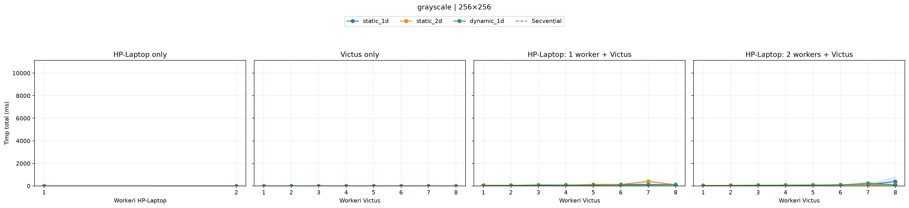

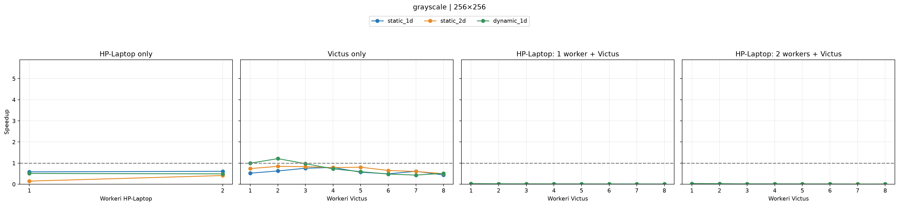

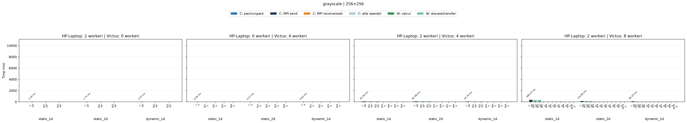

Cel mai mic timp paralel mediu este 0.369 ms, cu dynamic_1d, 0 workeri HP-Laptop și 2 workeri Victus. Speedup față de referința de pe victus este 1.21.

## blur

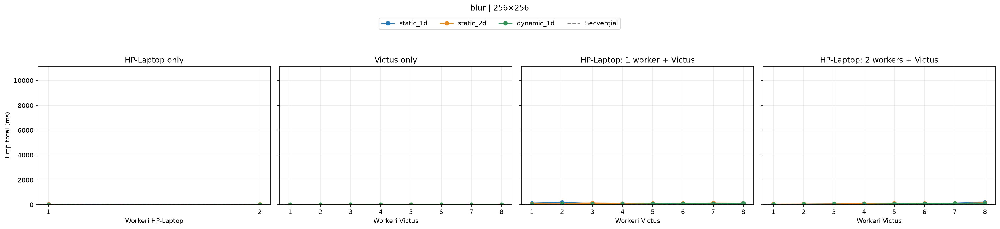

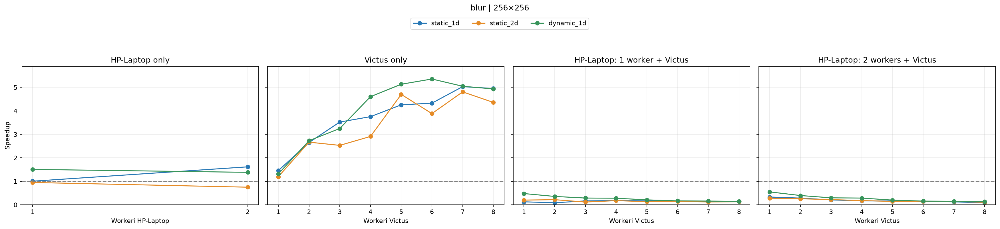

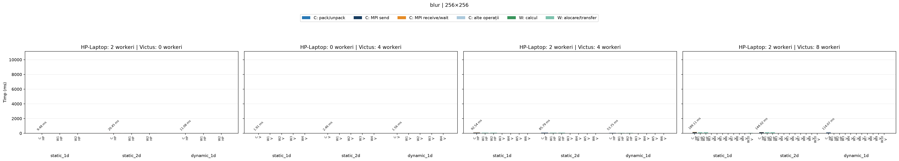

Cel mai mic timp paralel mediu este 1.337 ms, cu dynamic_1d, 0 workeri HP-Laptop și 6 workeri Victus. Speedup față de referința de pe victus este 5.36.

## rotate90

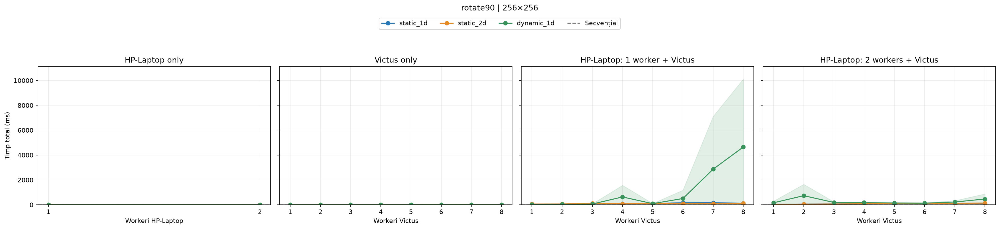

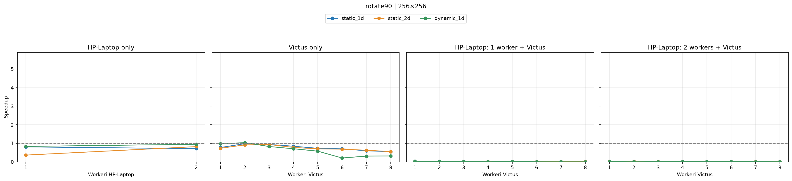

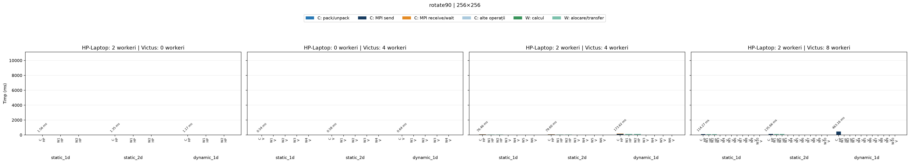

Cel mai mic timp paralel mediu este 0.439 ms, cu dynamic_1d, 0 workeri HP-Laptop și 2 workeri Victus. Speedup față de referința de pe victus este 1.03.

## grayscale,blur,flip

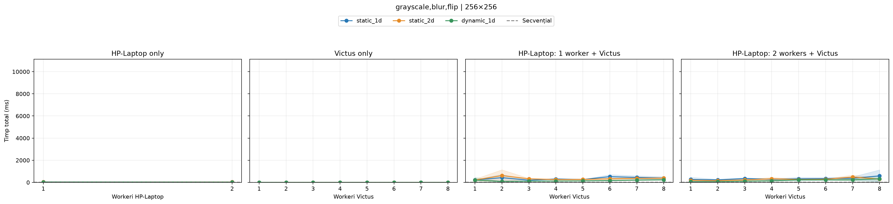

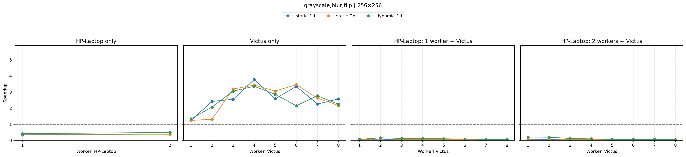

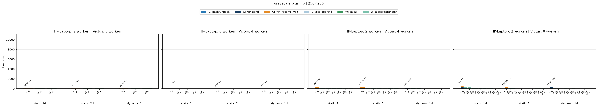

Cel mai mic timp paralel mediu este 1.948 ms, cu static_1d, 0 workeri HP-Laptop și 4 workeri Victus. Speedup față de referința de pe victus este 3.78.

## Verificare și interpretare

Cea mai lentă repetare a durat 10767.017 ms, pentru rotate90, dynamic_1d, cu 1 worker HP-Laptop și 8 workeri Victus. Cea mai mare abatere standard relativă este 149.5%, pentru rotate90, dynamic_1d, HP=1, Victus=4. Am păstrat toate repetările. Acest pilot verifică matricea și graficele, dar variația limitează concluziile despre ordinea strategiilor. Nu am măsurat separat rețeaua sau încărcarea de fond, deci nu pot atribui variația unei singure cauze.

Toate cele 320 de configurații au rezultate identice pixel cu pixel cu referința secvențială în prima repetare.

Barele C și W se suprapun în timp și nu se adună. HP înseamnă HP-Laptop, iar V înseamnă Victus. Barele workerilor arată calculul și timpul instrumentat de alocare/transfer. Timpul rămas până la timpul coordonatorului nu este etichetat drept inactivitate, deoarece programul nu măsoară separat acea durată. Segmentele pack/unpack nu sunt defalcate per worker, deoarece instrumentarea oferă numai totalul coordonatorului.

## Reproducere

Scriptul separat este [benchmark_two_machines_small.py](benchmark_two_machines_small.py). Ambele calculatoare trebuie să acceseze același director și să accepte conexiuni SSH fără parolă. Rularea completă folosește comanda de mai jos. Scriptul reia configurațiile lipsă din jurnalul existent.

```bash
uv run --with numpy --with matplotlib python benchmark_two_machines_small.py
```

Pentru regenerarea raportului și a figurilor din măsurătorile salvate:

```bash
uv run --with numpy --with matplotlib python benchmark_two_machines_small.py --plot-only
```

## Date complete

Datele sunt în [results.csv](benchmark_small_two_machines/results.csv), [runs.csv](benchmark_small_two_machines/runs.csv) și [runs.jsonl](benchmark_small_two_machines/runs.jsonl). Fișierul [metadata.json](benchmark_small_two_machines/metadata.json) păstrează informațiile calculatoarelor și hash-urile imaginii și sursei. În jurnalul intern JSONL, pentru modul seq, hp=1 sau victus=1 selectează calculatorul referinței, fără workeri. Fișierele CSV arată zero workeri pentru modul seq.

| Operație | Strategie | HP workeri | Victus workeri | Coordonator | Total ms | Abatere ms | Speedup | Eficiență |
| --- | --- | ---: | ---: | --- | ---: | ---: | ---: | ---: |
| grayscale | seq | 0 | 0 | HP-Laptop | 0.719 | 0.147 | 1.000 | 1.000 |
| grayscale | seq | 0 | 0 | victus | 0.447 | 0.086 | 1.000 | 1.000 |
| blur | seq | 0 | 0 | HP-Laptop | 15.312 | 5.185 | 1.000 | 1.000 |
| blur | seq | 0 | 0 | victus | 7.161 | 2.052 | 1.000 | 1.000 |
| rotate90 | seq | 0 | 0 | HP-Laptop | 1.111 | 0.454 | 1.000 | 1.000 |
| rotate90 | seq | 0 | 0 | victus | 0.454 | 0.072 | 1.000 | 1.000 |
| grayscale,blur,flip | seq | 0 | 0 | HP-Laptop | 13.650 | 3.753 | 1.000 | 1.000 |
| grayscale,blur,flip | seq | 0 | 0 | victus | 7.358 | 3.198 | 1.000 | 1.000 |
| grayscale | static_1d | 1 | 0 | HP-Laptop | 1.228 | 0.130 | 0.585 | 0.585 |
| grayscale | static_1d | 2 | 0 | HP-Laptop | 1.177 | 0.156 | 0.611 | 0.305 |
| grayscale | static_1d | 0 | 1 | victus | 0.856 | 0.125 | 0.522 | 0.522 |
| grayscale | static_1d | 0 | 2 | victus | 0.713 | 0.258 | 0.627 | 0.313 |
| grayscale | static_1d | 0 | 3 | victus | 0.591 | 0.188 | 0.756 | 0.252 |
| grayscale | static_1d | 0 | 4 | victus | 0.563 | 0.081 | 0.793 | 0.198 |
| grayscale | static_1d | 0 | 5 | victus | 0.789 | 0.190 | 0.567 | 0.113 |
| grayscale | static_1d | 0 | 6 | victus | 0.909 | 0.228 | 0.492 | 0.082 |
| grayscale | static_1d | 0 | 7 | victus | 0.732 | 0.032 | 0.611 | 0.087 |
| grayscale | static_1d | 0 | 8 | victus | 1.029 | 0.125 | 0.435 | 0.054 |
| grayscale | static_1d | 1 | 1 | HP-Laptop | 64.899 | 5.828 | 0.011 | 0.006 |
| grayscale | static_1d | 1 | 2 | HP-Laptop | 62.080 | 3.892 | 0.012 | 0.004 |
| grayscale | static_1d | 1 | 3 | HP-Laptop | 99.428 | 16.537 | 0.007 | 0.002 |
| grayscale | static_1d | 1 | 4 | HP-Laptop | 89.470 | 7.010 | 0.008 | 0.002 |
| grayscale | static_1d | 1 | 5 | HP-Laptop | 99.217 | 13.778 | 0.007 | 0.001 |
| grayscale | static_1d | 1 | 6 | HP-Laptop | 129.106 | 45.207 | 0.006 | 0.001 |
| grayscale | static_1d | 1 | 7 | HP-Laptop | 133.127 | 49.749 | 0.005 | 0.001 |
| grayscale | static_1d | 1 | 8 | HP-Laptop | 122.603 | 16.517 | 0.006 | 0.001 |
| grayscale | static_1d | 2 | 1 | HP-Laptop | 44.912 | 2.500 | 0.016 | 0.005 |
| grayscale | static_1d | 2 | 2 | HP-Laptop | 62.041 | 8.998 | 0.012 | 0.003 |
| grayscale | static_1d | 2 | 3 | HP-Laptop | 65.186 | 5.572 | 0.011 | 0.002 |
| grayscale | static_1d | 2 | 4 | HP-Laptop | 83.561 | 8.417 | 0.009 | 0.001 |
| grayscale | static_1d | 2 | 5 | HP-Laptop | 91.952 | 11.401 | 0.008 | 0.001 |
| grayscale | static_1d | 2 | 6 | HP-Laptop | 115.324 | 26.717 | 0.006 | 0.001 |
| grayscale | static_1d | 2 | 7 | HP-Laptop | 119.424 | 16.430 | 0.006 | 0.001 |
| grayscale | static_1d | 2 | 8 | HP-Laptop | 390.572 | 451.647 | 0.002 | 0.000 |
| grayscale | static_2d | 1 | 0 | HP-Laptop | 4.927 | 2.736 | 0.146 | 0.146 |
| grayscale | static_2d | 2 | 0 | HP-Laptop | 1.754 | 0.931 | 0.410 | 0.205 |
| grayscale | static_2d | 0 | 1 | victus | 0.604 | 0.142 | 0.740 | 0.740 |
| grayscale | static_2d | 0 | 2 | victus | 0.529 | 0.100 | 0.844 | 0.422 |
| grayscale | static_2d | 0 | 3 | victus | 0.539 | 0.210 | 0.829 | 0.276 |
| grayscale | static_2d | 0 | 4 | victus | 0.568 | 0.037 | 0.787 | 0.197 |
| grayscale | static_2d | 0 | 5 | victus | 0.555 | 0.073 | 0.805 | 0.161 |
| grayscale | static_2d | 0 | 6 | victus | 0.689 | 0.119 | 0.648 | 0.108 |
| grayscale | static_2d | 0 | 7 | victus | 0.742 | 0.083 | 0.603 | 0.086 |
| grayscale | static_2d | 0 | 8 | victus | 0.901 | 0.033 | 0.496 | 0.062 |
| grayscale | static_2d | 1 | 1 | HP-Laptop | 63.610 | 14.858 | 0.011 | 0.006 |
| grayscale | static_2d | 1 | 2 | HP-Laptop | 67.336 | 4.928 | 0.011 | 0.004 |
| grayscale | static_2d | 1 | 3 | HP-Laptop | 75.308 | 9.361 | 0.010 | 0.002 |
| grayscale | static_2d | 1 | 4 | HP-Laptop | 79.914 | 4.732 | 0.009 | 0.002 |
| grayscale | static_2d | 1 | 5 | HP-Laptop | 137.992 | 66.388 | 0.005 | 0.001 |
| grayscale | static_2d | 1 | 6 | HP-Laptop | 134.945 | 45.646 | 0.005 | 0.001 |
| grayscale | static_2d | 1 | 7 | HP-Laptop | 402.128 | 84.055 | 0.002 | 0.000 |
| grayscale | static_2d | 1 | 8 | HP-Laptop | 121.107 | 1.356 | 0.006 | 0.001 |
| grayscale | static_2d | 2 | 1 | HP-Laptop | 50.827 | 6.798 | 0.014 | 0.005 |
| grayscale | static_2d | 2 | 2 | HP-Laptop | 59.977 | 4.422 | 0.012 | 0.003 |
| grayscale | static_2d | 2 | 3 | HP-Laptop | 75.132 | 9.362 | 0.010 | 0.002 |
| grayscale | static_2d | 2 | 4 | HP-Laptop | 82.076 | 1.615 | 0.009 | 0.001 |
| grayscale | static_2d | 2 | 5 | HP-Laptop | 89.227 | 5.338 | 0.008 | 0.001 |
| grayscale | static_2d | 2 | 6 | HP-Laptop | 108.432 | 10.056 | 0.007 | 0.001 |
| grayscale | static_2d | 2 | 7 | HP-Laptop | 101.947 | 19.171 | 0.007 | 0.001 |
| grayscale | static_2d | 2 | 8 | HP-Laptop | 132.801 | 19.993 | 0.005 | 0.001 |
| grayscale | dynamic_1d | 1 | 0 | HP-Laptop | 1.414 | 0.248 | 0.508 | 0.508 |
| grayscale | dynamic_1d | 2 | 0 | HP-Laptop | 1.469 | 0.548 | 0.489 | 0.245 |
| grayscale | dynamic_1d | 0 | 1 | victus | 0.450 | 0.003 | 0.993 | 0.993 |
| grayscale | dynamic_1d | 0 | 2 | victus | 0.369 | 0.033 | 1.211 | 0.606 |
| grayscale | dynamic_1d | 0 | 3 | victus | 0.460 | 0.038 | 0.971 | 0.324 |
| grayscale | dynamic_1d | 0 | 4 | victus | 0.616 | 0.041 | 0.725 | 0.181 |
| grayscale | dynamic_1d | 0 | 5 | victus | 0.752 | 0.017 | 0.594 | 0.119 |
| grayscale | dynamic_1d | 0 | 6 | victus | 0.932 | 0.052 | 0.480 | 0.080 |
| grayscale | dynamic_1d | 0 | 7 | victus | 1.037 | 0.150 | 0.431 | 0.062 |
| grayscale | dynamic_1d | 0 | 8 | victus | 0.868 | 0.025 | 0.515 | 0.064 |
| grayscale | dynamic_1d | 1 | 1 | HP-Laptop | 28.852 | 5.491 | 0.025 | 0.012 |
| grayscale | dynamic_1d | 1 | 2 | HP-Laptop | 39.904 | 5.153 | 0.018 | 0.006 |
| grayscale | dynamic_1d | 1 | 3 | HP-Laptop | 49.782 | 5.519 | 0.014 | 0.004 |
| grayscale | dynamic_1d | 1 | 4 | HP-Laptop | 70.130 | 23.157 | 0.010 | 0.002 |
| grayscale | dynamic_1d | 1 | 5 | HP-Laptop | 64.464 | 5.433 | 0.011 | 0.002 |
| grayscale | dynamic_1d | 1 | 6 | HP-Laptop | 84.396 | 11.738 | 0.009 | 0.001 |
| grayscale | dynamic_1d | 1 | 7 | HP-Laptop | 85.483 | 4.007 | 0.008 | 0.001 |
| grayscale | dynamic_1d | 1 | 8 | HP-Laptop | 106.653 | 9.918 | 0.007 | 0.001 |
| grayscale | dynamic_1d | 2 | 1 | HP-Laptop | 24.647 | 0.075 | 0.029 | 0.010 |
| grayscale | dynamic_1d | 2 | 2 | HP-Laptop | 31.777 | 5.494 | 0.023 | 0.006 |
| grayscale | dynamic_1d | 2 | 3 | HP-Laptop | 59.839 | 22.043 | 0.012 | 0.002 |
| grayscale | dynamic_1d | 2 | 4 | HP-Laptop | 54.740 | 4.840 | 0.013 | 0.002 |
| grayscale | dynamic_1d | 2 | 5 | HP-Laptop | 67.382 | 0.804 | 0.011 | 0.002 |
| grayscale | dynamic_1d | 2 | 6 | HP-Laptop | 79.750 | 16.920 | 0.009 | 0.001 |
| grayscale | dynamic_1d | 2 | 7 | HP-Laptop | 231.730 | 187.480 | 0.003 | 0.000 |
| grayscale | dynamic_1d | 2 | 8 | HP-Laptop | 94.104 | 3.865 | 0.008 | 0.001 |
| blur | static_1d | 1 | 0 | HP-Laptop | 15.256 | 10.841 | 1.004 | 1.004 |
| blur | static_1d | 2 | 0 | HP-Laptop | 9.479 | 0.987 | 1.615 | 0.808 |
| blur | static_1d | 0 | 1 | victus | 4.919 | 0.085 | 1.456 | 1.456 |
| blur | static_1d | 0 | 2 | victus | 2.701 | 0.060 | 2.651 | 1.325 |
| blur | static_1d | 0 | 3 | victus | 2.032 | 0.103 | 3.523 | 1.174 |
| blur | static_1d | 0 | 4 | victus | 1.908 | 0.556 | 3.754 | 0.938 |
| blur | static_1d | 0 | 5 | victus | 1.682 | 0.373 | 4.256 | 0.851 |
| blur | static_1d | 0 | 6 | victus | 1.654 | 0.220 | 4.329 | 0.722 |
| blur | static_1d | 0 | 7 | victus | 1.423 | 0.024 | 5.032 | 0.719 |
| blur | static_1d | 0 | 8 | victus | 1.446 | 0.042 | 4.952 | 0.619 |
| blur | static_1d | 1 | 1 | HP-Laptop | 122.046 | 39.142 | 0.125 | 0.063 |
| blur | static_1d | 1 | 2 | HP-Laptop | 181.181 | 70.896 | 0.085 | 0.028 |
| blur | static_1d | 1 | 3 | HP-Laptop | 92.720 | 30.521 | 0.165 | 0.041 |
| blur | static_1d | 1 | 4 | HP-Laptop | 86.629 | 13.207 | 0.177 | 0.035 |
| blur | static_1d | 1 | 5 | HP-Laptop | 91.544 | 5.529 | 0.167 | 0.028 |
| blur | static_1d | 1 | 6 | HP-Laptop | 95.440 | 3.204 | 0.160 | 0.023 |
| blur | static_1d | 1 | 7 | HP-Laptop | 114.694 | 3.099 | 0.134 | 0.017 |
| blur | static_1d | 1 | 8 | HP-Laptop | 112.081 | 2.215 | 0.137 | 0.015 |
| blur | static_1d | 2 | 1 | HP-Laptop | 46.484 | 8.648 | 0.329 | 0.110 |
| blur | static_1d | 2 | 2 | HP-Laptop | 53.934 | 4.572 | 0.284 | 0.071 |
| blur | static_1d | 2 | 3 | HP-Laptop | 73.983 | 17.759 | 0.207 | 0.041 |
| blur | static_1d | 2 | 4 | HP-Laptop | 92.544 | 35.716 | 0.165 | 0.028 |
| blur | static_1d | 2 | 5 | HP-Laptop | 95.162 | 9.172 | 0.161 | 0.023 |
| blur | static_1d | 2 | 6 | HP-Laptop | 102.506 | 13.156 | 0.149 | 0.019 |
| blur | static_1d | 2 | 7 | HP-Laptop | 122.602 | 11.351 | 0.125 | 0.014 |
| blur | static_1d | 2 | 8 | HP-Laptop | 189.105 | 90.071 | 0.081 | 0.008 |
| blur | static_2d | 1 | 0 | HP-Laptop | 16.131 | 9.586 | 0.949 | 0.949 |
| blur | static_2d | 2 | 0 | HP-Laptop | 20.454 | 7.860 | 0.749 | 0.374 |
| blur | static_2d | 0 | 1 | victus | 5.989 | 2.084 | 1.196 | 1.196 |
| blur | static_2d | 0 | 2 | victus | 2.685 | 0.048 | 2.667 | 1.333 |
| blur | static_2d | 0 | 3 | victus | 2.831 | 0.801 | 2.530 | 0.843 |
| blur | static_2d | 0 | 4 | victus | 2.460 | 0.212 | 2.910 | 0.728 |
| blur | static_2d | 0 | 5 | victus | 1.523 | 0.047 | 4.701 | 0.940 |
| blur | static_2d | 0 | 6 | victus | 1.844 | 0.293 | 3.884 | 0.647 |
| blur | static_2d | 0 | 7 | victus | 1.489 | 0.133 | 4.809 | 0.687 |
| blur | static_2d | 0 | 8 | victus | 1.643 | 0.378 | 4.359 | 0.545 |
| blur | static_2d | 1 | 1 | HP-Laptop | 77.164 | 36.867 | 0.198 | 0.099 |
| blur | static_2d | 1 | 2 | HP-Laptop | 70.823 | 11.483 | 0.216 | 0.072 |
| blur | static_2d | 1 | 3 | HP-Laptop | 132.117 | 89.112 | 0.116 | 0.029 |
| blur | static_2d | 1 | 4 | HP-Laptop | 86.930 | 5.655 | 0.176 | 0.035 |
| blur | static_2d | 1 | 5 | HP-Laptop | 115.691 | 17.032 | 0.132 | 0.022 |
| blur | static_2d | 1 | 6 | HP-Laptop | 103.177 | 9.058 | 0.148 | 0.021 |
| blur | static_2d | 1 | 7 | HP-Laptop | 128.265 | 17.527 | 0.119 | 0.015 |
| blur | static_2d | 1 | 8 | HP-Laptop | 118.915 | 11.629 | 0.129 | 0.014 |
| blur | static_2d | 2 | 1 | HP-Laptop | 54.805 | 4.467 | 0.279 | 0.093 |
| blur | static_2d | 2 | 2 | HP-Laptop | 59.601 | 1.005 | 0.257 | 0.064 |
| blur | static_2d | 2 | 3 | HP-Laptop | 69.643 | 8.941 | 0.220 | 0.044 |
| blur | static_2d | 2 | 4 | HP-Laptop | 85.790 | 10.555 | 0.178 | 0.030 |
| blur | static_2d | 2 | 5 | HP-Laptop | 107.049 | 7.143 | 0.143 | 0.020 |
| blur | static_2d | 2 | 6 | HP-Laptop | 104.382 | 25.023 | 0.147 | 0.018 |
| blur | static_2d | 2 | 7 | HP-Laptop | 109.789 | 21.645 | 0.139 | 0.015 |
| blur | static_2d | 2 | 8 | HP-Laptop | 144.020 | 21.051 | 0.106 | 0.011 |
| blur | dynamic_1d | 1 | 0 | HP-Laptop | 10.170 | 1.601 | 1.506 | 1.506 |
| blur | dynamic_1d | 2 | 0 | HP-Laptop | 11.085 | 6.028 | 1.381 | 0.691 |
| blur | dynamic_1d | 0 | 1 | victus | 5.442 | 0.925 | 1.316 | 1.316 |
| blur | dynamic_1d | 0 | 2 | victus | 2.624 | 0.036 | 2.729 | 1.364 |
| blur | dynamic_1d | 0 | 3 | victus | 2.204 | 0.457 | 3.248 | 1.083 |
| blur | dynamic_1d | 0 | 4 | victus | 1.555 | 0.090 | 4.604 | 1.151 |
| blur | dynamic_1d | 0 | 5 | victus | 1.395 | 0.087 | 5.134 | 1.027 |
| blur | dynamic_1d | 0 | 6 | victus | 1.337 | 0.056 | 5.357 | 0.893 |
| blur | dynamic_1d | 0 | 7 | victus | 1.418 | 0.177 | 5.049 | 0.721 |
| blur | dynamic_1d | 0 | 8 | victus | 1.451 | 0.124 | 4.934 | 0.617 |
| blur | dynamic_1d | 1 | 1 | HP-Laptop | 32.100 | 3.987 | 0.477 | 0.239 |
| blur | dynamic_1d | 1 | 2 | HP-Laptop | 43.173 | 0.753 | 0.355 | 0.118 |
| blur | dynamic_1d | 1 | 3 | HP-Laptop | 53.533 | 9.295 | 0.286 | 0.072 |
| blur | dynamic_1d | 1 | 4 | HP-Laptop | 54.908 | 4.866 | 0.279 | 0.056 |
| blur | dynamic_1d | 1 | 5 | HP-Laptop | 73.695 | 5.946 | 0.208 | 0.035 |
| blur | dynamic_1d | 1 | 6 | HP-Laptop | 92.387 | 20.081 | 0.166 | 0.024 |
| blur | dynamic_1d | 1 | 7 | HP-Laptop | 97.240 | 5.552 | 0.157 | 0.020 |
| blur | dynamic_1d | 1 | 8 | HP-Laptop | 106.942 | 11.545 | 0.143 | 0.016 |
| blur | dynamic_1d | 2 | 1 | HP-Laptop | 27.927 | 2.993 | 0.548 | 0.183 |
| blur | dynamic_1d | 2 | 2 | HP-Laptop | 38.864 | 0.976 | 0.394 | 0.098 |
| blur | dynamic_1d | 2 | 3 | HP-Laptop | 51.927 | 5.683 | 0.295 | 0.059 |
| blur | dynamic_1d | 2 | 4 | HP-Laptop | 53.752 | 5.810 | 0.285 | 0.047 |
| blur | dynamic_1d | 2 | 5 | HP-Laptop | 77.534 | 10.805 | 0.197 | 0.028 |
| blur | dynamic_1d | 2 | 6 | HP-Laptop | 98.379 | 32.438 | 0.156 | 0.019 |
| blur | dynamic_1d | 2 | 7 | HP-Laptop | 103.634 | 11.820 | 0.148 | 0.016 |
| blur | dynamic_1d | 2 | 8 | HP-Laptop | 114.068 | 5.434 | 0.134 | 0.013 |
| rotate90 | static_1d | 1 | 0 | HP-Laptop | 1.378 | 0.103 | 0.806 | 0.806 |
| rotate90 | static_1d | 2 | 0 | HP-Laptop | 1.560 | 0.291 | 0.712 | 0.356 |
| rotate90 | static_1d | 0 | 1 | victus | 0.588 | 0.119 | 0.772 | 0.772 |
| rotate90 | static_1d | 0 | 2 | victus | 0.463 | 0.017 | 0.979 | 0.490 |
| rotate90 | static_1d | 0 | 3 | victus | 0.485 | 0.012 | 0.936 | 0.312 |
| rotate90 | static_1d | 0 | 4 | victus | 0.539 | 0.030 | 0.842 | 0.210 |
| rotate90 | static_1d | 0 | 5 | victus | 0.622 | 0.036 | 0.729 | 0.146 |
| rotate90 | static_1d | 0 | 6 | victus | 0.647 | 0.070 | 0.702 | 0.117 |
| rotate90 | static_1d | 0 | 7 | victus | 0.763 | 0.045 | 0.595 | 0.085 |
| rotate90 | static_1d | 0 | 8 | victus | 0.823 | 0.027 | 0.551 | 0.069 |
| rotate90 | static_1d | 1 | 1 | HP-Laptop | 53.789 | 1.062 | 0.021 | 0.010 |
| rotate90 | static_1d | 1 | 2 | HP-Laptop | 56.618 | 5.340 | 0.020 | 0.007 |
| rotate90 | static_1d | 1 | 3 | HP-Laptop | 80.057 | 5.606 | 0.014 | 0.003 |
| rotate90 | static_1d | 1 | 4 | HP-Laptop | 88.926 | 11.339 | 0.012 | 0.002 |
| rotate90 | static_1d | 1 | 5 | HP-Laptop | 85.261 | 9.758 | 0.013 | 0.002 |
| rotate90 | static_1d | 1 | 6 | HP-Laptop | 163.551 | 86.350 | 0.007 | 0.001 |
| rotate90 | static_1d | 1 | 7 | HP-Laptop | 169.439 | 30.419 | 0.007 | 0.001 |
| rotate90 | static_1d | 1 | 8 | HP-Laptop | 117.774 | 16.340 | 0.009 | 0.001 |
| rotate90 | static_1d | 2 | 1 | HP-Laptop | 40.813 | 6.612 | 0.027 | 0.009 |
| rotate90 | static_1d | 2 | 2 | HP-Laptop | 57.097 | 5.895 | 0.019 | 0.005 |
| rotate90 | static_1d | 2 | 3 | HP-Laptop | 63.298 | 9.233 | 0.018 | 0.004 |
| rotate90 | static_1d | 2 | 4 | HP-Laptop | 76.465 | 7.937 | 0.015 | 0.002 |
| rotate90 | static_1d | 2 | 5 | HP-Laptop | 88.075 | 7.980 | 0.013 | 0.002 |
| rotate90 | static_1d | 2 | 6 | HP-Laptop | 93.312 | 16.281 | 0.012 | 0.001 |
| rotate90 | static_1d | 2 | 7 | HP-Laptop | 97.033 | 5.518 | 0.011 | 0.001 |
| rotate90 | static_1d | 2 | 8 | HP-Laptop | 114.269 | 15.905 | 0.010 | 0.001 |
| rotate90 | static_2d | 1 | 0 | HP-Laptop | 3.052 | 2.693 | 0.364 | 0.364 |
| rotate90 | static_2d | 2 | 0 | HP-Laptop | 1.354 | 0.203 | 0.820 | 0.410 |
| rotate90 | static_2d | 0 | 1 | victus | 0.620 | 0.110 | 0.731 | 0.731 |
| rotate90 | static_2d | 0 | 2 | victus | 0.496 | 0.043 | 0.914 | 0.457 |
| rotate90 | static_2d | 0 | 3 | victus | 0.485 | 0.034 | 0.935 | 0.312 |
| rotate90 | static_2d | 0 | 4 | victus | 0.583 | 0.001 | 0.778 | 0.194 |
| rotate90 | static_2d | 0 | 5 | victus | 0.649 | 0.102 | 0.699 | 0.140 |
| rotate90 | static_2d | 0 | 6 | victus | 0.663 | 0.055 | 0.684 | 0.114 |
| rotate90 | static_2d | 0 | 7 | victus | 0.726 | 0.083 | 0.625 | 0.089 |
| rotate90 | static_2d | 0 | 8 | victus | 0.821 | 0.033 | 0.552 | 0.069 |
| rotate90 | static_2d | 1 | 1 | HP-Laptop | 60.610 | 13.998 | 0.018 | 0.009 |
| rotate90 | static_2d | 1 | 2 | HP-Laptop | 64.265 | 10.539 | 0.017 | 0.006 |
| rotate90 | static_2d | 1 | 3 | HP-Laptop | 106.714 | 33.441 | 0.010 | 0.003 |
| rotate90 | static_2d | 1 | 4 | HP-Laptop | 78.219 | 9.553 | 0.014 | 0.003 |
| rotate90 | static_2d | 1 | 5 | HP-Laptop | 90.337 | 13.576 | 0.012 | 0.002 |
| rotate90 | static_2d | 1 | 6 | HP-Laptop | 99.396 | 13.535 | 0.011 | 0.002 |
| rotate90 | static_2d | 1 | 7 | HP-Laptop | 101.841 | 8.313 | 0.011 | 0.001 |
| rotate90 | static_2d | 1 | 8 | HP-Laptop | 113.225 | 8.653 | 0.010 | 0.001 |
| rotate90 | static_2d | 2 | 1 | HP-Laptop | 49.637 | 3.394 | 0.022 | 0.007 |
| rotate90 | static_2d | 2 | 2 | HP-Laptop | 55.193 | 2.933 | 0.020 | 0.005 |
| rotate90 | static_2d | 2 | 3 | HP-Laptop | 63.367 | 6.726 | 0.018 | 0.004 |
| rotate90 | static_2d | 2 | 4 | HP-Laptop | 79.597 | 16.369 | 0.014 | 0.002 |
| rotate90 | static_2d | 2 | 5 | HP-Laptop | 91.955 | 10.690 | 0.012 | 0.002 |
| rotate90 | static_2d | 2 | 6 | HP-Laptop | 90.197 | 16.324 | 0.012 | 0.002 |
| rotate90 | static_2d | 2 | 7 | HP-Laptop | 120.679 | 7.167 | 0.009 | 0.001 |
| rotate90 | static_2d | 2 | 8 | HP-Laptop | 135.657 | 24.111 | 0.008 | 0.001 |
| rotate90 | dynamic_1d | 1 | 0 | HP-Laptop | 1.335 | 0.695 | 0.832 | 0.832 |
| rotate90 | dynamic_1d | 2 | 0 | HP-Laptop | 1.173 | 0.308 | 0.947 | 0.473 |
| rotate90 | dynamic_1d | 0 | 1 | victus | 0.465 | 0.031 | 0.975 | 0.975 |
| rotate90 | dynamic_1d | 0 | 2 | victus | 0.439 | 0.024 | 1.034 | 0.517 |
| rotate90 | dynamic_1d | 0 | 3 | victus | 0.549 | 0.074 | 0.826 | 0.275 |
| rotate90 | dynamic_1d | 0 | 4 | victus | 0.643 | 0.042 | 0.706 | 0.176 |
| rotate90 | dynamic_1d | 0 | 5 | victus | 0.788 | 0.049 | 0.576 | 0.115 |
| rotate90 | dynamic_1d | 0 | 6 | victus | 2.194 | 2.140 | 0.207 | 0.034 |
| rotate90 | dynamic_1d | 0 | 7 | victus | 1.465 | 0.390 | 0.310 | 0.044 |
| rotate90 | dynamic_1d | 0 | 8 | victus | 1.437 | 0.167 | 0.316 | 0.039 |
| rotate90 | dynamic_1d | 1 | 1 | HP-Laptop | 32.515 | 1.986 | 0.034 | 0.017 |
| rotate90 | dynamic_1d | 1 | 2 | HP-Laptop | 49.308 | 8.638 | 0.023 | 0.008 |
| rotate90 | dynamic_1d | 1 | 3 | HP-Laptop | 58.730 | 14.671 | 0.019 | 0.005 |
| rotate90 | dynamic_1d | 1 | 4 | HP-Laptop | 627.673 | 938.309 | 0.002 | 0.000 |
| rotate90 | dynamic_1d | 1 | 5 | HP-Laptop | 91.328 | 14.568 | 0.012 | 0.002 |
| rotate90 | dynamic_1d | 1 | 6 | HP-Laptop | 502.128 | 672.503 | 0.002 | 0.000 |
| rotate90 | dynamic_1d | 1 | 7 | HP-Laptop | 2858.109 | 4249.034 | 0.000 | 0.000 |
| rotate90 | dynamic_1d | 1 | 8 | HP-Laptop | 4647.081 | 5470.032 | 0.000 | 0.000 |
| rotate90 | dynamic_1d | 2 | 1 | HP-Laptop | 158.213 | 134.948 | 0.007 | 0.002 |
| rotate90 | dynamic_1d | 2 | 2 | HP-Laptop | 730.586 | 915.706 | 0.002 | 0.000 |
| rotate90 | dynamic_1d | 2 | 3 | HP-Laptop | 185.801 | 46.954 | 0.006 | 0.001 |
| rotate90 | dynamic_1d | 2 | 4 | HP-Laptop | 173.620 | 34.343 | 0.006 | 0.001 |
| rotate90 | dynamic_1d | 2 | 5 | HP-Laptop | 142.774 | 25.830 | 0.008 | 0.001 |
| rotate90 | dynamic_1d | 2 | 6 | HP-Laptop | 128.272 | 29.168 | 0.009 | 0.001 |
| rotate90 | dynamic_1d | 2 | 7 | HP-Laptop | 220.271 | 107.362 | 0.005 | 0.001 |
| rotate90 | dynamic_1d | 2 | 8 | HP-Laptop | 463.158 | 413.261 | 0.002 | 0.000 |
| grayscale,blur,flip | static_1d | 1 | 0 | HP-Laptop | 40.232 | 11.516 | 0.339 | 0.339 |
| grayscale,blur,flip | static_1d | 2 | 0 | HP-Laptop | 34.639 | 5.369 | 0.394 | 0.197 |
| grayscale,blur,flip | static_1d | 0 | 1 | victus | 5.970 | 0.715 | 1.233 | 1.233 |
| grayscale,blur,flip | static_1d | 0 | 2 | victus | 3.038 | 0.098 | 2.422 | 1.211 |
| grayscale,blur,flip | static_1d | 0 | 3 | victus | 2.885 | 0.749 | 2.550 | 0.850 |
| grayscale,blur,flip | static_1d | 0 | 4 | victus | 1.948 | 0.027 | 3.778 | 0.945 |
| grayscale,blur,flip | static_1d | 0 | 5 | victus | 2.844 | 0.720 | 2.587 | 0.517 |
| grayscale,blur,flip | static_1d | 0 | 6 | victus | 2.193 | 0.110 | 3.355 | 0.559 |
| grayscale,blur,flip | static_1d | 0 | 7 | victus | 3.259 | 0.188 | 2.258 | 0.323 |
| grayscale,blur,flip | static_1d | 0 | 8 | victus | 2.856 | 0.707 | 2.576 | 0.322 |
| grayscale,blur,flip | static_1d | 1 | 1 | HP-Laptop | 225.506 | 22.531 | 0.061 | 0.030 |
| grayscale,blur,flip | static_1d | 1 | 2 | HP-Laptop | 427.875 | 294.423 | 0.032 | 0.011 |
| grayscale,blur,flip | static_1d | 1 | 3 | HP-Laptop | 200.723 | 22.210 | 0.068 | 0.017 |
| grayscale,blur,flip | static_1d | 1 | 4 | HP-Laptop | 306.747 | 65.727 | 0.044 | 0.009 |
| grayscale,blur,flip | static_1d | 1 | 5 | HP-Laptop | 262.678 | 6.826 | 0.052 | 0.009 |
| grayscale,blur,flip | static_1d | 1 | 6 | HP-Laptop | 519.426 | 177.233 | 0.026 | 0.004 |
| grayscale,blur,flip | static_1d | 1 | 7 | HP-Laptop | 450.722 | 141.739 | 0.030 | 0.004 |
| grayscale,blur,flip | static_1d | 1 | 8 | HP-Laptop | 386.692 | 132.214 | 0.035 | 0.004 |
| grayscale,blur,flip | static_1d | 2 | 1 | HP-Laptop | 267.463 | 189.169 | 0.051 | 0.017 |
| grayscale,blur,flip | static_1d | 2 | 2 | HP-Laptop | 230.511 | 58.831 | 0.059 | 0.015 |
| grayscale,blur,flip | static_1d | 2 | 3 | HP-Laptop | 346.250 | 78.771 | 0.039 | 0.008 |
| grayscale,blur,flip | static_1d | 2 | 4 | HP-Laptop | 282.446 | 50.899 | 0.048 | 0.008 |
| grayscale,blur,flip | static_1d | 2 | 5 | HP-Laptop | 326.329 | 130.110 | 0.042 | 0.006 |
| grayscale,blur,flip | static_1d | 2 | 6 | HP-Laptop | 350.254 | 72.661 | 0.039 | 0.005 |
| grayscale,blur,flip | static_1d | 2 | 7 | HP-Laptop | 371.008 | 131.319 | 0.037 | 0.004 |
| grayscale,blur,flip | static_1d | 2 | 8 | HP-Laptop | 592.772 | 543.073 | 0.023 | 0.002 |
| grayscale,blur,flip | static_2d | 1 | 0 | HP-Laptop | 35.461 | 5.911 | 0.385 | 0.385 |
| grayscale,blur,flip | static_2d | 2 | 0 | HP-Laptop | 35.826 | 3.935 | 0.381 | 0.191 |
| grayscale,blur,flip | static_2d | 0 | 1 | victus | 5.937 | 0.550 | 1.239 | 1.239 |
| grayscale,blur,flip | static_2d | 0 | 2 | victus | 5.605 | 2.427 | 1.313 | 0.656 |
| grayscale,blur,flip | static_2d | 0 | 3 | victus | 2.307 | 0.154 | 3.190 | 1.063 |
| grayscale,blur,flip | static_2d | 0 | 4 | victus | 2.144 | 0.092 | 3.433 | 0.858 |
| grayscale,blur,flip | static_2d | 0 | 5 | victus | 2.399 | 0.794 | 3.067 | 0.613 |
| grayscale,blur,flip | static_2d | 0 | 6 | victus | 2.128 | 0.076 | 3.458 | 0.576 |
| grayscale,blur,flip | static_2d | 0 | 7 | victus | 2.796 | 0.517 | 2.632 | 0.376 |
| grayscale,blur,flip | static_2d | 0 | 8 | victus | 3.401 | 1.183 | 2.164 | 0.270 |
| grayscale,blur,flip | static_2d | 1 | 1 | HP-Laptop | 212.886 | 80.325 | 0.064 | 0.032 |
| grayscale,blur,flip | static_2d | 1 | 2 | HP-Laptop | 618.075 | 526.235 | 0.022 | 0.007 |
| grayscale,blur,flip | static_2d | 1 | 3 | HP-Laptop | 325.660 | 37.446 | 0.042 | 0.010 |
| grayscale,blur,flip | static_2d | 1 | 4 | HP-Laptop | 258.034 | 39.988 | 0.053 | 0.011 |
| grayscale,blur,flip | static_2d | 1 | 5 | HP-Laptop | 270.629 | 56.495 | 0.050 | 0.008 |
| grayscale,blur,flip | static_2d | 1 | 6 | HP-Laptop | 324.601 | 63.059 | 0.042 | 0.006 |
| grayscale,blur,flip | static_2d | 1 | 7 | HP-Laptop | 367.570 | 118.735 | 0.037 | 0.005 |
| grayscale,blur,flip | static_2d | 1 | 8 | HP-Laptop | 381.028 | 73.945 | 0.036 | 0.004 |
| grayscale,blur,flip | static_2d | 2 | 1 | HP-Laptop | 190.032 | 31.920 | 0.072 | 0.024 |
| grayscale,blur,flip | static_2d | 2 | 2 | HP-Laptop | 161.673 | 37.696 | 0.084 | 0.021 |
| grayscale,blur,flip | static_2d | 2 | 3 | HP-Laptop | 224.518 | 42.434 | 0.061 | 0.012 |
| grayscale,blur,flip | static_2d | 2 | 4 | HP-Laptop | 326.256 | 133.866 | 0.042 | 0.007 |
| grayscale,blur,flip | static_2d | 2 | 5 | HP-Laptop | 261.578 | 39.274 | 0.052 | 0.007 |
| grayscale,blur,flip | static_2d | 2 | 6 | HP-Laptop | 279.696 | 41.196 | 0.049 | 0.006 |
| grayscale,blur,flip | static_2d | 2 | 7 | HP-Laptop | 487.501 | 180.930 | 0.028 | 0.003 |
| grayscale,blur,flip | static_2d | 2 | 8 | HP-Laptop | 295.251 | 41.801 | 0.046 | 0.005 |
| grayscale,blur,flip | dynamic_1d | 1 | 0 | HP-Laptop | 32.785 | 4.255 | 0.416 | 0.416 |
| grayscale,blur,flip | dynamic_1d | 2 | 0 | HP-Laptop | 27.653 | 2.935 | 0.494 | 0.247 |
| grayscale,blur,flip | dynamic_1d | 0 | 1 | victus | 5.507 | 0.335 | 1.336 | 1.336 |
| grayscale,blur,flip | dynamic_1d | 0 | 2 | victus | 3.555 | 0.532 | 2.070 | 1.035 |
| grayscale,blur,flip | dynamic_1d | 0 | 3 | victus | 2.407 | 0.184 | 3.057 | 1.019 |
| grayscale,blur,flip | dynamic_1d | 0 | 4 | victus | 2.189 | 0.075 | 3.362 | 0.840 |
| grayscale,blur,flip | dynamic_1d | 0 | 5 | victus | 2.571 | 0.553 | 2.862 | 0.572 |
| grayscale,blur,flip | dynamic_1d | 0 | 6 | victus | 3.422 | 0.937 | 2.150 | 0.358 |
| grayscale,blur,flip | dynamic_1d | 0 | 7 | victus | 2.656 | 0.518 | 2.770 | 0.396 |
| grayscale,blur,flip | dynamic_1d | 0 | 8 | victus | 3.275 | 0.405 | 2.247 | 0.281 |
| grayscale,blur,flip | dynamic_1d | 1 | 1 | HP-Laptop | 215.533 | 245.980 | 0.063 | 0.032 |
| grayscale,blur,flip | dynamic_1d | 1 | 2 | HP-Laptop | 85.139 | 4.934 | 0.160 | 0.053 |
| grayscale,blur,flip | dynamic_1d | 1 | 3 | HP-Laptop | 112.405 | 3.503 | 0.121 | 0.030 |
| grayscale,blur,flip | dynamic_1d | 1 | 4 | HP-Laptop | 124.994 | 3.315 | 0.109 | 0.022 |
| grayscale,blur,flip | dynamic_1d | 1 | 5 | HP-Laptop | 137.953 | 13.526 | 0.099 | 0.016 |
| grayscale,blur,flip | dynamic_1d | 1 | 6 | HP-Laptop | 170.651 | 46.445 | 0.080 | 0.011 |
| grayscale,blur,flip | dynamic_1d | 1 | 7 | HP-Laptop | 205.898 | 19.524 | 0.066 | 0.008 |
| grayscale,blur,flip | dynamic_1d | 1 | 8 | HP-Laptop | 233.010 | 32.005 | 0.059 | 0.007 |
| grayscale,blur,flip | dynamic_1d | 2 | 1 | HP-Laptop | 65.136 | 10.803 | 0.210 | 0.070 |
| grayscale,blur,flip | dynamic_1d | 2 | 2 | HP-Laptop | 69.050 | 13.189 | 0.198 | 0.049 |
| grayscale,blur,flip | dynamic_1d | 2 | 3 | HP-Laptop | 115.583 | 21.544 | 0.118 | 0.024 |
| grayscale,blur,flip | dynamic_1d | 2 | 4 | HP-Laptop | 145.334 | 42.539 | 0.094 | 0.016 |
| grayscale,blur,flip | dynamic_1d | 2 | 5 | HP-Laptop | 234.134 | 117.446 | 0.058 | 0.008 |
| grayscale,blur,flip | dynamic_1d | 2 | 6 | HP-Laptop | 222.555 | 16.281 | 0.061 | 0.008 |
| grayscale,blur,flip | dynamic_1d | 2 | 7 | HP-Laptop | 225.552 | 87.187 | 0.061 | 0.007 |
| grayscale,blur,flip | dynamic_1d | 2 | 8 | HP-Laptop | 331.925 | 231.989 | 0.041 | 0.004 |
