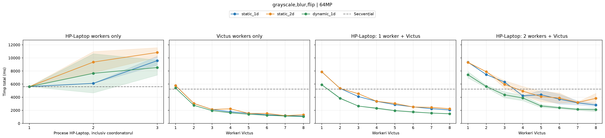
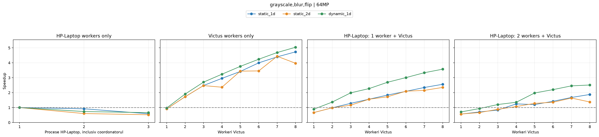
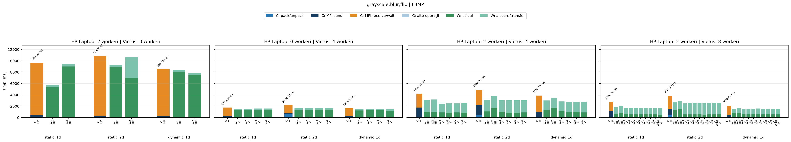

# Studiu pe două calculatoare, 64MP

Imaginea `test_images/sample_64MP.ppm` are 10667×6000 pixeli. Rezultatele sunt separate de studiile anterioare.

## Metodologie

Am măsurat 80 de configurații, cu câte 3 repetări, în total 240 de rulări măsurate. Măsurăm numai pipeline-ul grayscale,blur,flip, cu blur 9×9. Strategiile sunt static_1d, static_2d și dynamic_1d.

HP-Laptop are un Intel Core i7-7500U, cu 2 nuclee și 4 fire hardware. Victus are un Intel Core i5-12500H și 16 fire hardware. Am folosit Open MPI 4.1.6, compilare `mpicc -O3 -Wall` și `--bind-to none`. Procesele rulează fără fixare pe nuclee. Coordonatorul este un proces suplimentar față de numărul de workeri.

Rangul 0 rulează pe HP-Laptop pentru testele exclusiv pe HP-Laptop și pe Victus pentru celelalte teste. Graficul HP-Laptop include 1 proces secvențial, 2 procese cu un worker și 3 procese cu doi workeri. Rangurile 1 până la numărul de workeri HP-Laptop rulează pe HP-Laptop, iar workerii rămași rulează pe Victus. Limitele de 2 și 8 se referă la workeri, fără coordonator.

Speedup = media timpului secvențial / media timpului paralel. Referința secvențială rulează pe HP-Laptop pentru testele exclusiv pe HP-Laptop și pe Victus pentru celelalte teste. Eficiența este speedup / numărul total de workeri. Pe calculatoare diferite, acest raport depinde de performanța referinței secvențiale.

Timpii provin din instrumentarea C și exclud lansarea MPI, citirea imaginii, scrierea rezultatului și verificarea pixelilor. Prima repetare a fiecărei configurații salvează rezultatul pentru comparație integrală cu referința secvențială. Celelalte repetări folosesc ieșirea NONE. Timpii sunt afișați ca medie și abatere standard. Trei repetări oferă o verificare pilot, cu precizie limitată pentru operațiile scurte.

Toate graficele de timp folosesc aceeași limită verticală, inclusiv graficele strategiilor. Graficele de speedup folosesc o limită comună. Valorile extreme ridică limita verticală, astfel că unele curbe și bare sunt aproape de zero pe această scară. Tabelele păstrează valorile numerice. Datele brute includ timpii fiecărui worker, distribuția pe calculatoare și datele necesare eficienței. Această rulare măsoară numai imaginea de 64MP. CSV-urile păstrează eficiența și pot fi comparate cu rezultatele anterioare la alte rezoluții.

## grayscale,blur,flip







Cel mai mic timp paralel mediu este 1043.257 ms, cu dynamic_1d, 0 workeri HP-Laptop și 8 workeri Victus. Speedup față de referința de pe victus este 5.04.

## Verificare și interpretare

Cea mai lentă repetare a durat 11666.043 ms, pentru grayscale,blur,flip, static_2d, cu 2 workeri HP-Laptop și 0 workeri Victus. Cea mai mare abatere standard relativă este 39.1%, pentru grayscale,blur,flip, dynamic_1d, HP=1, Victus=0. Am păstrat toate repetările. Acest pilot verifică matricea și graficele, dar variația limitează concluziile despre ordinea strategiilor. Nu am măsurat separat rețeaua sau încărcarea de fond, deci nu pot atribui variația unei singure cauze.

Toate cele 80 de configurații au rezultate identice pixel cu pixel cu referința secvențială în prima repetare.

Barele C și W se suprapun în timp și nu se adună. HP înseamnă HP-Laptop, iar V înseamnă Victus. Barele workerilor arată calculul și timpul instrumentat de alocare/transfer. Timpul rămas până la timpul coordonatorului nu este etichetat drept inactivitate, deoarece programul nu măsoară separat acea durată. Segmentele pack/unpack nu sunt defalcate per worker, deoarece instrumentarea oferă numai totalul coordonatorului.

## Reproducere

Scriptul separat este [benchmark_two_machines_small.py](benchmark_two_machines_small.py). Ambele calculatoare trebuie să acceseze același director și să accepte conexiuni SSH fără parolă. Rularea completă folosește comanda de mai jos. Scriptul reia configurațiile lipsă din jurnalul existent.

```bash
uv run --with numpy --with matplotlib python benchmark_two_machines_small.py
```

Pentru regenerarea raportului și a figurilor din măsurătorile salvate:

```bash
uv run --with numpy --with matplotlib python benchmark_two_machines_small.py --plot-only
```

## Date complete

Datele sunt în [results.csv](benchmark_two_machines/64MP/results.csv), [runs.csv](benchmark_two_machines/64MP/runs.csv) și [runs.jsonl](benchmark_two_machines/64MP/runs.jsonl). Fișierul [metadata.json](benchmark_two_machines/64MP/metadata.json) păstrează informațiile calculatoarelor și hash-urile imaginii și sursei. Câmpurile hp și victus reprezintă numărul de workeri. În CSV, modul seq are zero workeri și coloana coordinator identifică laptopul. În jurnalul JSONL, hp=1 selectează referința secvențială HP-Laptop, iar hp=0 selectează Victus.

| Operație | Strategie | HP workeri | Victus workeri | Coordonator | Total ms | Abatere ms | Speedup | Eficiență |
| --- | --- | ---: | ---: | --- | ---: | ---: | ---: | ---: |
| grayscale,blur,flip | seq | 0 | 0 | HP-Laptop | 5615.360 | 7.844 | 1.000 | 1.000 |
| grayscale,blur,flip | seq | 0 | 0 | victus | 5256.822 | 6.177 | 1.000 | 1.000 |
| grayscale,blur,flip | static_1d | 1 | 0 | HP-Laptop | 6113.425 | 9.214 | 0.919 | 0.919 |
| grayscale,blur,flip | static_1d | 2 | 0 | HP-Laptop | 9581.019 | 692.866 | 0.586 | 0.293 |
| grayscale,blur,flip | static_1d | 0 | 1 | victus | 5763.506 | 23.809 | 0.912 | 0.912 |
| grayscale,blur,flip | static_1d | 0 | 2 | victus | 3052.913 | 9.065 | 1.722 | 0.861 |
| grayscale,blur,flip | static_1d | 0 | 3 | victus | 2122.051 | 3.589 | 2.477 | 0.826 |
| grayscale,blur,flip | static_1d | 0 | 4 | victus | 1778.245 | 2.074 | 2.956 | 0.739 |
| grayscale,blur,flip | static_1d | 0 | 5 | victus | 1537.490 | 15.871 | 3.419 | 0.684 |
| grayscale,blur,flip | static_1d | 0 | 6 | victus | 1315.655 | 4.911 | 3.996 | 0.666 |
| grayscale,blur,flip | static_1d | 0 | 7 | victus | 1196.118 | 15.899 | 4.395 | 0.628 |
| grayscale,blur,flip | static_1d | 0 | 8 | victus | 1110.853 | 6.838 | 4.732 | 0.592 |
| grayscale,blur,flip | static_1d | 1 | 1 | victus | 7872.399 | 7.611 | 0.668 | 0.334 |
| grayscale,blur,flip | static_1d | 1 | 2 | victus | 5338.481 | 4.609 | 0.985 | 0.328 |
| grayscale,blur,flip | static_1d | 1 | 3 | victus | 4098.055 | 6.096 | 1.283 | 0.321 |
| grayscale,blur,flip | static_1d | 1 | 4 | victus | 3369.441 | 2.460 | 1.560 | 0.312 |
| grayscale,blur,flip | static_1d | 1 | 5 | victus | 2863.425 | 11.015 | 1.836 | 0.306 |
| grayscale,blur,flip | static_1d | 1 | 6 | victus | 2519.518 | 3.009 | 2.086 | 0.298 |
| grayscale,blur,flip | static_1d | 1 | 7 | victus | 2242.722 | 4.812 | 2.344 | 0.293 |
| grayscale,blur,flip | static_1d | 1 | 8 | victus | 2053.945 | 13.002 | 2.559 | 0.284 |
| grayscale,blur,flip | static_1d | 2 | 1 | victus | 9342.955 | 59.273 | 0.563 | 0.188 |
| grayscale,blur,flip | static_1d | 2 | 2 | victus | 7455.549 | 22.082 | 0.705 | 0.176 |
| grayscale,blur,flip | static_1d | 2 | 3 | victus | 6312.024 | 35.711 | 0.833 | 0.167 |
| grayscale,blur,flip | static_1d | 2 | 4 | victus | 4218.110 | 10.268 | 1.246 | 0.208 |
| grayscale,blur,flip | static_1d | 2 | 5 | victus | 4378.241 | 708.914 | 1.201 | 0.172 |
| grayscale,blur,flip | static_1d | 2 | 6 | victus | 3702.558 | 755.332 | 1.420 | 0.177 |
| grayscale,blur,flip | static_1d | 2 | 7 | victus | 3137.847 | 320.456 | 1.675 | 0.186 |
| grayscale,blur,flip | static_1d | 2 | 8 | victus | 2800.305 | 218.230 | 1.877 | 0.188 |
| grayscale,blur,flip | static_2d | 1 | 0 | HP-Laptop | 9360.443 | 1611.348 | 0.600 | 0.600 |
| grayscale,blur,flip | static_2d | 2 | 0 | HP-Laptop | 10829.416 | 741.367 | 0.519 | 0.259 |
| grayscale,blur,flip | static_2d | 0 | 1 | victus | 5778.750 | 17.611 | 0.910 | 0.910 |
| grayscale,blur,flip | static_2d | 0 | 2 | victus | 3042.239 | 16.269 | 1.728 | 0.864 |
| grayscale,blur,flip | static_2d | 0 | 3 | victus | 2125.526 | 2.559 | 2.473 | 0.824 |
| grayscale,blur,flip | static_2d | 0 | 4 | victus | 2224.619 | 12.237 | 2.363 | 0.591 |
| grayscale,blur,flip | static_2d | 0 | 5 | victus | 1528.136 | 2.040 | 3.440 | 0.688 |
| grayscale,blur,flip | static_2d | 0 | 6 | victus | 1521.427 | 45.838 | 3.455 | 0.576 |
| grayscale,blur,flip | static_2d | 0 | 7 | victus | 1185.367 | 10.519 | 4.435 | 0.634 |
| grayscale,blur,flip | static_2d | 0 | 8 | victus | 1324.567 | 37.349 | 3.969 | 0.496 |
| grayscale,blur,flip | static_2d | 1 | 1 | victus | 7870.286 | 4.527 | 0.668 | 0.334 |
| grayscale,blur,flip | static_2d | 1 | 2 | victus | 5342.496 | 2.823 | 0.984 | 0.328 |
| grayscale,blur,flip | static_2d | 1 | 3 | victus | 4531.997 | 11.320 | 1.160 | 0.290 |
| grayscale,blur,flip | static_2d | 1 | 4 | victus | 3375.775 | 21.195 | 1.557 | 0.311 |
| grayscale,blur,flip | static_2d | 1 | 5 | victus | 3050.035 | 43.860 | 1.724 | 0.287 |
| grayscale,blur,flip | static_2d | 1 | 6 | victus | 2508.267 | 3.226 | 2.096 | 0.299 |
| grayscale,blur,flip | static_2d | 1 | 7 | victus | 2443.593 | 44.815 | 2.151 | 0.269 |
| grayscale,blur,flip | static_2d | 1 | 8 | victus | 2237.540 | 39.391 | 2.349 | 0.261 |
| grayscale,blur,flip | static_2d | 2 | 1 | victus | 9303.780 | 89.769 | 0.565 | 0.188 |
| grayscale,blur,flip | static_2d | 2 | 2 | victus | 7892.918 | 6.016 | 0.666 | 0.167 |
| grayscale,blur,flip | static_2d | 2 | 3 | victus | 5955.294 | 584.327 | 0.883 | 0.177 |
| grayscale,blur,flip | static_2d | 2 | 4 | victus | 4924.008 | 720.860 | 1.068 | 0.178 |
| grayscale,blur,flip | static_2d | 2 | 5 | victus | 4100.939 | 800.021 | 1.282 | 0.183 |
| grayscale,blur,flip | static_2d | 2 | 6 | victus | 3878.535 | 785.841 | 1.355 | 0.169 |
| grayscale,blur,flip | static_2d | 2 | 7 | victus | 3208.789 | 78.844 | 1.638 | 0.182 |
| grayscale,blur,flip | static_2d | 2 | 8 | victus | 3825.276 | 773.167 | 1.374 | 0.137 |
| grayscale,blur,flip | dynamic_1d | 1 | 0 | HP-Laptop | 7645.484 | 2991.783 | 0.734 | 0.734 |
| grayscale,blur,flip | dynamic_1d | 2 | 0 | HP-Laptop | 8527.528 | 1150.155 | 0.658 | 0.329 |
| grayscale,blur,flip | dynamic_1d | 0 | 1 | victus | 5392.684 | 38.639 | 0.975 | 0.975 |
| grayscale,blur,flip | dynamic_1d | 0 | 2 | victus | 2759.881 | 7.606 | 1.905 | 0.952 |
| grayscale,blur,flip | dynamic_1d | 0 | 3 | victus | 1944.708 | 1.147 | 2.703 | 0.901 |
| grayscale,blur,flip | dynamic_1d | 0 | 4 | victus | 1625.099 | 56.291 | 3.235 | 0.809 |
| grayscale,blur,flip | dynamic_1d | 0 | 5 | victus | 1398.232 | 8.422 | 3.760 | 0.752 |
| grayscale,blur,flip | dynamic_1d | 0 | 6 | victus | 1240.545 | 7.366 | 4.238 | 0.706 |
| grayscale,blur,flip | dynamic_1d | 0 | 7 | victus | 1121.868 | 6.863 | 4.686 | 0.669 |
| grayscale,blur,flip | dynamic_1d | 0 | 8 | victus | 1043.257 | 13.063 | 5.039 | 0.630 |
| grayscale,blur,flip | dynamic_1d | 1 | 1 | victus | 5895.646 | 48.166 | 0.892 | 0.446 |
| grayscale,blur,flip | dynamic_1d | 1 | 2 | victus | 3839.588 | 95.234 | 1.369 | 0.456 |
| grayscale,blur,flip | dynamic_1d | 1 | 3 | victus | 2647.189 | 9.699 | 1.986 | 0.496 |
| grayscale,blur,flip | dynamic_1d | 1 | 4 | victus | 2315.351 | 102.947 | 2.270 | 0.454 |
| grayscale,blur,flip | dynamic_1d | 1 | 5 | victus | 1951.344 | 44.982 | 2.694 | 0.449 |
| grayscale,blur,flip | dynamic_1d | 1 | 6 | victus | 1748.770 | 63.525 | 3.006 | 0.429 |
| grayscale,blur,flip | dynamic_1d | 1 | 7 | victus | 1577.142 | 22.599 | 3.333 | 0.417 |
| grayscale,blur,flip | dynamic_1d | 1 | 8 | victus | 1471.855 | 44.925 | 3.572 | 0.397 |
| grayscale,blur,flip | dynamic_1d | 2 | 1 | victus | 7421.588 | 488.523 | 0.708 | 0.236 |
| grayscale,blur,flip | dynamic_1d | 2 | 2 | victus | 5634.662 | 180.678 | 0.933 | 0.233 |
| grayscale,blur,flip | dynamic_1d | 2 | 3 | victus | 4367.230 | 468.624 | 1.204 | 0.241 |
| grayscale,blur,flip | dynamic_1d | 2 | 4 | victus | 3880.832 | 415.836 | 1.355 | 0.226 |
| grayscale,blur,flip | dynamic_1d | 2 | 5 | victus | 2659.178 | 230.531 | 1.977 | 0.282 |
| grayscale,blur,flip | dynamic_1d | 2 | 6 | victus | 2387.548 | 161.833 | 2.202 | 0.275 |
| grayscale,blur,flip | dynamic_1d | 2 | 7 | victus | 2142.629 | 145.451 | 2.453 | 0.273 |
| grayscale,blur,flip | dynamic_1d | 2 | 8 | victus | 2092.942 | 301.538 | 2.512 | 0.251 |
