# Studiu pe două calculatoare, comparație între rezoluții

Comparăm `1.5MP`, `4MP`, `8MP` și `64MP`. La 64MP este măsurat numai pipeline-ul `grayscale,blur,flip`.

## Ajută al doilea calculator?

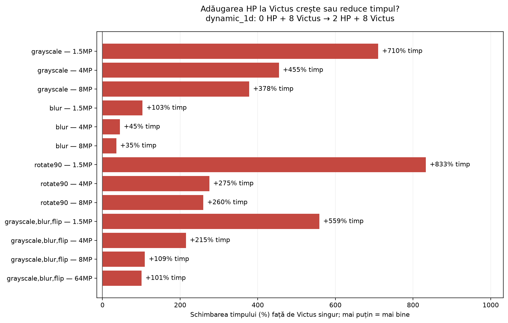

`dynamic_1d`: **8 workeri Victus → 8 Victus + 2 HP**. Roșu = mai lent; verde = mai rapid. `+100% timp` înseamnă durată dublă. **Adăugarea HP crește timpul mediu în toate cazurile afișate.**

## Metodologie

Conexiune Ethernet; HP: i7-7500U, 2 nuclee/4 fire; Victus: i5-12500H, 16 fire. Open MPI 4.1.6, `mpicc -O3 -Wall`, `--bind-to none`. Coordonatorul este suplimentar și rulează pe Victus, exceptând testele exclusiv HP.

- `1.5MP`: `sample_1.5MP.ppm`, 1600×900 pixeli.
- `4MP`: `sample_4MP.ppm`, 2400×1600 pixeli.
- `8MP`: `sample_8MP.ppm`, 3840×2160 pixeli.
- `64MP`: `sample_64MP.ppm`, 10667×6000 pixeli.

**1040 configurații × 3 repetări = 3120 rulări**, cu blur 9×9. Timpii exclud lansarea MPI și operațiile pe fișiere; pipeline-ul însumează cele trei etape. Toate configurațiile au verificarea pixelilor trecută în prima repetare.

**Speedup** = timp secvențial / timp paralel; **eficiență** = speedup / workeri; **CV** = 100 × SD / medie. SD este abaterea standard, nu un interval de încredere. Trei repetări limitează precizia comparațiilor.

**Culori:** albastru = `static_1d`, portocaliu = `static_2d`, verde = `dynamic_1d`. Benzile și barele de eroare arată ± SD. Panourile aceleiași imagini au aceeași scară verticală.

## grayscale

### Timp total

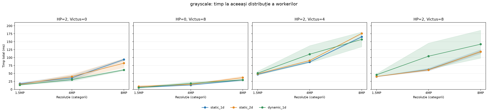

Panouri: **2 HP**, **8 V**, **2 HP + 4 V**, **2 HP + 8 V**. X = rezoluție; Y = timp (ms). **Mai jos = mai rapid.**

### Speedup

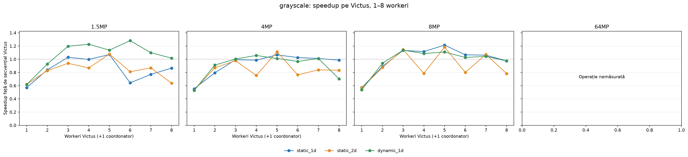

Panouri: **1.5MP, 4MP, 8MP, 64MP**. X = workeri Victus (1–8); Y = speedup față de secvențialul Victus. **Mai sus = mai bine; sub 1× = mai lent decât secvențialul.**

### Compararea strategiilor

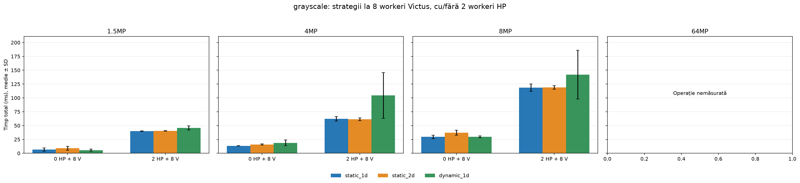

Aceleași panouri de rezoluție. În fiecare: **8 V** în stânga, **8 V + 2 HP** în dreapta. Barele arată timpul (ms). **Mai scurt = mai rapid.**

### Cele mai bune rezultate observate

Minimul mediu din toate configurațiile paralele, pentru fiecare imagine. Numărul de workeri poate diferi de cel din graficele de timp.

| Imagine | Timp ± SD (ms) | Strategie | HP | Victus | Speedup | Eficiență | CV |
| --- | --- | --- | --- | --- | --- | --- | --- |
| `sample_1.5MP.ppm` | 4.485 ± 0.072 | dynamic_1d | 0 | 6 | 1.28× | 21.3% | 1.6% |
| `sample_4MP.ppm` | 11.893 ± 0.809 | static_2d | 0 | 5 | 1.11× | 22.3% | 6.8% |
| `sample_8MP.ppm` | 23.827 ± 0.259 | static_1d | 0 | 5 | 1.21× | 24.3% | 1.1% |

Câștig modest; strategia cu minimul observat diferă între rezoluții.

## blur

### Timp total

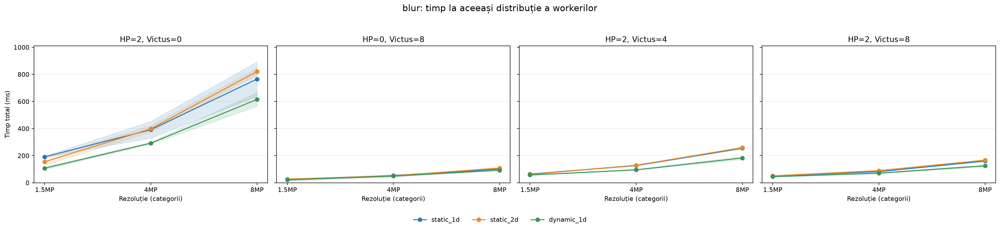

Panouri: **2 HP**, **8 V**, **2 HP + 4 V**, **2 HP + 8 V**. X = rezoluție; Y = timp (ms). **Mai jos = mai rapid.**

### Speedup

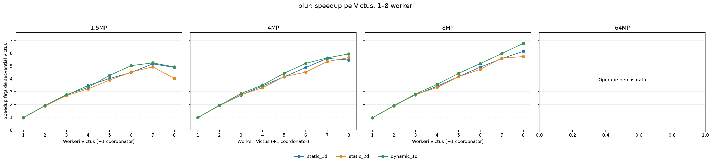

Panouri: **1.5MP, 4MP, 8MP, 64MP**. X = workeri Victus (1–8); Y = speedup față de secvențialul Victus. **Mai sus = mai bine; sub 1× = mai lent decât secvențialul.**

### Compararea strategiilor

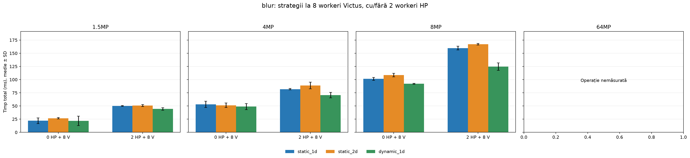

Aceleași panouri de rezoluție. În fiecare: **8 V** în stânga, **8 V + 2 HP** în dreapta. Barele arată timpul (ms). **Mai scurt = mai rapid.**

### Cele mai bune rezultate observate

Minimul mediu din toate configurațiile paralele, pentru fiecare imagine. Numărul de workeri poate diferi de cel din graficele de timp.

| Imagine | Timp ± SD (ms) | Strategie | HP | Victus | Speedup | Eficiență | CV |
| --- | --- | --- | --- | --- | --- | --- | --- |
| `sample_1.5MP.ppm` | 20.527 ± 2.113 | dynamic_1d | 0 | 7 | 5.24× | 74.8% | 10.3% |
| `sample_4MP.ppm` | 48.776 ± 5.769 | dynamic_1d | 0 | 8 | 5.94× | 74.3% | 11.8% |
| `sample_8MP.ppm` | 92.041 ± 0.965 | dynamic_1d | 0 | 8 | 6.76× | 84.5% | 1.0% |

La 8 workeri Victus, `dynamic_1d` crește de la 4.93× la 6.76× între 1.5MP și 8MP.

## rotate90

### Timp total

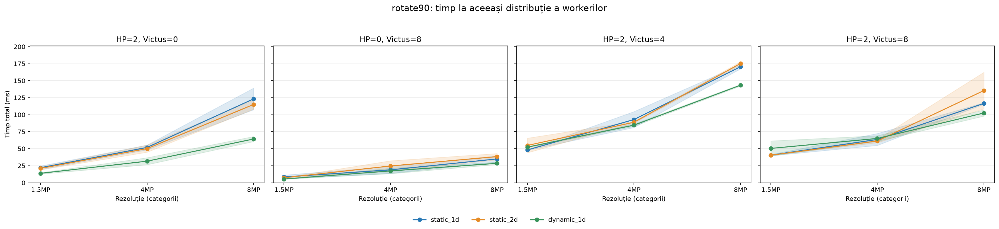

Panouri: **2 HP**, **8 V**, **2 HP + 4 V**, **2 HP + 8 V**. X = rezoluție; Y = timp (ms). **Mai jos = mai rapid.**

### Speedup

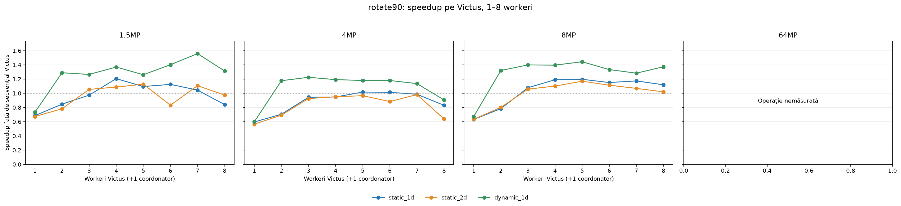

Panouri: **1.5MP, 4MP, 8MP, 64MP**. X = workeri Victus (1–8); Y = speedup față de secvențialul Victus. **Mai sus = mai bine; sub 1× = mai lent decât secvențialul.**

### Compararea strategiilor

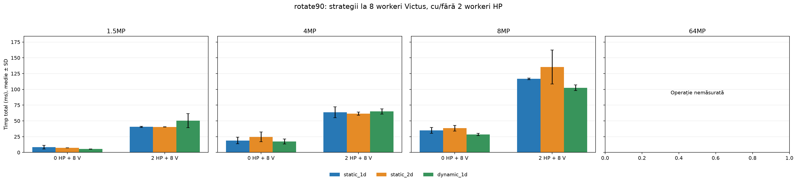

Aceleași panouri de rezoluție. În fiecare: **8 V** în stânga, **8 V + 2 HP** în dreapta. Barele arată timpul (ms). **Mai scurt = mai rapid.**

### Cele mai bune rezultate observate

Minimul mediu din toate configurațiile paralele, pentru fiecare imagine. Numărul de workeri poate diferi de cel din graficele de timp.

| Imagine | Timp ± SD (ms) | Strategie | HP | Victus | Speedup | Eficiență | CV |
| --- | --- | --- | --- | --- | --- | --- | --- |
| `sample_1.5MP.ppm` | 4.557 ± 0.150 | dynamic_1d | 0 | 7 | 1.56× | 22.3% | 3.3% |
| `sample_4MP.ppm` | 12.824 ± 0.595 | dynamic_1d | 0 | 3 | 1.22× | 40.8% | 4.6% |
| `sample_8MP.ppm` | 27.107 ± 0.720 | dynamic_1d | 0 | 5 | 1.44× | 28.9% | 2.7% |

Minimele folosesc 7, 3 și 5 workeri Victus; 8 workeri nu oferă timpul minim.

## grayscale,blur,flip

### Timp total

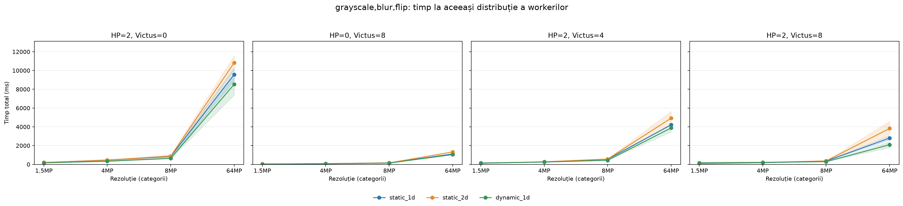

Panouri: **2 HP**, **8 V**, **2 HP + 4 V**, **2 HP + 8 V**. X = rezoluție; Y = timp (ms). **Mai jos = mai rapid.**

### Speedup

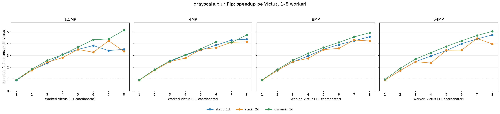

Panouri: **1.5MP, 4MP, 8MP, 64MP**. X = workeri Victus (1–8); Y = speedup față de secvențialul Victus. **Mai sus = mai bine; sub 1× = mai lent decât secvențialul.**

### Compararea strategiilor

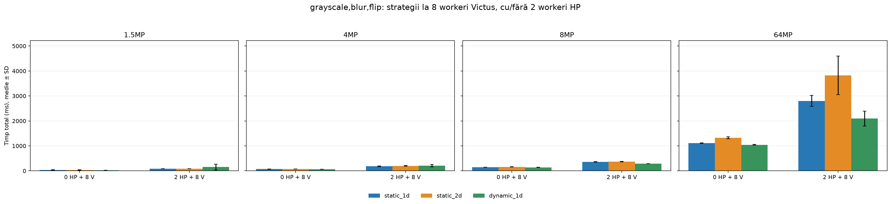

Aceleași panouri de rezoluție. În fiecare: **8 V** în stânga, **8 V + 2 HP** în dreapta. Barele arată timpul (ms). **Mai scurt = mai rapid.**

### Cele mai bune rezultate observate

Minimul mediu din toate configurațiile paralele, pentru fiecare imagine. Numărul de workeri poate diferi de cel din graficele de timp.

| Imagine | Timp ± SD (ms) | Strategie | HP | Victus | Speedup | Eficiență | CV |
| --- | --- | --- | --- | --- | --- | --- | --- |
| `sample_1.5MP.ppm` | 23.181 ± 0.773 | dynamic_1d | 0 | 8 | 5.13× | 64.1% | 3.3% |
| `sample_4MP.ppm` | 66.473 ± 0.126 | dynamic_1d | 0 | 8 | 4.72× | 59.0% | 0.2% |
| `sample_8MP.ppm` | 136.916 ± 3.803 | dynamic_1d | 0 | 8 | 4.92× | 61.5% | 2.8% |
| `sample_64MP.ppm` | 1043.257 ± 13.063 | dynamic_1d | 0 | 8 | 5.04× | 63.0% | 1.3% |

`dynamic_1d` cu 8 workeri Victus are timpul minim la toate rezoluțiile, cu speedup aproximativ 5×.

## Reproducere

Generatorul folosește datele salvate, fără rulări MPI:

```bash
uv run --with numpy --with matplotlib python benchmark_two_machines_combined.py
```

Regenerează raportul, cele 13 grafice și CSV-ul agregat. Editați textul în generator pentru a-l păstra la regenerare.

## Date complete

[CSV agregat](benchmark_two_machines/combined/results.csv) · [Generator](benchmark_two_machines_combined.py). Timpii din CSV sunt în secunde.

- **1.5MP**: [studiu](experimental_study_two_machines_1.5MP.md), [rezultate](benchmark_two_machines/1.5MP/results.csv), [rulări](benchmark_two_machines/1.5MP/runs.csv), [metadata](benchmark_two_machines/1.5MP/metadata.json).
- **4MP**: [studiu](experimental_study_two_machines_4MP.md), [rezultate](benchmark_two_machines/4MP/results.csv), [rulări](benchmark_two_machines/4MP/runs.csv), [metadata](benchmark_two_machines/4MP/metadata.json).
- **8MP**: [studiu](experimental_study_two_machines_8MP.md), [rezultate](benchmark_two_machines/8MP/results.csv), [rulări](benchmark_two_machines/8MP/runs.csv), [metadata](benchmark_two_machines/8MP/metadata.json).
- **64MP**: [studiu](experimental_study_two_machines_64MP.md), [rezultate](benchmark_two_machines/64MP/results.csv), [rulări](benchmark_two_machines/64MP/runs.csv), [metadata](benchmark_two_machines/64MP/metadata.json).
