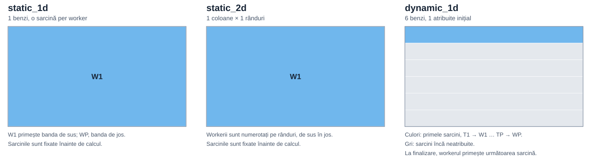
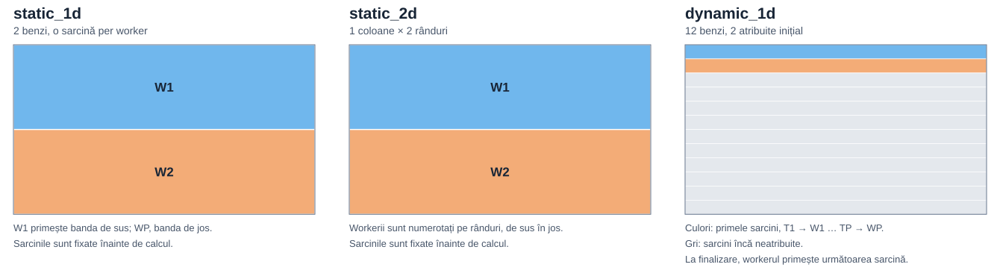
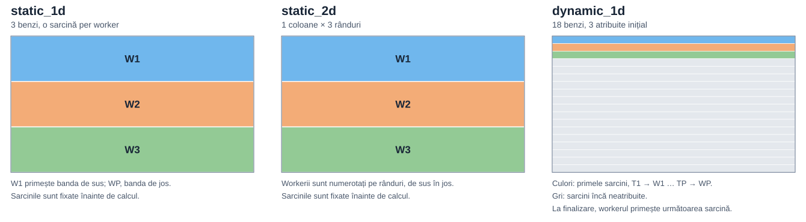
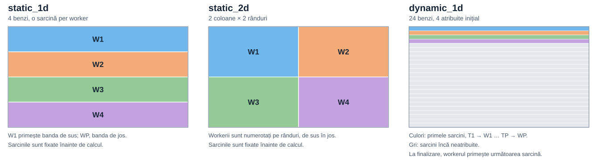
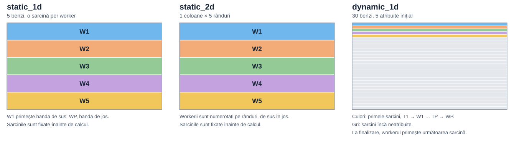
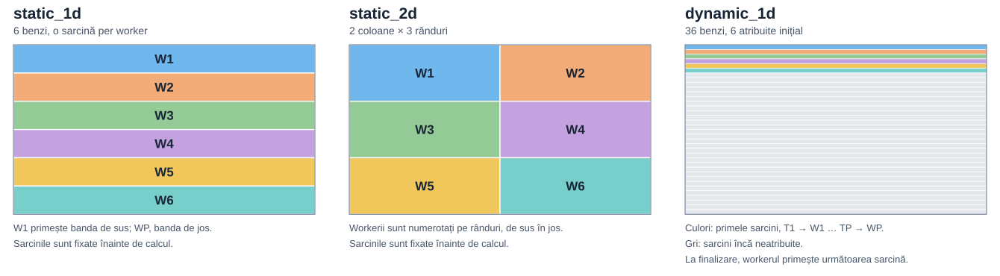
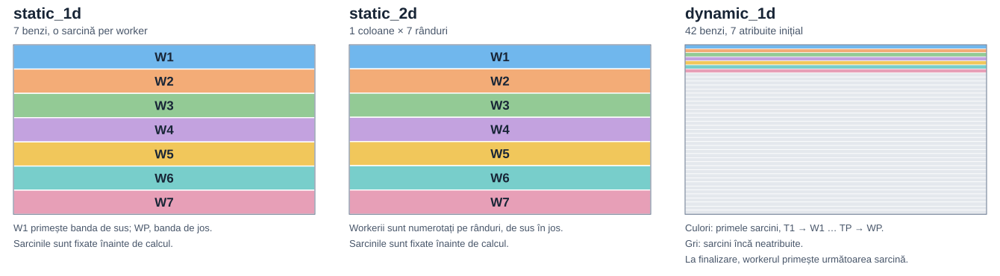
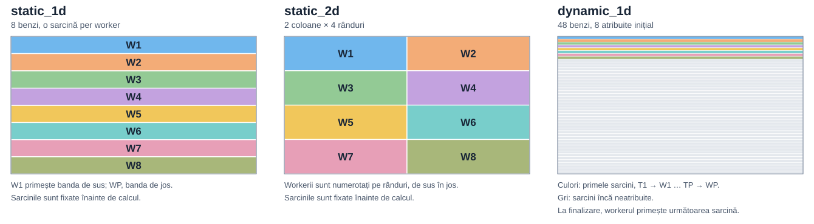
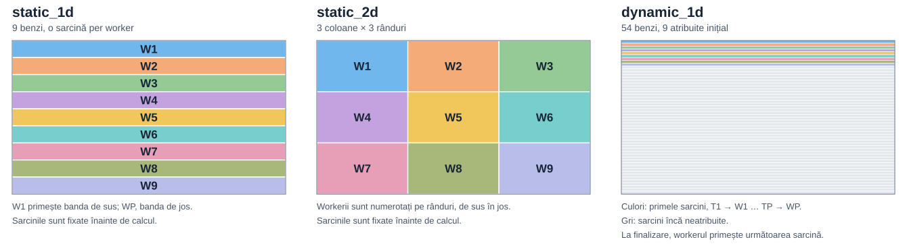
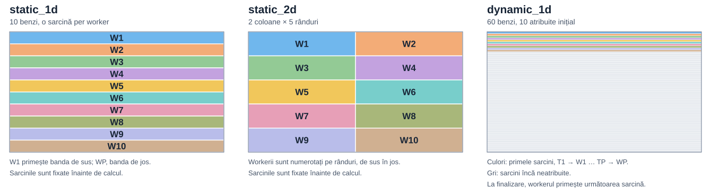

# Distribuirea imaginii între workeri

- **`static_1d`** împarte imaginea în benzi orizontale, câte una per worker.
- **`static_2d`** împarte imaginea într-o grilă. Pentru un număr prim de workeri, produce benzi orizontale.
- **`dynamic_1d`** creează `6 × P` benzi pentru `P` workeri. Următoarea bandă merge la workerul care termină.

Culorile identifică workerii, fără coordonator. La `dynamic_1d`, sunt colorate doar sarcinile atribuite inițial; benzile gri așteaptă în coadă. Diagramele arată regiunile de ieșire, fără marginile suplimentare necesare blur-ului.

[Varianta interactivă](partition_strategy_figures/interactive.html) · [Implementarea C](mpi_image_proc.c)

## Partiționarea pentru fiecare număr de workeri

| Workeri | Procese MPI cu coordonator | Grilă static_2d, coloane × rânduri | Benzi dynamic_1d |
| ---: | ---: | --- | ---: |
| `1` | `2` | `1×1` | `6` |
| `2` | `3` | `1×2` | `12` |
| `3` | `4` | `1×3` | `18` |
| `4` | `5` | `2×2` | `24` |
| `5` | `6` | `1×5` | `30` |
| `6` | `7` | `2×3` | `36` |
| `7` | `8` | `1×7` | `42` |
| `8` | `9` | `2×4` | `48` |
| `9` | `10` | `3×3` | `54` |
| `10` | `11` | `2×5` | `60` |

### 1 worker

### 2 workeri

### 3 workeri

### 4 workeri

### 5 workeri

### 6 workeri

### 7 workeri

### 8 workeri

### 9 workeri

### 10 workeri

