# Matrix multiplication: presentation examples

**11 examples:** three parallel, three collapse, three nested, and both hybrid
variants. Static, dynamic, and guided scheduling are all covered.

**[Open the interactive walkthrough](USAGE.html)** to select an example, click
an output cell, and see exactly which worker computes each of its k-products.
Use **Step by step** to follow the highlighted A and B entries through the code.
The colored diagrams below are the printable version of the same assignments.
Use the **Tell the professor** line in each example as your short explanation.
Chunk inspection and source highlighting are optional extra detail.

## Build and read the examples

Run once from the directory containing `matmul.c`:

```bash
make
export OMP_THREAD_LIMIT=8
export OMP_WAIT_POLICY=PASSIVE
```

We compute **A[n,m] × B[m,r] = C[n,r]**: i selects an output row, j selects an
output column, and k runs through the products summed into C[i,j]. All matrices
contain ones, so **every output cell equals m**. These small cases explain work
ownership; use the existing experiment report for timing comparisons.

**Read the pictures:** a color and a label identify a worker. Each output cell's
small colored strip lists its k-product owners from left to right. The enlarged
C[0,0] view shows those products separately. `T0.1` means outer thread 0 and
child thread 1; IDs are local to each team and start at zero. A child team is
created each time its parent reaches that inner parallel region.

**Static** chunks are assigned round-robin. **Dynamic** workers request fixed-size
chunks as they finish. **Guided** workers request chunks that shrink as work runs
out; the chunk option is a minimum size. Dynamic/guided pictures show **one
possible teaching schedule**, not an execution trace or a timing prediction.
The walkthrough reuses the supplied reference's scheduling model.

`--threads I,J,K` sets the team sizes. A collapsed group uses its **first loop's**
thread count and schedule. Sequential-loop settings are unused. Nested active
team sizes multiply: `2,2,2` in N3 requests a hierarchy with eight leaf workers,
not six. The program enables up to three active levels itself.

Each command prints one verified JSON record: `--dump` includes the matrices,
`--repeats 1` gives one measured run, and `--warmups 0` skips warmups. The C excerpts
are copied from the current [matmul.c](matmul.c); `dot(p,i,j)` runs the full k-loop
sequentially, while `b_at(p,k,j)` reads logical B[k,j].

## 1. Parallel: distribute one loop

### Commands

```bash
# P1: Whole rows
./matmul --n 4 --m 4 --r 4 --variant parallel_i --threads 2,1,1 \
  --schedule static:1 \
  --dataset ones --repeats 1 --warmups 0 --dump

# P2: Dynamic chunks from a queue
./matmul --n 2 --m 4 --r 7 --variant parallel_j --threads 1,2,1 \
  --schedule dynamic:2 \
  --dataset ones --repeats 1 --warmups 0 --dump

# P3: Guided chunks, step by step
./matmul --n 2 --m 24 --r 2 --variant parallel_k --threads 1,1,4 \
  --schedule guided:2 \
  --dataset ones --repeats 1 --warmups 0 --dump
```

### Code used by these commands

The `schedule_at` helper sets the policy used by `schedule(runtime)`.

```c
static void schedule_at(const Problem *p, int loop) {
  omp_set_schedule(p->schedules[loop], p->chunks[loop]);
}
```

```c
static void parallel_i(const Problem *p) {
  schedule_at(p, 0);
#pragma omp parallel for num_threads(p->threads[0])                            \
    schedule(runtime) default(none) shared(p)
  for (int i = 0; i < p->n; ++i)
    for (int j = 0; j < p->r; ++j)
      p->c[(size_t)i * p->r + j] = dot(p, i, j);
}

static void parallel_j(const Problem *p) {
  schedule_at(p, 1);
  for (int i = 0; i < p->n; ++i) {
#pragma omp parallel for num_threads(p->threads[1])                            \
    schedule(runtime) default(none) shared(p, i)
    for (int j = 0; j < p->r; ++j)
      p->c[(size_t)i * p->r + j] = dot(p, i, j);
  }
}

static void parallel_k_reduction(const Problem *p) {
  schedule_at(p, 2);
  for (int i = 0; i < p->n; ++i)
    for (int j = 0; j < p->r; ++j) {
      scalar sum = 0;
#pragma omp parallel for num_threads(p->threads[2]) schedule(runtime)          \
    reduction(+ : sum) default(none) shared(p, i, j)
      for (int k = 0; k < p->m; ++k)
        sum += p->a[(size_t)i * p->m + k] * b_at(p, k, j);
      p->c[(size_t)i * p->r + j] = sum;
    }
}
```

### How i, j, k are distributed

#### P1 — Whole rows

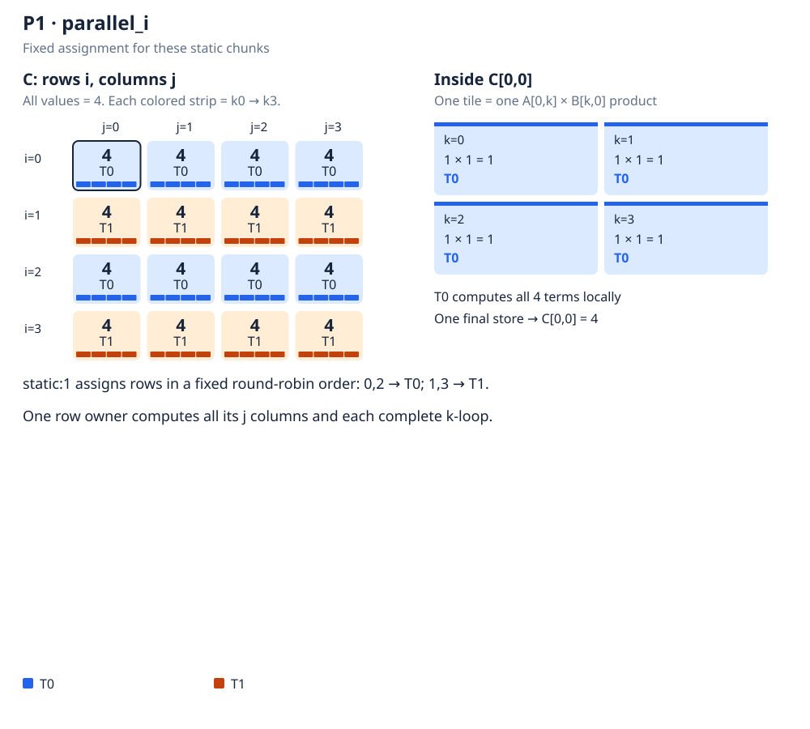

**Tell the professor.** Two workers split the rows. Each worker finishes every cell in its assigned rows.

[Explore P1 interactively](USAGE.html#p1) · Expected probe: `[2, 0, 0]`; every C cell = **4**.

#### P2 — Dynamic chunks from a queue

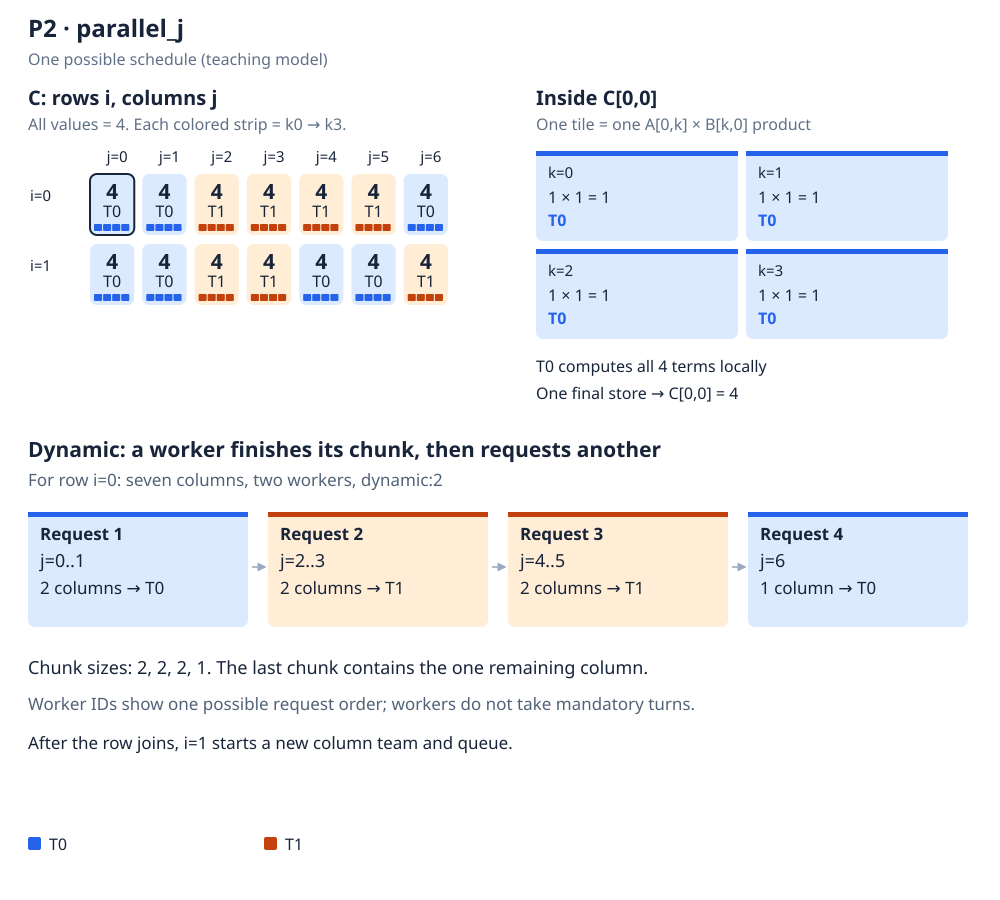

**Tell the professor.** For each row, workers request two columns at a time until only the final column remains.

[Explore P2 interactively](USAGE.html#p2) · Expected probe: `[2, 0, 0]`; every C cell = **4**.

#### P3 — Guided chunks, step by step

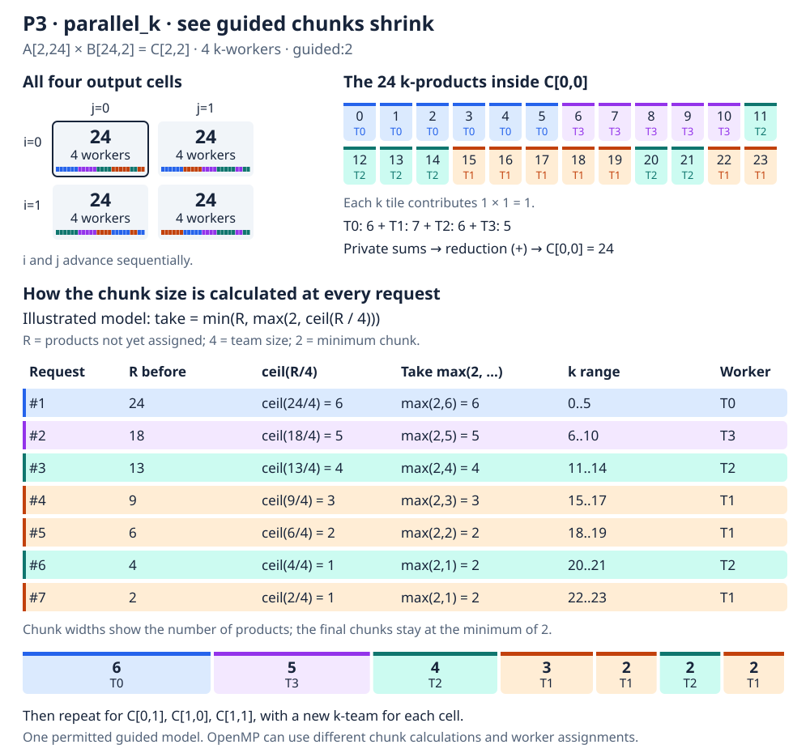

**Tell the professor.** Guided starts with larger chunks and shrinks to two products per chunk in this example. The workers combine their sums for each cell.

[Explore P3 interactively](USAGE.html#p3) · Expected probe: `[4, 0, 0]`; every C cell = **24**.

**Why this demonstrates guided:** for each cell, R starts at 24 unassigned
products. This illustration uses `take = min(R, max(2, ceil(R/4)))`.
The division uses **four workers**; `guided:2` sets a **minimum**, not a fixed size.

| Request | R before assignment | ceil(R/4) | Products taken | k range |
| --- | ---: | ---: | ---: | --- |
| 1 | 24 | 6 | 6 | 0..5 |
| 2 | 18 | 5 | 5 | 6..10 |
| 3 | 13 | 4 | 4 | 11..14 |
| 4 | 9 | 3 | 3 | 15..17 |
| 5 | 6 | 2 | 2 | 18..19 |
| 6 | 4 | 1 | 2 | 20..21 |
| 7 | 2 | 1 | 2 | 22..23 |

R decreases when a chunk is **assigned**, even while its worker is still
computing. A worker requests another chunk after finishing its current one.
The pictured worker IDs show one possible execution. OpenMP permits other
proportional chunk calculations; this exact formula is the walkthrough's model,
not a portable requirement. See the [OpenMP guided schedule definition](https://www.openmp.org/spec-html/5.1/openmpsu48.html).

Only k is parallel. The program finishes C[0,0], then C[0,1], C[1,0], and
C[1,1], creating a new four-worker k-team for each. All four cells equal 24.

## 2. Collapse: flatten loops into one team

### Commands

```bash
# C1: Flatten cells across row boundaries
./matmul --n 2 --m 4 --r 3 --variant collapse_ij --threads 3,1,1 \
  --schedule static:2 \
  --dataset ones --repeats 1 --warmups 0 --dump

# C2: Flatten products in a row
./matmul --n 1 --m 4 --r 2 --variant collapse_jk --threads 1,2,1 \
  --schedule dynamic:2 \
  --dataset ones --repeats 1 --warmups 0 --dump

# C3: Flatten products and share cells
./matmul --n 2 --m 3 --r 2 --variant collapse_ijk --threads 2,1,1 \
  --schedule static:2 \
  --dataset ones --repeats 1 --warmups 0 --dump
```

### Code used by these commands

```c
static void collapse_ij(const Problem *p) {
  schedule_at(p, 0);
#pragma omp parallel for collapse(2) num_threads(p->threads[0])                \
    schedule(runtime) default(none) shared(p)
  for (int64_t i = 0; i < p->n; ++i)
    for (int64_t j = 0; j < p->r; ++j)
      p->c[(size_t)i * p->r + j] = dot(p, i, j);
}

static void collapse_jk_atomic(const Problem *p) {
  schedule_at(p, 1);
  for (int i = 0; i < p->n; ++i) {
#pragma omp parallel for collapse(2) num_threads(p->threads[1])                \
    schedule(runtime) default(none) shared(p, i)
    for (int64_t j = 0; j < p->r; ++j)
      for (int64_t k = 0; k < p->m; ++k) {
        scalar term = p->a[(size_t)i * p->m + k] * b_at(p, k, j);
/* Several collapsed iterations contribute to the same cell. */
#pragma omp atomic update
        p->c[(size_t)i * p->r + j] += term;
      }
  }
}

static void collapse_ijk_atomic(const Problem *p) {
  schedule_at(p, 0);
#pragma omp parallel for collapse(3) num_threads(p->threads[0])                \
    schedule(runtime) default(none) shared(p)
  for (int64_t i = 0; i < p->n; ++i)
    for (int64_t j = 0; j < p->r; ++j)
      for (int64_t k = 0; k < p->m; ++k) {
        scalar term = p->a[(size_t)i * p->m + k] * b_at(p, k, j);
#pragma omp atomic update
        p->c[(size_t)i * p->r + j] += term;
      }
}
```

### How i, j, k are distributed

#### C1 — Flatten cells across row boundaries

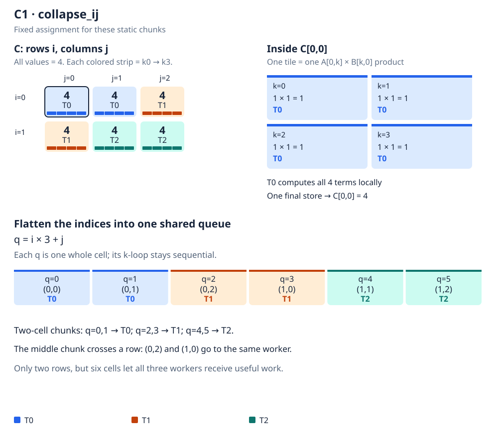

**Tell the professor.** Flattening puts six cells in one queue. A chunk can cross a row boundary, and all three workers get work.

[Explore C1 interactively](USAGE.html#c1) · Expected probe: `[3, 0, 0]`; every C cell = **4**.

#### C2 — Flatten products in a row

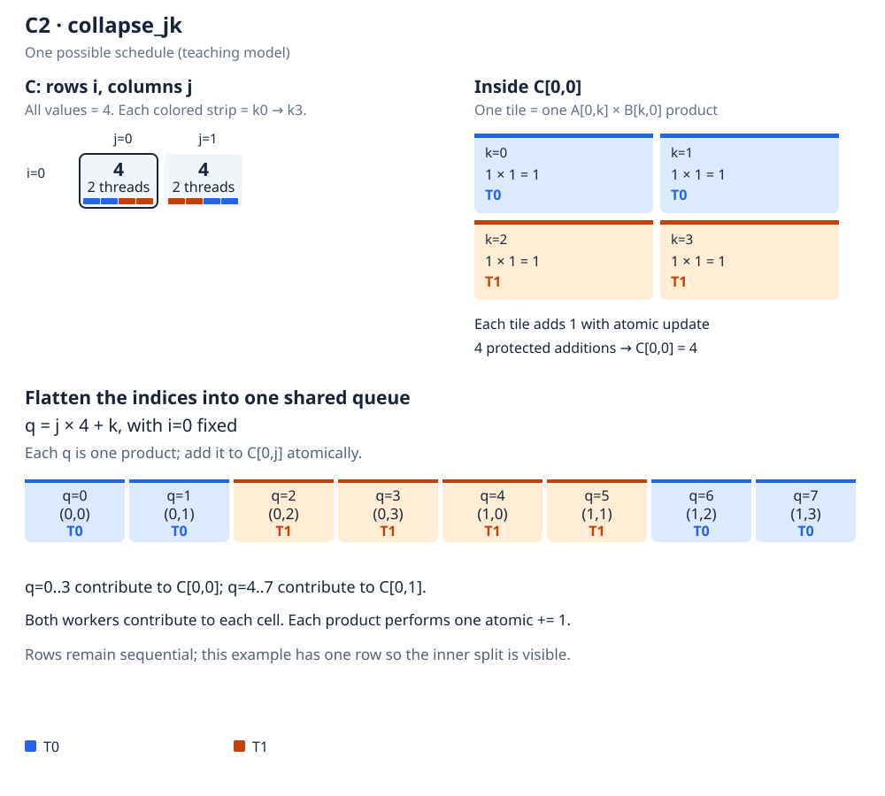

**Tell the professor.** Within one row, flattening puts the (j,k) products in one queue. Workers use atomic updates when they add to the same output cell.

[Explore C2 interactively](USAGE.html#c2) · Expected probe: `[2, 0, 0]`; every C cell = **4**.

#### C3 — Flatten products and share cells

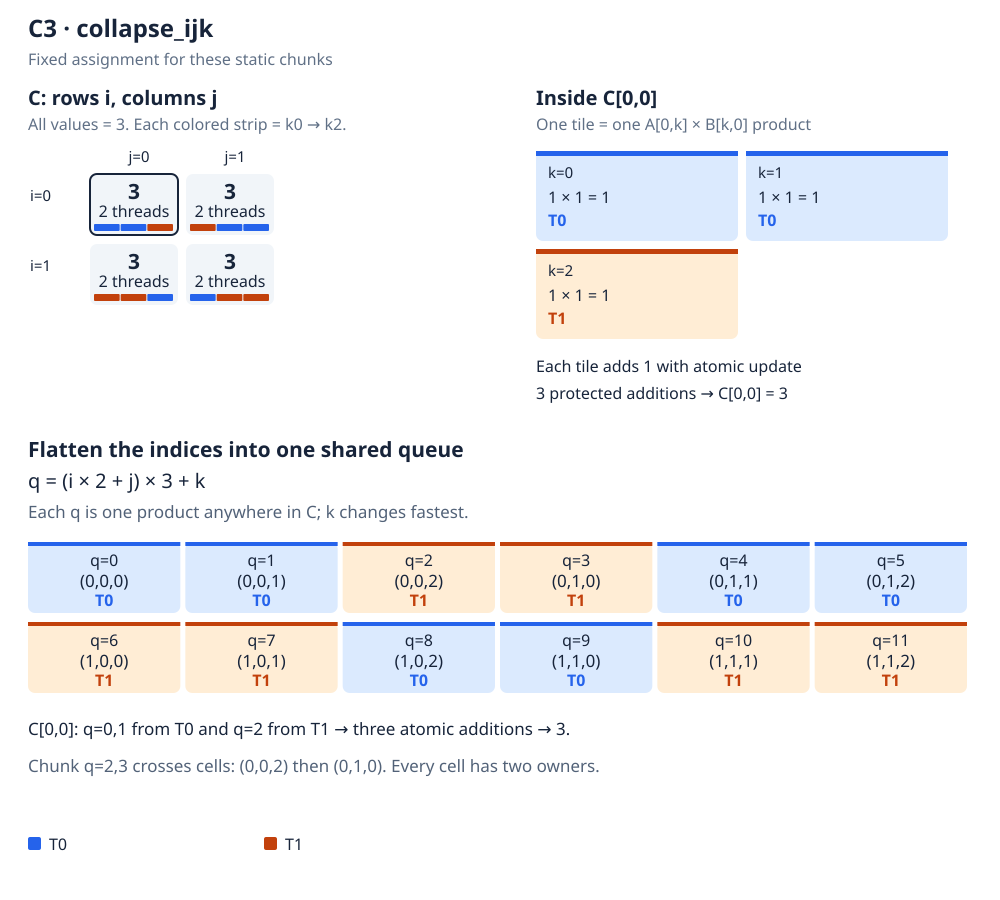

**Tell the professor.** Flattening puts all twelve products in one queue. Both workers contribute to every cell, so they use atomic updates.

[Explore C3 interactively](USAGE.html#c3) · Expected probe: `[2, 0, 0]`; every C cell = **3**.

## 3. Nested: teams inside teams

### Commands

```bash
# N1: Rows, then columns
./matmul --n 2 --m 4 --r 4 --variant nested_ij --threads 2,2,1 \
  --schedule static:1 \
  --dataset ones --repeats 1 --warmups 0 --dump

# N2: Rows, then k-products
./matmul --n 2 --m 4 --r 2 --variant nested_ik --threads 2,1,2 \
  --schedule static:1 \
  --dataset ones --repeats 1 --warmups 0 --dump

# N3: Rows, columns, then products
./matmul --n 2 --m 4 --r 2 --variant nested_ijk --threads 2,2,2 \
  --schedule static:1 \
  --dataset ones --repeats 1 --warmups 0 --dump
```

### Code used by these commands

```c
static void nested_ij(const Problem *p) {
  schedule_at(p, 0);
#pragma omp parallel for num_threads(p->threads[0])                            \
    schedule(runtime) default(none) shared(p)
  for (int i = 0; i < p->n; ++i) {
    schedule_at(p, 1);
#pragma omp parallel for num_threads(p->threads[1])                            \
    schedule(runtime) default(none) shared(p, i)
    for (int j = 0; j < p->r; ++j)
      p->c[(size_t)i * p->r + j] = dot(p, i, j);
  }
}

static void nested_ik_reduction(const Problem *p) {
  schedule_at(p, 0);
#pragma omp parallel for num_threads(p->threads[0])                            \
    schedule(runtime) default(none) shared(p)
  for (int i = 0; i < p->n; ++i) {
    schedule_at(p, 2);
    for (int j = 0; j < p->r; ++j) {
      scalar sum = 0;
#pragma omp parallel for num_threads(p->threads[2]) schedule(runtime)          \
    reduction(+ : sum) default(none) shared(p, i, j)
      for (int k = 0; k < p->m; ++k)
        sum += p->a[(size_t)i * p->m + k] * b_at(p, k, j);
      p->c[(size_t)i * p->r + j] = sum;
    }
  }
}

static void nested_ijk_reduction(const Problem *p) {
  schedule_at(p, 0);
#pragma omp parallel for num_threads(p->threads[0])                            \
    schedule(runtime) default(none) shared(p)
  for (int i = 0; i < p->n; ++i) {
    schedule_at(p, 1);
#pragma omp parallel for num_threads(p->threads[1])                            \
    schedule(runtime) default(none) shared(p, i)
    for (int j = 0; j < p->r; ++j) {
      scalar sum = 0;
      schedule_at(p, 2);
#pragma omp parallel for num_threads(p->threads[2]) schedule(runtime)          \
    reduction(+ : sum) default(none) shared(p, i, j)
      for (int k = 0; k < p->m; ++k)
        sum += p->a[(size_t)i * p->m + k] * b_at(p, k, j);
      p->c[(size_t)i * p->r + j] = sum;
    }
  }
}
```

### How i, j, k are distributed

#### N1 — Rows, then columns

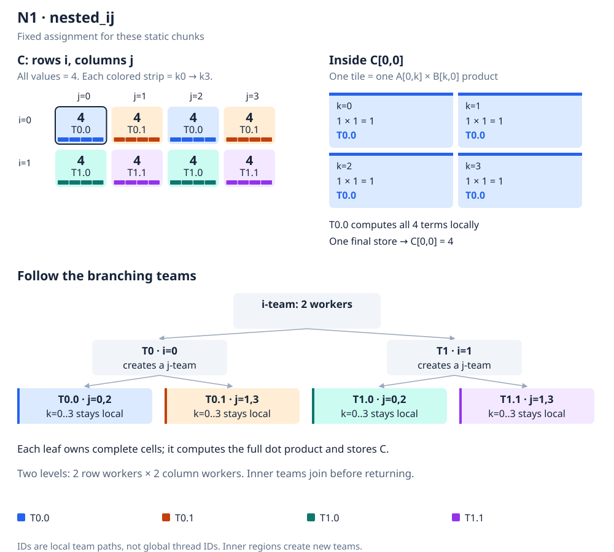

**Tell the professor.** Two workers split rows, and each row worker creates a two-worker team to split its columns.

[Explore N1 interactively](USAGE.html#n1) · Expected probe: `[2, 2, 0]`; every C cell = **4**.

#### N2 — Rows, then k-products

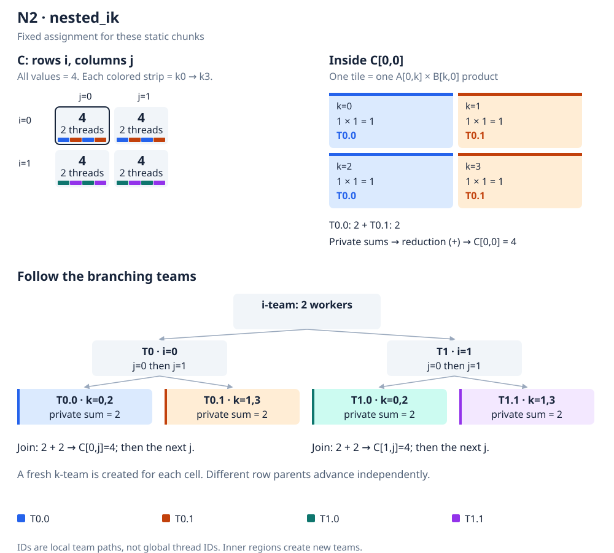

**Tell the professor.** Two workers split the rows. Each visits its columns in order and creates a two-worker k-team for each cell.

[Explore N2 interactively](USAGE.html#n2) · Expected probe: `[2, 2, 0]`; every C cell = **4**.

#### N3 — Rows, columns, then products

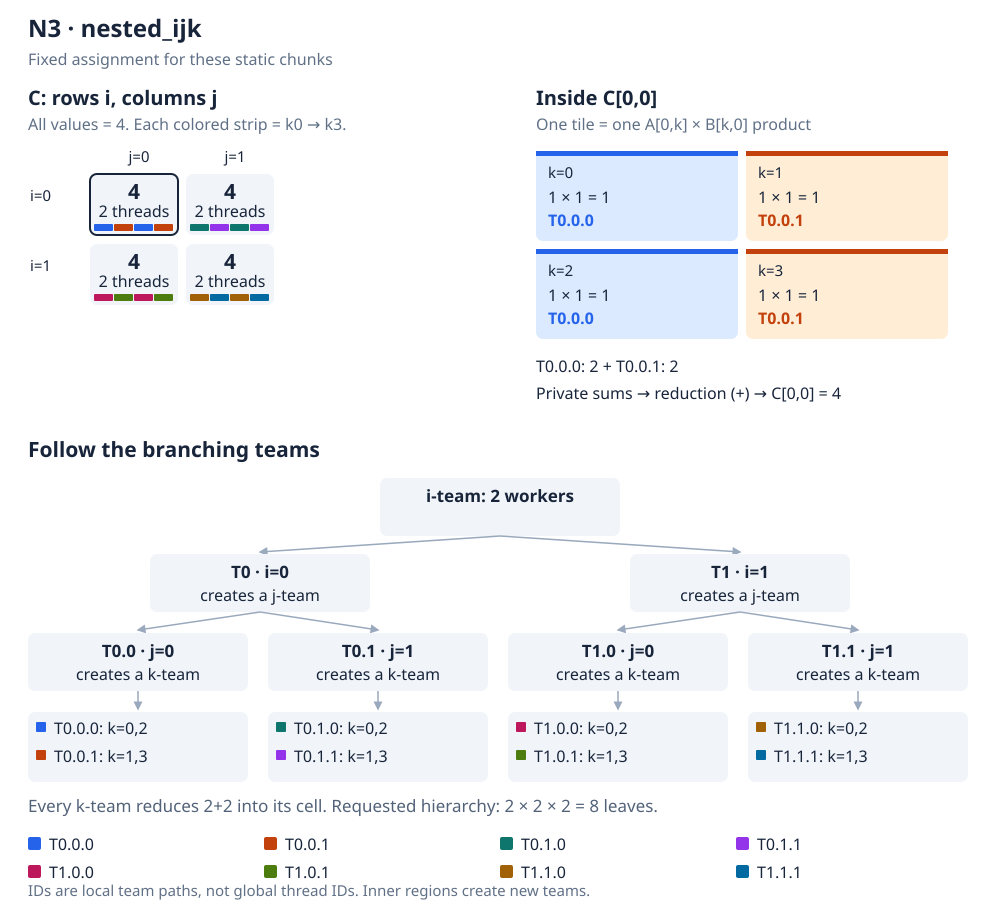

**Tell the professor.** Rows, columns, and products each have a two-worker team. The requested hierarchy is 2 × 2 × 2.

[Explore N3 interactively](USAGE.html#n3) · Expected probe: `[2, 2, 2]`; every C cell = **4**.

## 4. Hybrid: collapse plus nested teams

### Commands

```bash
# H1: Flatten cells, then share k
./matmul --n 2 --m 4 --r 4 --variant hybrid_ij_k --threads 2,1,2 \
  --schedule-i static:2 --schedule-k static:1 \
  --dataset ones --repeats 1 --warmups 0 --dump

# H2: Rows, then flattened products
./matmul --n 2 --m 4 --r 2 --variant hybrid_i_jk --threads 2,2,1 \
  --schedule-i static:1 --schedule-j static:2 \
  --dataset ones --repeats 1 --warmups 0 --dump
```

### Code used by these commands

```c
static void hybrid_ij_k_reduction(const Problem *p) {
  schedule_at(p, 0);
#pragma omp parallel for collapse(2) num_threads(p->threads[0])                \
    schedule(runtime) default(none) shared(p)
  for (int64_t i = 0; i < p->n; ++i)
    for (int64_t j = 0; j < p->r; ++j) {
      scalar sum = 0;
      schedule_at(p, 2);
#pragma omp parallel for num_threads(p->threads[2]) schedule(runtime)          \
    reduction(+ : sum) default(none) shared(p, i, j)
      for (int k = 0; k < p->m; ++k)
        sum += p->a[(size_t)i * p->m + k] * b_at(p, k, j);
      p->c[(size_t)i * p->r + j] = sum;
    }
}

static void hybrid_i_jk_atomic(const Problem *p) {
  schedule_at(p, 0);
#pragma omp parallel for num_threads(p->threads[0])                            \
    schedule(runtime) default(none) shared(p)
  for (int i = 0; i < p->n; ++i) {
    schedule_at(p, 1);
#pragma omp parallel for collapse(2) num_threads(p->threads[1])                \
    schedule(runtime) default(none) shared(p, i)
    for (int64_t j = 0; j < p->r; ++j)
      for (int64_t k = 0; k < p->m; ++k) {
        scalar term = p->a[(size_t)i * p->m + k] * b_at(p, k, j);
#pragma omp atomic update
        p->c[(size_t)i * p->r + j] += term;
      }
  }
}
```

### How i, j, k are distributed

#### H1 — Flatten cells, then share k

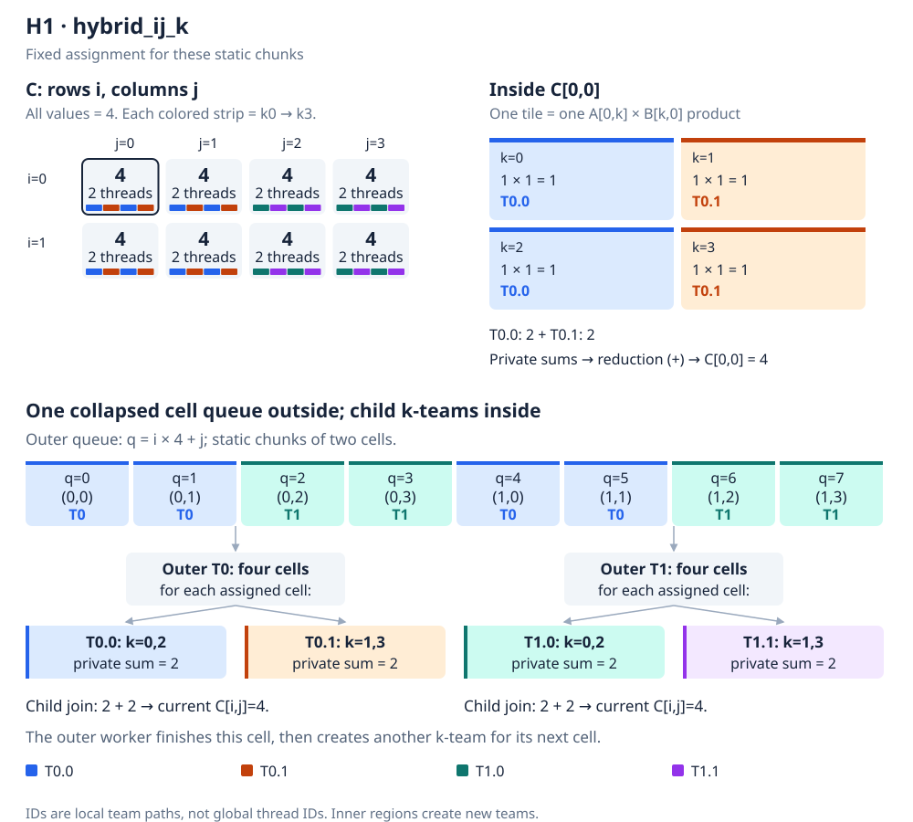

**Tell the professor.** One team shares a flat queue of cells. Each cell gets an inner k-team that combines its partial sums.

[Explore H1 interactively](USAGE.html#h1) · Expected probe: `[2, 2, 0]`; every C cell = **4**.

#### H2 — Rows, then flattened products

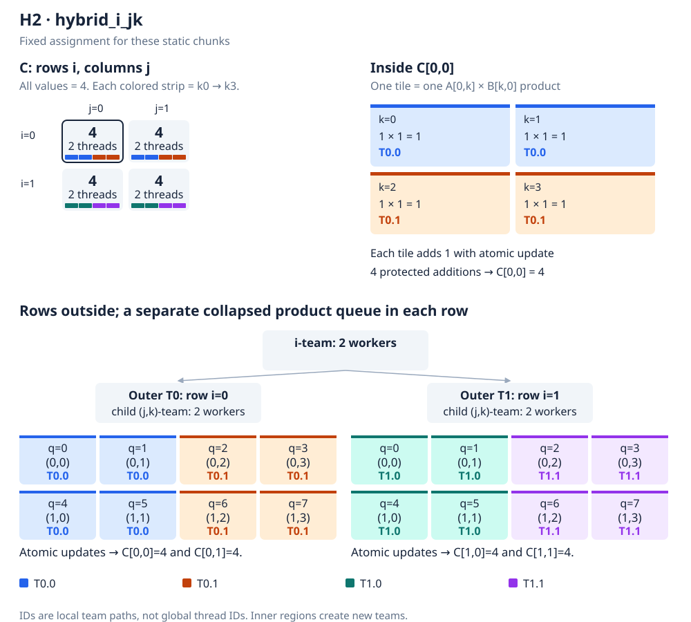

**Tell the professor.** The outer team splits rows. Each row gets an inner team that shares a flat product queue and uses atomic updates.

[Explore H2 interactively](USAGE.html#h2) · Expected probe: `[2, 2, 0]`; every C cell = **4**.

## What to point out in the output

Each command prints one JSON record. `verified` must be `true`, and all `n*r`
values in `c` must equal `m`. P3 prints `"c":[24,24,24,24]`; C3 prints
`"c":[3,3,3,3]`. `team_min` and `team_max` should match the expected probe sizes
beside each diagram. The entries describe parallel levels, rather than i/j/k
positions, and come from a separate team-size probe.

For the presentation, use the command, picture, and **Tell the professor** line.
The optional chunk and source views help with follow-up questions. In the
walkthrough, selecting a chunk shows how its q values map back to the loop
indices and destination cells.

A whole-cell owner stores its answer directly. A parallel k-loop reduces private
sums. In these examples, a collapsed group containing k performs an atomic update for each product.
