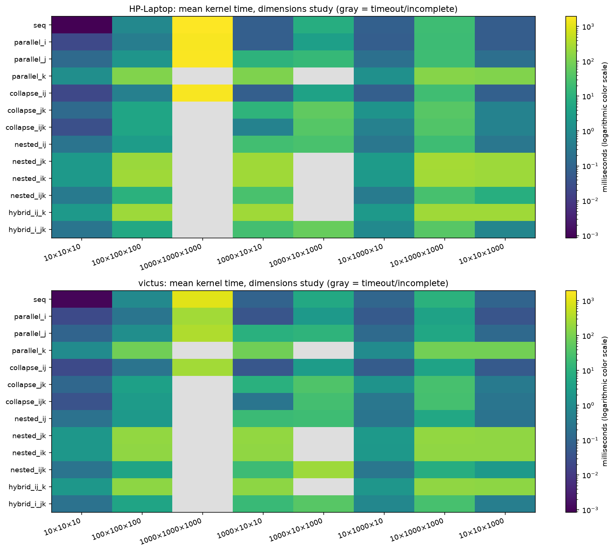
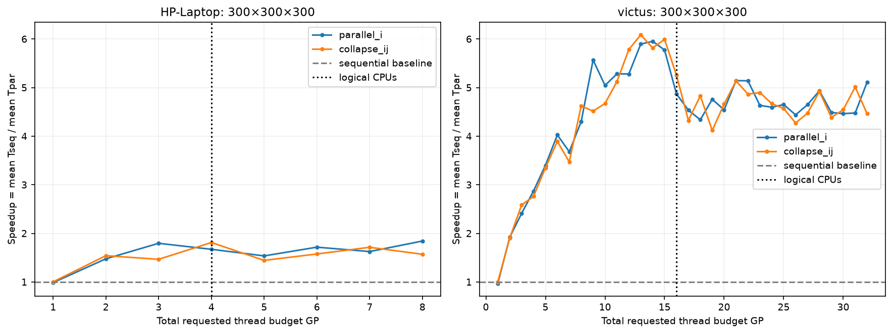
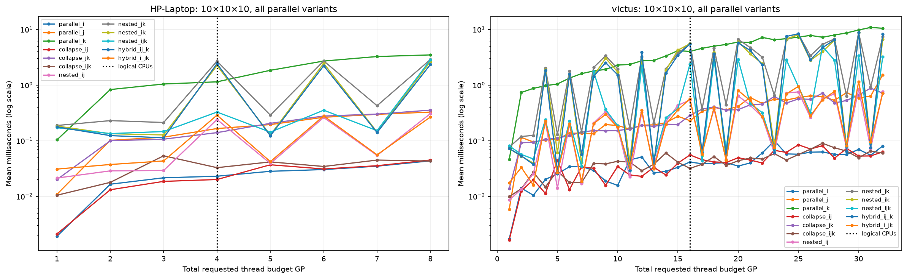
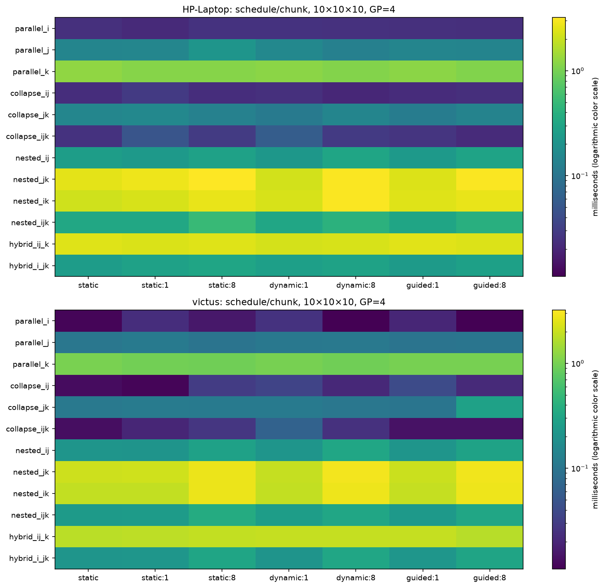
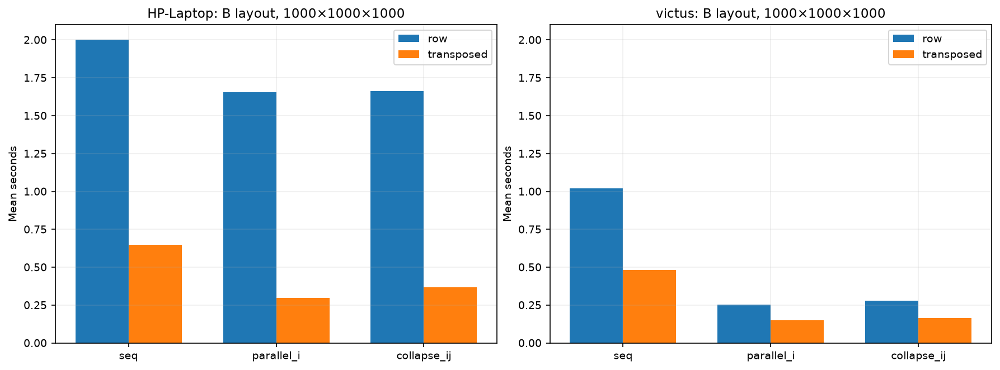
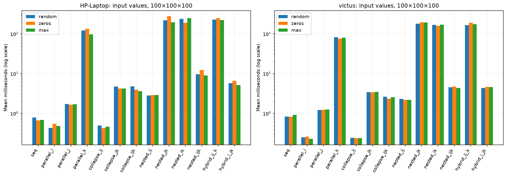
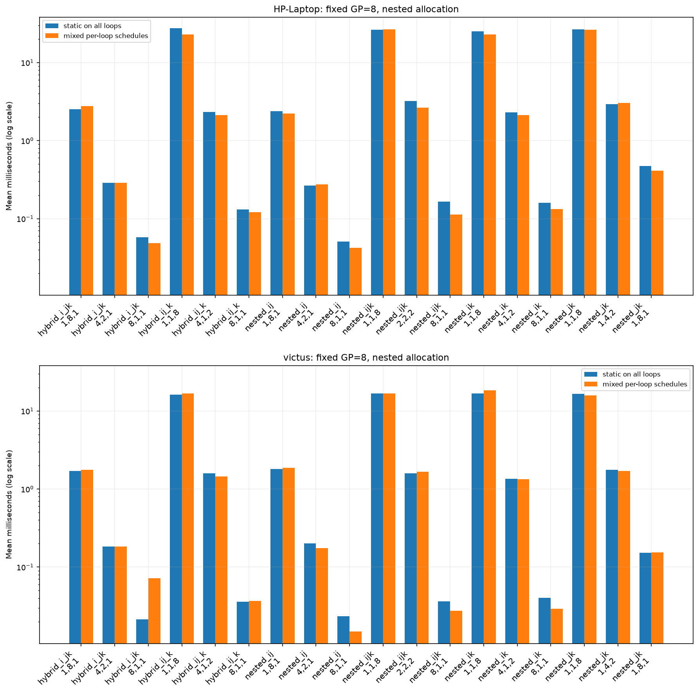

# HW2 — Rezultate experimentale măsurate

Datele provin exclusiv din execuțiile salvate în subdirectoarele fiecărei mașini. Regenerare: `python3 HW2/analyze.py --input HW2/results/study`.

## Platforme și metodologie

| Mașină | CPU | Core-uri fizice | CPU logice disponibile | RAM | Început UTC | Load 1 min început/final |
| --- | --- | --- | --- | --- | --- | --- |
| HP-Laptop | Intel(R) Core(TM) i7-7500U CPU @ 2.70GHz | 2 | 4 | 11.6 GiB | 2026-11-16T12:34:15.192774+00:00 | 0.00 / 2.71 |
| victus | 12th Gen Intel(R) Core(TM) i5-12500H | 12 | 16 | 15.3 GiB | 2026-11-16T12:23:44.912744+00:00 | 0.80 / 3.34 |

GCC 13.3, `-O3 -std=c11 -fopenmp`, Ubuntu 24.04; versiunile exacte, topologia, guvernorii CPU, memoria, mediul OpenMP și hash-urile surselor sunt în `metadata.json`. Victus are un procesor hibrid: numărul de CPU logice nu se deduce prin dublarea tuturor core-urilor fizice.

Măsurăm cu `omp_get_wtime()` numai apelul nucleului, inclusiv crearea echipelor, planificarea și sincronizarea cerute de variantă. Generarea A/B, aranjarea lui B, alocarea, resetarea lui C, referința secvențială și verificarea tuturor elementelor sunt în afara intervalului. O încălzire precedă cele cinci repetări ale aceleiași perechi. Pentru cazul aleator se folosesc cinci seed-uri distincte (1001–1005), identice între variante și calculatoare. Media este întâi calculată pe repetările unui seed, apoi pe seed-uri cu ponderi egale.

`GP` este bugetul total cerut: produsul dimensiunilor echipelor pentru nivelurile nested; un `collapse` folosește o singură echipă. Bugetul este factorizat echilibrat, iar pentru GP prim nivelurile interioare au un fir. Campania `allocation` compară alte repartizări la GP=8. Mediul folosește `OMP_WAIT_POLICY=PASSIVE`, `OMP_DYNAMIC=FALSE`, `OMP_PROC_BIND=FALSE`; dimensiunile realizate în proba de echipe sunt păstrate în fiecare înregistrare.

Profilul `study` separă factorii: dimensiuni (8 forme, toate variantele, GP=4), thread-uri (toate variantele, 10³), scalare (variantele i și collapse(ij), 300³), schedule/chunk (toate variantele, 10³ și suplimentar i/collapse(ij) la 300³), layout B (toate variantele, 100³ și variantele i/collapse(ij) la 1000³), repartizarea nivelurilor și schedule-uri independente (10³). Cazurile zeros și max sunt incluse în campaniile dimensiuni și schedule. Profilul `full` disponibil în script permite produsul cartezian complet ales de utilizator.

## Integritatea datelor și limitele măsurării

| Mașină | Configurații | Repetări verificate | Configurații TIMEOUT | Bugete GP |
| --- | --- | --- | --- | --- |
| HP-Laptop | 2319 | 11120 | 98 | 1–8 |
| victus | 3999 | 19564 | 91 | 1–32 |

Limita este de 3 secunde pentru o invocare completă, respectiv 30 de secunde pentru configurațiile mari seq/i/j/collapse(ij). Include inițializarea, referința, încălzirea și toate repetările; TIMEOUT nu reprezintă un timp măsurat al înmulțirii. Repetările finalizate înaintea întreruperii rămân în datele brute, dar un seed incomplet este exclus integral din medii. Grupurile cu seed-uri lipsă sunt marcate PARTIAL și nu intră în grafice sau clasamente. Nu se înlocuiesc timeout-urile cu zero sau cu durata limită.

Numerele sunt `uint64_t`; operațiile sunt definite modulo 2⁶⁴. Cazul `max` conține UINT64_MAX și are C[i,j]=m modulo 2⁶⁴, fără overflow semnat nedefinit. Cazul aleator [0,100] și zeros au rezultate matematice exacte pentru dimensiunile studiate. Înmulțirea cu numere de precizie arbitrară nu este studiată. Denumirile best/worst din enunț descriu valorile de intrare; nu garantează extrema timpului pentru instrucțiuni întregi de lățime fixă.

Nu am izolat sistemele de toate serviciile și aplicațiile: load-ul observat este în tabel. Frecvența, migrarea pe core-uri și încărcarea concurentă pot afecta mediile. Rulările foarte mici sunt dominate de overhead și de variația măsurării; nu se extrapolează scalarea lor la matrici mari. Numărul de page faults este observat, dar nu dovedește cauzalitatea efectului cache-ului. Nu sunt efectuate comparații Docker/VM ori experimente controlate cu/fără Hyper-Threading.

## Dimensiuni și alegerea variantei

Rezultate detaliate pentru toate variantele și dimensiunile

Aceleași configurații ca în hărțile de mai sus, cu intrări `random`, B pe linii și schedule `static`. Varianta cu cel mai mic timp valid pentru fiecare mașină și dimensiune este scrisă cu caractere aldine. `PARTIAL` indică seed-uri incomplete; `n/a` indică o valoare indisponibilă sau exclusă din comparație. TIMEOUT-uri numără evenimentele de întrerupere, nu timpi ai nucleului.

| Mașină | n×m×r | Variantă | Status | GP | Media ms | Speedup | CV repetări | Seed-uri complete/cerute | TIMEOUT-uri |
| --- | --- | --- | --- | --- | --- | --- | --- | --- | --- |
| HP-Laptop | 10×10×10 | **seq** | OK | 1 | 0.00085935997 | 1.0000 | 13.7% | 5/5 | 0 |
| HP-Laptop | 10×10×10 | parallel_i | OK | 4 | 0.0219692 | 0.0391 | 49.8% | 5/5 | 0 |
| HP-Laptop | 10×10×10 | parallel_j | OK | 4 | 0.13561072 | 0.0063 | 25.7% | 5/5 | 0 |
| HP-Laptop | 10×10×10 | parallel_k | OK | 4 | 1.215579 | 0.0007 | 14.6% | 5/5 | 0 |
| HP-Laptop | 10×10×10 | collapse_ij | OK | 4 | 0.02098352 | 0.0410 | 43.2% | 5/5 | 0 |
| HP-Laptop | 10×10×10 | collapse_jk | OK | 4 | 0.13891776 | 0.0062 | 16.1% | 5/5 | 0 |
| HP-Laptop | 10×10×10 | collapse_ijk | OK | 4 | 0.0312694 | 0.0275 | 46.1% | 5/5 | 0 |
| HP-Laptop | 10×10×10 | nested_ij | OK | 4 | 0.23440364 | 0.0037 | 15.7% | 5/5 | 0 |
| HP-Laptop | 10×10×10 | nested_jk | OK | 4 | 2.3171413 | 0.0004 | 14.3% | 5/5 | 0 |
| HP-Laptop | 10×10×10 | nested_ik | OK | 4 | 2.281325 | 0.0004 | 15.8% | 5/5 | 0 |
| HP-Laptop | 10×10×10 | nested_ijk | OK | 4 | 0.3300796 | 0.0026 | 16.1% | 5/5 | 0 |
| HP-Laptop | 10×10×10 | hybrid_ij_k | OK | 4 | 2.2544671 | 0.0004 | 14.8% | 5/5 | 0 |
| HP-Laptop | 10×10×10 | hybrid_i_jk | OK | 4 | 0.25138952 | 0.0034 | 21.2% | 5/5 | 0 |
| HP-Laptop | 100×100×100 | seq | OK | 1 | 0.79004036 | 1.0000 | 14.0% | 5/5 | 0 |
| HP-Laptop | 100×100×100 | **parallel_i** | OK | 4 | 0.43013944 | 1.8367 | 20.9% | 5/5 | 0 |
| HP-Laptop | 100×100×100 | parallel_j | OK | 4 | 1.7226564 | 0.4586 | 24.1% | 5/5 | 0 |
| HP-Laptop | 100×100×100 | parallel_k | OK | 4 | 121.63703 | 0.0065 | 10.8% | 5/5 | 0 |
| HP-Laptop | 100×100×100 | collapse_ij | OK | 4 | 0.49854936 | 1.5847 | 18.7% | 5/5 | 0 |
| HP-Laptop | 100×100×100 | collapse_jk | OK | 4 | 4.7351405 | 0.1668 | 13.4% | 5/5 | 0 |
| HP-Laptop | 100×100×100 | collapse_ijk | OK | 4 | 4.7827682 | 0.1652 | 16.9% | 5/5 | 0 |
| HP-Laptop | 100×100×100 | nested_ij | OK | 4 | 2.8258298 | 0.2796 | 11.4% | 5/5 | 0 |
| HP-Laptop | 100×100×100 | nested_jk | OK | 4 | 218.43977 | 0.0036 | 14.0% | 5/5 | 0 |
| HP-Laptop | 100×100×100 | nested_ik | OK | 4 | 240.06713 | 0.0033 | 11.5% | 5/5 | 0 |
| HP-Laptop | 100×100×100 | nested_ijk | OK | 4 | 9.7285359 | 0.0812 | 15.7% | 5/5 | 0 |
| HP-Laptop | 100×100×100 | hybrid_ij_k | OK | 4 | 230.22651 | 0.0034 | 15.0% | 5/5 | 0 |
| HP-Laptop | 100×100×100 | hybrid_i_jk | OK | 4 | 5.7426034 | 0.1376 | 14.9% | 5/5 | 0 |
| HP-Laptop | 1000×1000×1000 | seq | OK | 1 | 1938.4581 | 1.0000 | 3.1% | 5/5 | 0 |
| HP-Laptop | 1000×1000×1000 | **parallel_i** | OK | 4 | 1686.1653 | 1.1496 | 1.3% | 5/5 | 0 |
| HP-Laptop | 1000×1000×1000 | parallel_j | OK | 4 | 1796.2212 | 1.0792 | 3.3% | 5/5 | 0 |
| HP-Laptop | 1000×1000×1000 | parallel_k | TIMEOUT | 4 | n/a | n/a | n/a | 0/5 | 5 |
| HP-Laptop | 1000×1000×1000 | collapse_ij | OK | 4 | 1705.0598 | 1.1369 | 1.7% | 5/5 | 0 |
| HP-Laptop | 1000×1000×1000 | collapse_jk | TIMEOUT | 4 | n/a | n/a | n/a | 0/5 | 5 |
| HP-Laptop | 1000×1000×1000 | collapse_ijk | TIMEOUT | 4 | n/a | n/a | n/a | 0/5 | 5 |
| HP-Laptop | 1000×1000×1000 | nested_ij | TIMEOUT | 4 | n/a | n/a | n/a | 0/5 | 5 |
| HP-Laptop | 1000×1000×1000 | nested_jk | TIMEOUT | 4 | n/a | n/a | n/a | 0/5 | 5 |
| HP-Laptop | 1000×1000×1000 | nested_ik | TIMEOUT | 4 | n/a | n/a | n/a | 0/5 | 5 |
| HP-Laptop | 1000×1000×1000 | nested_ijk | TIMEOUT | 4 | n/a | n/a | n/a | 0/5 | 5 |
| HP-Laptop | 1000×1000×1000 | hybrid_ij_k | TIMEOUT | 4 | n/a | n/a | n/a | 0/5 | 5 |
| HP-Laptop | 1000×1000×1000 | hybrid_i_jk | TIMEOUT | 4 | n/a | n/a | n/a | 0/5 | 5 |
| HP-Laptop | 1000×10×10 | seq | OK | 1 | 0.07345244 | 1.0000 | 12.6% | 5/5 | 0 |
| HP-Laptop | 1000×10×10 | **parallel_i** | OK | 4 | 0.07031884 | 1.0446 | 21.9% | 5/5 | 0 |
| HP-Laptop | 1000×10×10 | parallel_j | OK | 4 | 11.051635 | 0.0066 | 13.7% | 5/5 | 0 |
| HP-Laptop | 1000×10×10 | parallel_k | OK | 4 | 117.37769 | 0.0006 | 13.4% | 5/5 | 0 |
| HP-Laptop | 1000×10×10 | collapse_ij | OK | 4 | 0.07197812 | 1.0205 | 32.0% | 5/5 | 0 |
| HP-Laptop | 1000×10×10 | collapse_jk | OK | 4 | 11.526175 | 0.0064 | 13.1% | 5/5 | 0 |
| HP-Laptop | 1000×10×10 | collapse_ijk | OK | 4 | 0.57095412 | 0.1286 | 23.5% | 5/5 | 0 |
| HP-Laptop | 1000×10×10 | nested_ij | OK | 4 | 23.139254 | 0.0032 | 14.6% | 5/5 | 0 |
| HP-Laptop | 1000×10×10 | nested_jk | OK | 4 | 247.31446 | 0.0003 | 13.3% | 5/5 | 0 |
| HP-Laptop | 1000×10×10 | nested_ik | OK | 4 | 247.46142 | 0.0003 | 0.6% | 5/5 | 0 |
| HP-Laptop | 1000×10×10 | nested_ijk | OK | 4 | 29.683386 | 0.0025 | 13.7% | 5/5 | 0 |
| HP-Laptop | 1000×10×10 | hybrid_ij_k | OK | 4 | 239.20278 | 0.0003 | 8.3% | 5/5 | 0 |
| HP-Laptop | 1000×10×10 | hybrid_i_jk | OK | 4 | 23.877845 | 0.0031 | 10.7% | 5/5 | 0 |
| HP-Laptop | 1000×10×1000 | seq | OK | 1 | 7.649004 | 1.0000 | 12.7% | 5/5 | 0 |
| HP-Laptop | 1000×10×1000 | **parallel_i** | OK | 4 | 3.3603765 | 2.2762 | 10.4% | 5/5 | 0 |
| HP-Laptop | 1000×10×1000 | parallel_j | OK | 4 | 15.840411 | 0.4829 | 10.7% | 5/5 | 0 |
| HP-Laptop | 1000×10×1000 | parallel_k | TIMEOUT | 4 | n/a | n/a | n/a | 0/5 | 5 |
| HP-Laptop | 1000×10×1000 | collapse_ij | OK | 4 | 3.8401017 | 1.9919 | 12.4% | 5/5 | 0 |
| HP-Laptop | 1000×10×1000 | collapse_jk | OK | 4 | 55.222331 | 0.1385 | 0.8% | 5/5 | 0 |
| HP-Laptop | 1000×10×1000 | collapse_ijk | OK | 4 | 41.651157 | 0.1836 | 1.8% | 5/5 | 0 |
| HP-Laptop | 1000×10×1000 | nested_ij | OK | 4 | 28.476181 | 0.2686 | 12.8% | 5/5 | 0 |
| HP-Laptop | 1000×10×1000 | nested_jk | TIMEOUT | 4 | n/a | n/a | n/a | 0/5 | 5 |
| HP-Laptop | 1000×10×1000 | nested_ik | TIMEOUT | 4 | n/a | n/a | n/a | 0/5 | 5 |
| HP-Laptop | 1000×10×1000 | nested_ijk | TIMEOUT | 4 | n/a | n/a | n/a | 0/5 | 5 |
| HP-Laptop | 1000×10×1000 | hybrid_ij_k | TIMEOUT | 4 | n/a | n/a | n/a | 0/5 | 5 |
| HP-Laptop | 1000×10×1000 | hybrid_i_jk | OK | 4 | 65.645738 | 0.1165 | 0.6% | 5/5 | 0 |
| HP-Laptop | 10×1000×10 | seq | OK | 1 | 0.07780544 | 1.0000 | 14.2% | 5/5 | 0 |
| HP-Laptop | 10×1000×10 | **parallel_i** | OK | 4 | 0.06998064 | 1.1118 | 18.4% | 5/5 | 0 |
| HP-Laptop | 10×1000×10 | parallel_j | OK | 4 | 0.19247648 | 0.4042 | 10.2% | 5/5 | 0 |
| HP-Laptop | 10×1000×10 | parallel_k | OK | 4 | 1.3222152 | 0.0588 | 9.4% | 5/5 | 0 |
| HP-Laptop | 10×1000×10 | collapse_ij | OK | 4 | 0.07001984 | 1.1112 | 28.8% | 5/5 | 0 |
| HP-Laptop | 10×1000×10 | collapse_jk | OK | 4 | 1.5350896 | 0.0507 | 12.3% | 5/5 | 0 |
| HP-Laptop | 10×1000×10 | collapse_ijk | OK | 4 | 0.53508292 | 0.1454 | 27.5% | 5/5 | 0 |
| HP-Laptop | 10×1000×10 | nested_ij | OK | 4 | 0.29019168 | 0.2681 | 20.8% | 5/5 | 0 |
| HP-Laptop | 10×1000×10 | nested_jk | OK | 4 | 2.5884595 | 0.0301 | 13.2% | 5/5 | 0 |
| HP-Laptop | 10×1000×10 | nested_ik | OK | 4 | 2.3815965 | 0.0327 | 14.9% | 5/5 | 0 |
| HP-Laptop | 10×1000×10 | nested_ijk | OK | 4 | 0.38863528 | 0.2002 | 15.6% | 5/5 | 0 |
| HP-Laptop | 10×1000×10 | hybrid_ij_k | OK | 4 | 2.3970262 | 0.0325 | 14.1% | 5/5 | 0 |
| HP-Laptop | 10×1000×10 | hybrid_i_jk | OK | 4 | 0.88680716 | 0.0877 | 37.2% | 5/5 | 0 |
| HP-Laptop | 10×1000×1000 | seq | OK | 1 | 20.407923 | 1.0000 | 12.8% | 5/5 | 0 |
| HP-Laptop | 10×1000×1000 | **parallel_i** | OK | 4 | 19.584125 | 1.0421 | 15.1% | 5/5 | 0 |
| HP-Laptop | 10×1000×1000 | parallel_j | OK | 4 | 20.614595 | 0.9900 | 14.6% | 5/5 | 0 |
| HP-Laptop | 10×1000×1000 | parallel_k | OK | 4 | 134.10389 | 0.1522 | 8.3% | 5/5 | 0 |
| HP-Laptop | 10×1000×1000 | collapse_ij | OK | 4 | 21.254522 | 0.9602 | 10.4% | 5/5 | 0 |
| HP-Laptop | 10×1000×1000 | collapse_jk | OK | 4 | 42.758041 | 0.4773 | 7.0% | 5/5 | 0 |
| HP-Laptop | 10×1000×1000 | collapse_ijk | OK | 4 | 36.679255 | 0.5564 | 8.2% | 5/5 | 0 |
| HP-Laptop | 10×1000×1000 | nested_ij | OK | 4 | 20.390757 | 1.0008 | 12.3% | 5/5 | 0 |
| HP-Laptop | 10×1000×1000 | nested_jk | OK | 4 | 269.23218 | 0.0758 | 5.6% | 5/5 | 0 |
| HP-Laptop | 10×1000×1000 | nested_ik | OK | 4 | 258.3615 | 0.0790 | 11.2% | 5/5 | 0 |
| HP-Laptop | 10×1000×1000 | nested_ijk | OK | 4 | 27.952916 | 0.7301 | 13.5% | 5/5 | 0 |
| HP-Laptop | 10×1000×1000 | hybrid_ij_k | OK | 4 | 245.6336 | 0.0831 | 12.6% | 5/5 | 0 |
| HP-Laptop | 10×1000×1000 | hybrid_i_jk | OK | 4 | 44.502099 | 0.4586 | 3.4% | 5/5 | 0 |
| HP-Laptop | 10×10×1000 | **seq** | OK | 1 | 0.06455192 | 1.0000 | 3.8% | 5/5 | 0 |
| HP-Laptop | 10×10×1000 | parallel_i | OK | 4 | 0.06479248 | 0.9963 | 22.8% | 5/5 | 0 |
| HP-Laptop | 10×10×1000 | parallel_j | OK | 4 | 0.1765718 | 0.3656 | 10.6% | 5/5 | 0 |
| HP-Laptop | 10×10×1000 | parallel_k | OK | 4 | 118.44602 | 0.0005 | 13.9% | 5/5 | 0 |
| HP-Laptop | 10×10×1000 | collapse_ij | OK | 4 | 0.07546876 | 0.8553 | 29.6% | 5/5 | 0 |
| HP-Laptop | 10×10×1000 | collapse_jk | OK | 4 | 0.57122696 | 0.1130 | 17.9% | 5/5 | 0 |
| HP-Laptop | 10×10×1000 | collapse_ijk | OK | 4 | 0.56809392 | 0.1136 | 22.5% | 5/5 | 0 |
| HP-Laptop | 10×10×1000 | nested_ij | OK | 4 | 0.29072496 | 0.2220 | 14.9% | 5/5 | 0 |
| HP-Laptop | 10×10×1000 | nested_jk | OK | 4 | 227.48555 | 0.0003 | 12.7% | 5/5 | 0 |
| HP-Laptop | 10×10×1000 | nested_ik | OK | 4 | 228.81828 | 0.0003 | 12.2% | 5/5 | 0 |
| HP-Laptop | 10×10×1000 | nested_ijk | OK | 4 | 8.4799607 | 0.0076 | 13.8% | 5/5 | 0 |
| HP-Laptop | 10×10×1000 | hybrid_ij_k | OK | 4 | 244.57416 | 0.0003 | 5.6% | 5/5 | 0 |
| HP-Laptop | 10×10×1000 | hybrid_i_jk | OK | 4 | 0.72363768 | 0.0892 | 11.4% | 5/5 | 0 |
| victus | 10×10×10 | **seq** | OK | 1 | 0.0010609673 | 1.0000 | 8.6% | 5/5 | 0 |
| victus | 10×10×10 | parallel_i | OK | 4 | 0.023100148 | 0.0459 | 92.9% | 5/5 | 0 |
| victus | 10×10×10 | parallel_j | OK | 4 | 0.09682361 | 0.0110 | 9.8% | 5/5 | 0 |
| victus | 10×10×10 | parallel_k | OK | 4 | 0.99365732 | 0.0011 | 13.4% | 5/5 | 0 |
| victus | 10×10×10 | collapse_ij | OK | 4 | 0.022978438 | 0.0462 | 103.0% | 5/5 | 0 |
| victus | 10×10×10 | collapse_jk | OK | 4 | 0.11347507 | 0.0093 | 17.4% | 5/5 | 0 |
| victus | 10×10×10 | collapse_ijk | OK | 4 | 0.03649096 | 0.0291 | 89.6% | 5/5 | 0 |
| victus | 10×10×10 | nested_ij | OK | 4 | 0.2159794 | 0.0049 | 12.0% | 5/5 | 0 |
| victus | 10×10×10 | nested_jk | OK | 4 | 2.0323046 | 0.0005 | 5.1% | 5/5 | 0 |
| victus | 10×10×10 | nested_ik | OK | 4 | 1.9891798 | 0.0005 | 4.6% | 5/5 | 0 |
| victus | 10×10×10 | nested_ijk | OK | 4 | 0.23755974 | 0.0045 | 10.3% | 5/5 | 0 |
| victus | 10×10×10 | hybrid_ij_k | OK | 4 | 1.9688649 | 0.0005 | 11.8% | 5/5 | 0 |
| victus | 10×10×10 | hybrid_i_jk | OK | 4 | 0.21947801 | 0.0048 | 17.9% | 5/5 | 0 |
| victus | 100×100×100 | seq | OK | 1 | 0.83127505 | 1.0000 | 22.5% | 5/5 | 0 |
| victus | 100×100×100 | parallel_i | OK | 4 | 0.24931765 | 3.3342 | 9.8% | 5/5 | 0 |
| victus | 100×100×100 | parallel_j | OK | 4 | 1.2171036 | 0.6830 | 7.7% | 5/5 | 0 |
| victus | 100×100×100 | parallel_k | OK | 4 | 82.435702 | 0.0101 | 7.0% | 5/5 | 0 |
| victus | 100×100×100 | **collapse_ij** | OK | 4 | 0.24248739 | 3.4281 | 8.0% | 5/5 | 0 |
| victus | 100×100×100 | collapse_jk | OK | 4 | 3.4326572 | 0.2422 | 4.7% | 5/5 | 0 |
| victus | 100×100×100 | collapse_ijk | OK | 4 | 2.6361342 | 0.3153 | 7.7% | 5/5 | 0 |
| victus | 100×100×100 | nested_ij | OK | 4 | 2.321168 | 0.3581 | 11.2% | 5/5 | 0 |
| victus | 100×100×100 | nested_jk | OK | 4 | 181.47399 | 0.0046 | 9.4% | 5/5 | 0 |
| victus | 100×100×100 | nested_ik | OK | 4 | 168.9599 | 0.0049 | 7.3% | 5/5 | 0 |
| victus | 100×100×100 | nested_ijk | OK | 4 | 4.5169294 | 0.1840 | 8.3% | 5/5 | 0 |
| victus | 100×100×100 | hybrid_ij_k | OK | 4 | 164.96965 | 0.0050 | 6.3% | 5/5 | 0 |
| victus | 100×100×100 | hybrid_i_jk | OK | 4 | 4.3409786 | 0.1915 | 7.2% | 5/5 | 0 |
| victus | 1000×1000×1000 | seq | OK | 1 | 995.00894 | 1.0000 | 3.3% | 5/5 | 0 |
| victus | 1000×1000×1000 | **parallel_i** | OK | 4 | 248.98832 | 3.9962 | 2.5% | 5/5 | 0 |
| victus | 1000×1000×1000 | parallel_j | OK | 4 | 347.35395 | 2.8645 | 37.8% | 5/5 | 0 |
| victus | 1000×1000×1000 | parallel_k | TIMEOUT | 4 | n/a | n/a | n/a | 0/5 | 5 |
| victus | 1000×1000×1000 | collapse_ij | OK | 4 | 250.33095 | 3.9748 | 3.5% | 5/5 | 0 |
| victus | 1000×1000×1000 | collapse_jk | TIMEOUT | 4 | n/a | n/a | n/a | 0/5 | 5 |
| victus | 1000×1000×1000 | collapse_ijk | TIMEOUT | 4 | n/a | n/a | n/a | 0/5 | 5 |
| victus | 1000×1000×1000 | nested_ij | TIMEOUT | 4 | n/a | n/a | n/a | 0/5 | 5 |
| victus | 1000×1000×1000 | nested_jk | TIMEOUT | 4 | n/a | n/a | n/a | 0/5 | 5 |
| victus | 1000×1000×1000 | nested_ik | TIMEOUT | 4 | n/a | n/a | n/a | 0/5 | 5 |
| victus | 1000×1000×1000 | nested_ijk | TIMEOUT | 4 | n/a | n/a | n/a | 0/5 | 5 |
| victus | 1000×1000×1000 | hybrid_ij_k | TIMEOUT | 4 | n/a | n/a | n/a | 0/5 | 5 |
| victus | 1000×1000×1000 | hybrid_i_jk | TIMEOUT | 4 | n/a | n/a | n/a | 0/5 | 5 |
| victus | 1000×10×10 | seq | OK | 1 | 0.092293555 | 1.0000 | 17.2% | 5/5 | 0 |
| victus | 1000×10×10 | **parallel_i** | OK | 4 | 0.04099865 | 2.2511 | 42.6% | 5/5 | 0 |
| victus | 1000×10×10 | parallel_j | OK | 4 | 9.2003021 | 0.0100 | 6.7% | 5/5 | 0 |
| victus | 1000×10×10 | parallel_k | OK | 4 | 82.523748 | 0.0011 | 9.4% | 5/5 | 0 |
| victus | 1000×10×10 | collapse_ij | OK | 4 | 0.045977384 | 2.0074 | 60.3% | 5/5 | 0 |
| victus | 1000×10×10 | collapse_jk | OK | 4 | 9.1429452 | 0.0101 | 10.4% | 5/5 | 0 |
| victus | 1000×10×10 | collapse_ijk | OK | 4 | 0.24664272 | 0.3742 | 6.9% | 5/5 | 0 |
| victus | 1000×10×10 | nested_ij | OK | 4 | 18.308132 | 0.0050 | 9.4% | 5/5 | 0 |
| victus | 1000×10×10 | nested_jk | OK | 4 | 184.17986 | 0.0005 | 7.2% | 5/5 | 0 |
| victus | 1000×10×10 | nested_ik | OK | 4 | 175.24582 | 0.0005 | 7.7% | 5/5 | 0 |
| victus | 1000×10×10 | nested_ijk | OK | 4 | 19.970037 | 0.0046 | 10.3% | 5/5 | 0 |
| victus | 1000×10×10 | hybrid_ij_k | OK | 4 | 165.9073 | 0.0006 | 7.3% | 5/5 | 0 |
| victus | 1000×10×10 | hybrid_i_jk | OK | 4 | 17.008743 | 0.0054 | 8.2% | 5/5 | 0 |
| victus | 1000×10×1000 | seq | OK | 1 | 5.7668281 | 1.0000 | 1.4% | 5/5 | 0 |
| victus | 1000×10×1000 | **parallel_i** | OK | 4 | 2.4157478 | 2.3872 | 5.7% | 5/5 | 0 |
| victus | 1000×10×1000 | parallel_j | OK | 4 | 11.430431 | 0.5045 | 7.2% | 5/5 | 0 |
| victus | 1000×10×1000 | parallel_k | TIMEOUT | 4 | n/a | n/a | n/a | 0/5 | 5 |
| victus | 1000×10×1000 | collapse_ij | OK | 4 | 2.7725294 | 2.0800 | 10.2% | 5/5 | 0 |
| victus | 1000×10×1000 | collapse_jk | OK | 4 | 34.756517 | 0.1659 | 8.1% | 5/5 | 0 |
| victus | 1000×10×1000 | collapse_ijk | OK | 4 | 24.815679 | 0.2324 | 2.5% | 5/5 | 0 |
| victus | 1000×10×1000 | nested_ij | OK | 4 | 21.041068 | 0.2741 | 11.8% | 5/5 | 0 |
| victus | 1000×10×1000 | nested_jk | TIMEOUT | 4 | n/a | n/a | n/a | 0/5 | 5 |
| victus | 1000×10×1000 | nested_ik | TIMEOUT | 4 | n/a | n/a | n/a | 0/5 | 5 |
| victus | 1000×10×1000 | nested_ijk | OK | 4 | 224.95873 | 0.0256 | 1.3% | 5/5 | 0 |
| victus | 1000×10×1000 | hybrid_ij_k | TIMEOUT | 4 | n/a | n/a | n/a | 0/5 | 5 |
| victus | 1000×10×1000 | hybrid_i_jk | OK | 4 | 42.150687 | 0.1368 | 2.5% | 5/5 | 0 |
| victus | 10×1000×10 | seq | OK | 1 | 0.10774168 | 1.0000 | 35.9% | 5/5 | 0 |
| victus | 10×1000×10 | **parallel_i** | OK | 4 | 0.054573952 | 1.9742 | 8.2% | 5/5 | 0 |
| victus | 10×1000×10 | parallel_j | OK | 4 | 0.1363261 | 0.7903 | 9.7% | 5/5 | 0 |
| victus | 10×1000×10 | parallel_k | OK | 4 | 1.0178638 | 0.1059 | 7.1% | 5/5 | 0 |
| victus | 10×1000×10 | collapse_ij | OK | 4 | 0.059386399 | 1.8142 | 40.4% | 5/5 | 0 |
| victus | 10×1000×10 | collapse_jk | OK | 4 | 1.5932952 | 0.0676 | 7.2% | 5/5 | 0 |
| victus | 10×1000×10 | collapse_ijk | OK | 4 | 0.28059324 | 0.3840 | 14.4% | 5/5 | 0 |
| victus | 10×1000×10 | nested_ij | OK | 4 | 0.24813385 | 0.4342 | 18.1% | 5/5 | 0 |
| victus | 10×1000×10 | nested_jk | OK | 4 | 2.1997282 | 0.0490 | 11.9% | 5/5 | 0 |
| victus | 10×1000×10 | nested_ik | OK | 4 | 2.084373 | 0.0517 | 14.6% | 5/5 | 0 |
| victus | 10×1000×10 | nested_ijk | OK | 4 | 0.29021185 | 0.3713 | 16.3% | 5/5 | 0 |
| victus | 10×1000×10 | hybrid_ij_k | OK | 4 | 1.8934857 | 0.0569 | 8.1% | 5/5 | 0 |
| victus | 10×1000×10 | hybrid_i_jk | OK | 4 | 0.76298676 | 0.1412 | 15.0% | 5/5 | 0 |
| victus | 10×1000×1000 | seq | OK | 1 | 10.048279 | 1.0000 | 4.1% | 5/5 | 0 |
| victus | 10×1000×1000 | **parallel_i** | OK | 4 | 3.9030167 | 2.5745 | 21.9% | 5/5 | 0 |
| victus | 10×1000×1000 | parallel_j | OK | 4 | 5.300565 | 1.8957 | 35.5% | 5/5 | 0 |
| victus | 10×1000×1000 | parallel_k | OK | 4 | 84.669308 | 0.1187 | 6.5% | 5/5 | 0 |
| victus | 10×1000×1000 | collapse_ij | OK | 4 | 4.2721654 | 2.3520 | 13.5% | 5/5 | 0 |
| victus | 10×1000×1000 | collapse_jk | OK | 4 | 27.074793 | 0.3711 | 1.9% | 5/5 | 0 |
| victus | 10×1000×1000 | collapse_ijk | OK | 4 | 25.584896 | 0.3927 | 1.4% | 5/5 | 0 |
| victus | 10×1000×1000 | nested_ij | OK | 4 | 5.5813775 | 1.8003 | 11.0% | 5/5 | 0 |
| victus | 10×1000×1000 | nested_jk | OK | 4 | 175.97729 | 0.0571 | 10.0% | 5/5 | 0 |
| victus | 10×1000×1000 | nested_ik | OK | 4 | 170.83824 | 0.0588 | 6.9% | 5/5 | 0 |
| victus | 10×1000×1000 | nested_ijk | OK | 4 | 7.8717269 | 1.2765 | 7.5% | 5/5 | 0 |
| victus | 10×1000×1000 | hybrid_ij_k | OK | 4 | 173.88276 | 0.0578 | 5.4% | 5/5 | 0 |
| victus | 10×1000×1000 | hybrid_i_jk | OK | 4 | 27.486886 | 0.3656 | 5.1% | 5/5 | 0 |
| victus | 10×10×1000 | seq | OK | 1 | 0.09839464 | 1.0000 | 74.6% | 5/5 | 0 |
| victus | 10×10×1000 | **parallel_i** | OK | 4 | 0.039911154 | 2.4653 | 18.0% | 5/5 | 0 |
| victus | 10×10×1000 | parallel_j | OK | 4 | 0.12865164 | 0.7648 | 10.9% | 5/5 | 0 |
| victus | 10×10×1000 | parallel_k | OK | 4 | 87.143883 | 0.0011 | 5.8% | 5/5 | 0 |
| victus | 10×10×1000 | collapse_ij | OK | 4 | 0.052982159 | 1.8571 | 66.8% | 5/5 | 0 |
| victus | 10×10×1000 | collapse_jk | OK | 4 | 0.34203444 | 0.2877 | 17.9% | 5/5 | 0 |
| victus | 10×10×1000 | collapse_ijk | OK | 4 | 0.24706287 | 0.3983 | 11.2% | 5/5 | 0 |
| victus | 10×10×1000 | nested_ij | OK | 4 | 0.23061356 | 0.4267 | 11.5% | 5/5 | 0 |
| victus | 10×10×1000 | nested_jk | OK | 4 | 169.77106 | 0.0006 | 7.4% | 5/5 | 0 |
| victus | 10×10×1000 | nested_ik | OK | 4 | 175.73585 | 0.0006 | 9.3% | 5/5 | 0 |
| victus | 10×10×1000 | nested_ijk | OK | 4 | 2.4062552 | 0.0409 | 9.0% | 5/5 | 0 |
| victus | 10×10×1000 | hybrid_ij_k | OK | 4 | 161.42679 | 0.0006 | 4.8% | 5/5 | 0 |
| victus | 10×10×1000 | hybrid_i_jk | OK | 4 | 0.4499631 | 0.2187 | 13.8% | 5/5 | 0 |

Varianta i și collapse(ij) oferă celule independente fără sincronizare în bucla k. Paralelizarea k creează o echipă pentru fiecare celulă; variantele nested creează echipe suplimentare pentru fiecare iterație a nivelului exterior. collapse(jk), collapse(ijk) și hibridul i/(jk) execută câte un atomic per contribuție, deoarece iterațiile distincte pot actualiza aceeași celulă. Aceste costuri explică diferențele structurale; tabelul arată care dintre variante câștigă efectiv pe datele măsurate.

## Numărul de thread-uri și factorul de accelerare

Rezultate detaliate pentru toate variantele și bugetele GP

Tabelele includ toate configurațiile salvate din cele două campanii, inclusiv referințele secvențiale. Intrările sunt `random`, cu B pe linii și schedule `static`. Bugetul cu cel mai mic timp valid pentru fiecare variantă, dimensiune și mașină este scris cu caractere aldine. `n/a` indică o valoare indisponibilă sau exclusă din comparație. Pentru configurațiile incomplete, coloana Media ms afișează statusul, iar ceilalți indicatori sunt `n/a`.

### Scalare pentru parallel_i și collapse_ij

| Mașină | Variantă, 300³ | GP | Media ms | Speedup | Eficiență S/GP | CV |
| --- | --- | --- | --- | --- | --- | --- |
| HP-Laptop | seq | **1** | 20.663984 | 1.0000 | 1.0000 | 12.5% |
| HP-Laptop | parallel_i | 1 | 20.913322 | 0.9881 | 0.9881 | 11.0% |
| HP-Laptop | parallel_i | 2 | 13.982783 | 1.4778 | 0.7389 | 29.7% |
| HP-Laptop | parallel_i | 3 | 11.49926 | 1.7970 | 0.5990 | 14.2% |
| HP-Laptop | parallel_i | 4 | 12.348758 | 1.6734 | 0.4183 | 12.4% |
| HP-Laptop | parallel_i | 5 | 13.439717 | 1.5375 | 0.3075 | 12.7% |
| HP-Laptop | parallel_i | 6 | 12.033153 | 1.7173 | 0.2862 | 15.7% |
| HP-Laptop | parallel_i | 7 | 12.702412 | 1.6268 | 0.2324 | 12.4% |
| HP-Laptop | parallel_i | **8** | 11.208432 | 1.8436 | 0.2305 | 14.8% |
| HP-Laptop | collapse_ij | 1 | 20.577888 | 1.0042 | 1.0042 | 13.4% |
| HP-Laptop | collapse_ij | 2 | 13.39904 | 1.5422 | 0.7711 | 28.5% |
| HP-Laptop | collapse_ij | 3 | 14.08094 | 1.4675 | 0.4892 | 8.9% |
| HP-Laptop | collapse_ij | **4** | 11.397395 | 1.8130 | 0.4533 | 17.0% |
| HP-Laptop | collapse_ij | 5 | 14.297897 | 1.4452 | 0.2890 | 7.9% |
| HP-Laptop | collapse_ij | 6 | 13.101321 | 1.5772 | 0.2629 | 5.9% |
| HP-Laptop | collapse_ij | 7 | 12.050874 | 1.7147 | 0.2450 | 11.0% |
| HP-Laptop | collapse_ij | 8 | 13.152774 | 1.5711 | 0.1964 | 5.3% |
| victus | seq | **1** | 17.165519 | 1.0000 | 1.0000 | 2.5% |
| victus | parallel_i | 1 | 17.710721 | 0.9692 | 0.9692 | 3.9% |
| victus | parallel_i | 2 | 8.9382061 | 1.9205 | 0.9602 | 4.4% |
| victus | parallel_i | 3 | 7.1120885 | 2.4136 | 0.8045 | 18.4% |
| victus | parallel_i | 4 | 5.9728024 | 2.8739 | 0.7185 | 10.9% |
| victus | parallel_i | 5 | 5.0433447 | 3.4036 | 0.6807 | 2.9% |
| victus | parallel_i | 6 | 4.2616324 | 4.0279 | 0.6713 | 2.6% |
| victus | parallel_i | 7 | 4.6631485 | 3.6811 | 0.5259 | 9.1% |
| victus | parallel_i | 8 | 3.9899832 | 4.3022 | 0.5378 | 15.4% |
| victus | parallel_i | 9 | 3.081555 | 5.5704 | 0.6189 | 6.3% |
| victus | parallel_i | 10 | 3.4015746 | 5.0463 | 0.5046 | 17.6% |
| victus | parallel_i | 11 | 3.2480488 | 5.2849 | 0.4804 | 25.1% |
| victus | parallel_i | 12 | 3.2496521 | 5.2823 | 0.4402 | 18.1% |
| victus | parallel_i | 13 | 2.9107304 | 5.8973 | 0.4536 | 16.4% |
| victus | parallel_i | **14** | 2.8830174 | 5.9540 | 0.4253 | 14.5% |
| victus | parallel_i | 15 | 2.9722209 | 5.7753 | 0.3850 | 26.6% |
| victus | parallel_i | 16 | 3.5248414 | 4.8699 | 0.3044 | 26.7% |
| victus | parallel_i | 17 | 3.7830736 | 4.5375 | 0.2669 | 13.0% |
| victus | parallel_i | 18 | 3.9555801 | 4.3396 | 0.2411 | 14.1% |
| victus | parallel_i | 19 | 3.6054846 | 4.7609 | 0.2506 | 14.7% |
| victus | parallel_i | 20 | 3.7774348 | 4.5442 | 0.2272 | 16.7% |
| victus | parallel_i | 21 | 3.3361435 | 5.1453 | 0.2450 | 20.2% |
| victus | parallel_i | 22 | 3.3389732 | 5.1410 | 0.2337 | 13.3% |
| victus | parallel_i | 23 | 3.703269 | 4.6352 | 0.2015 | 13.1% |
| victus | parallel_i | 24 | 3.7338196 | 4.5973 | 0.1916 | 16.2% |
| victus | parallel_i | 25 | 3.6905607 | 4.6512 | 0.1860 | 22.5% |
| victus | parallel_i | 26 | 3.8655272 | 4.4407 | 0.1708 | 16.5% |
| victus | parallel_i | 27 | 3.6913318 | 4.6502 | 0.1722 | 22.4% |
| victus | parallel_i | 28 | 3.477287 | 4.9365 | 0.1763 | 16.9% |
| victus | parallel_i | 29 | 3.8234706 | 4.4895 | 0.1548 | 20.6% |
| victus | parallel_i | 30 | 3.8433757 | 4.4663 | 0.1489 | 10.0% |
| victus | parallel_i | 31 | 3.8324997 | 4.4789 | 0.1445 | 22.8% |
| victus | parallel_i | 32 | 3.3587804 | 5.1106 | 0.1597 | 19.8% |
| victus | collapse_ij | 1 | 17.089412 | 1.0045 | 1.0045 | 2.6% |
| victus | collapse_ij | 2 | 9.01813 | 1.9034 | 0.9517 | 5.7% |
| victus | collapse_ij | 3 | 6.6385534 | 2.5857 | 0.8619 | 16.4% |
| victus | collapse_ij | 4 | 6.2142429 | 2.7623 | 0.6906 | 3.1% |
| victus | collapse_ij | 5 | 5.1216652 | 3.3516 | 0.6703 | 2.1% |
| victus | collapse_ij | 6 | 4.4077008 | 3.8944 | 0.6491 | 4.8% |
| victus | collapse_ij | 7 | 4.9451165 | 3.4712 | 0.4959 | 19.3% |
| victus | collapse_ij | 8 | 3.7093203 | 4.6277 | 0.5785 | 13.5% |
| victus | collapse_ij | 9 | 3.8010301 | 4.5160 | 0.5018 | 20.4% |
| victus | collapse_ij | 10 | 3.6717414 | 4.6750 | 0.4675 | 18.3% |
| victus | collapse_ij | 11 | 3.349695 | 5.1245 | 0.4659 | 18.7% |
| victus | collapse_ij | 12 | 2.9669563 | 5.7856 | 0.4821 | 16.2% |
| victus | collapse_ij | **13** | 2.8195042 | 6.0881 | 0.4683 | 8.4% |
| victus | collapse_ij | 14 | 2.9510794 | 5.8167 | 0.4155 | 22.6% |
| victus | collapse_ij | 15 | 2.8635495 | 5.9945 | 0.3996 | 23.9% |
| victus | collapse_ij | 16 | 3.2663747 | 5.2552 | 0.3285 | 23.5% |
| victus | collapse_ij | 17 | 3.9677252 | 4.3263 | 0.2545 | 14.2% |
| victus | collapse_ij | 18 | 3.552585 | 4.8318 | 0.2684 | 17.9% |
| victus | collapse_ij | 19 | 4.1658121 | 4.1206 | 0.2169 | 24.4% |
| victus | collapse_ij | 20 | 3.6804371 | 4.6640 | 0.2332 | 17.0% |
| victus | collapse_ij | 21 | 3.339583 | 5.1400 | 0.2448 | 15.5% |
| victus | collapse_ij | 22 | 3.527017 | 4.8669 | 0.2212 | 21.8% |
| victus | collapse_ij | 23 | 3.5040164 | 4.8988 | 0.2130 | 11.9% |
| victus | collapse_ij | 24 | 3.6748883 | 4.6710 | 0.1946 | 19.7% |
| victus | collapse_ij | 25 | 3.7552996 | 4.5710 | 0.1828 | 15.4% |
| victus | collapse_ij | 26 | 4.0168964 | 4.2733 | 0.1644 | 18.5% |
| victus | collapse_ij | 27 | 3.8350774 | 4.4759 | 0.1658 | 11.3% |
| victus | collapse_ij | 28 | 3.4883876 | 4.9208 | 0.1757 | 16.0% |
| victus | collapse_ij | 29 | 3.9117979 | 4.3881 | 0.1513 | 15.1% |
| victus | collapse_ij | 30 | 3.7752143 | 4.5469 | 0.1516 | 11.4% |
| victus | collapse_ij | 31 | 3.4235127 | 5.0140 | 0.1617 | 18.3% |
| victus | collapse_ij | 32 | 3.8446188 | 4.4648 | 0.1395 | 11.4% |

### Variația bugetului GP pentru toate variantele

| Mașină | Variantă, 10³ | GP | Media ms | Speedup | Eficiență S/GP | CV |
| --- | --- | --- | --- | --- | --- | --- |
| HP-Laptop | seq | **1** | 0.00085243999 | 1.0000 | 1.0000 | 14.8% |
| HP-Laptop | parallel_i | **1** | 0.00191264 | 0.4457 | 0.4457 | 10.9% |
| HP-Laptop | parallel_i | 2 | 0.01649976 | 0.0517 | 0.0258 | 97.2% |
| HP-Laptop | parallel_i | 3 | 0.02150796 | 0.0396 | 0.0132 | 65.4% |
| HP-Laptop | parallel_i | 4 | 0.02295288 | 0.0371 | 0.0093 | 38.7% |
| HP-Laptop | parallel_i | 5 | 0.02815292 | 0.0303 | 0.0061 | 28.4% |
| HP-Laptop | parallel_i | 6 | 0.03025596 | 0.0282 | 0.0047 | 33.8% |
| HP-Laptop | parallel_i | 7 | 0.03478128 | 0.0245 | 0.0035 | 29.0% |
| HP-Laptop | parallel_i | 8 | 0.0433508 | 0.0197 | 0.0025 | 22.0% |
| HP-Laptop | parallel_j | **1** | 0.01086424 | 0.0785 | 0.0785 | 30.3% |
| HP-Laptop | parallel_j | 2 | 0.10130464 | 0.0084 | 0.0042 | 19.9% |
| HP-Laptop | parallel_j | 3 | 0.11562604 | 0.0074 | 0.0025 | 25.3% |
| HP-Laptop | parallel_j | 4 | 0.16508952 | 0.0052 | 0.0013 | 22.3% |
| HP-Laptop | parallel_j | 5 | 0.1945836 | 0.0044 | 0.0009 | 21.8% |
| HP-Laptop | parallel_j | 6 | 0.263133 | 0.0032 | 0.0005 | 13.8% |
| HP-Laptop | parallel_j | 7 | 0.29745248 | 0.0029 | 0.0004 | 19.0% |
| HP-Laptop | parallel_j | 8 | 0.32611268 | 0.0026 | 0.0003 | 18.4% |
| HP-Laptop | parallel_k | **1** | 0.1033804 | 0.0082 | 0.0082 | 11.8% |
| HP-Laptop | parallel_k | 2 | 0.82892908 | 0.0010 | 0.0005 | 18.2% |
| HP-Laptop | parallel_k | 3 | 1.0429289 | 0.0008 | 0.0003 | 11.2% |
| HP-Laptop | parallel_k | 4 | 1.1407892 | 0.0007 | 0.0002 | 13.5% |
| HP-Laptop | parallel_k | 5 | 1.8383995 | 0.0005 | 0.0001 | 16.1% |
| HP-Laptop | parallel_k | 6 | 2.6948038 | 0.0003 | 0.0001 | 20.5% |
| HP-Laptop | parallel_k | 7 | 3.2492295 | 0.0003 | 0.0000 | 11.6% |
| HP-Laptop | parallel_k | 8 | 3.4764886 | 0.0002 | 0.0000 | 6.3% |
| HP-Laptop | collapse_ij | **1** | 0.00210724 | 0.4045 | 0.4045 | 10.0% |
| HP-Laptop | collapse_ij | 2 | 0.01312052 | 0.0650 | 0.0325 | 28.6% |
| HP-Laptop | collapse_ij | 3 | 0.0185506 | 0.0460 | 0.0153 | 62.1% |
| HP-Laptop | collapse_ij | 4 | 0.02003252 | 0.0426 | 0.0106 | 26.4% |
| HP-Laptop | collapse_ij | 5 | 0.03688172 | 0.0231 | 0.0046 | 71.4% |
| HP-Laptop | collapse_ij | 6 | 0.03098132 | 0.0275 | 0.0046 | 28.8% |
| HP-Laptop | collapse_ij | 7 | 0.03546828 | 0.0240 | 0.0034 | 33.1% |
| HP-Laptop | collapse_ij | 8 | 0.0449304 | 0.0190 | 0.0024 | 37.4% |
| HP-Laptop | collapse_jk | **1** | 0.02000332 | 0.0426 | 0.0426 | 40.3% |
| HP-Laptop | collapse_jk | 2 | 0.0997168 | 0.0085 | 0.0043 | 23.1% |
| HP-Laptop | collapse_jk | 3 | 0.1063208 | 0.0080 | 0.0027 | 17.0% |
| HP-Laptop | collapse_jk | 4 | 0.13939752 | 0.0061 | 0.0015 | 21.0% |
| HP-Laptop | collapse_jk | 5 | 0.20479004 | 0.0042 | 0.0008 | 18.3% |
| HP-Laptop | collapse_jk | 6 | 0.27705868 | 0.0031 | 0.0005 | 10.6% |
| HP-Laptop | collapse_jk | 7 | 0.30023996 | 0.0028 | 0.0004 | 17.9% |
| HP-Laptop | collapse_jk | 8 | 0.35380232 | 0.0024 | 0.0003 | 13.6% |
| HP-Laptop | collapse_ijk | **1** | 0.01045652 | 0.0815 | 0.0815 | 21.2% |
| HP-Laptop | collapse_ijk | 2 | 0.01780696 | 0.0479 | 0.0239 | 73.4% |
| HP-Laptop | collapse_ijk | 3 | 0.05348028 | 0.0159 | 0.0053 | 196.4% |
| HP-Laptop | collapse_ijk | 4 | 0.03271388 | 0.0261 | 0.0065 | 61.5% |
| HP-Laptop | collapse_ijk | 5 | 0.04150924 | 0.0205 | 0.0041 | 42.3% |
| HP-Laptop | collapse_ijk | 6 | 0.03438168 | 0.0248 | 0.0041 | 22.7% |
| HP-Laptop | collapse_ijk | 7 | 0.04478476 | 0.0190 | 0.0027 | 70.8% |
| HP-Laptop | collapse_ijk | 8 | 0.04301204 | 0.0198 | 0.0025 | 20.3% |
| HP-Laptop | nested_ij | **1** | 0.02128148 | 0.0401 | 0.0401 | 22.7% |
| HP-Laptop | nested_ij | 2 | 0.02865852 | 0.0297 | 0.0149 | 24.4% |
| HP-Laptop | nested_ij | 3 | 0.02914788 | 0.0292 | 0.0097 | 64.8% |
| HP-Laptop | nested_ij | 4 | 0.24022516 | 0.0035 | 0.0009 | 23.3% |
| HP-Laptop | nested_ij | 5 | 0.03892644 | 0.0219 | 0.0044 | 22.0% |
| HP-Laptop | nested_ij | 6 | 0.260727 | 0.0033 | 0.0005 | 22.7% |
| HP-Laptop | nested_ij | 7 | 0.05434728 | 0.0157 | 0.0022 | 35.4% |
| HP-Laptop | nested_ij | 8 | 0.30624112 | 0.0028 | 0.0003 | 18.2% |
| HP-Laptop | nested_jk | **1** | 0.18739596 | 0.0045 | 0.0045 | 18.2% |
| HP-Laptop | nested_jk | 2 | 0.22921428 | 0.0037 | 0.0019 | 21.0% |
| HP-Laptop | nested_jk | 3 | 0.21207832 | 0.0040 | 0.0013 | 13.8% |
| HP-Laptop | nested_jk | 4 | 2.6840894 | 0.0003 | 0.0001 | 13.6% |
| HP-Laptop | nested_jk | 5 | 0.28739924 | 0.0030 | 0.0006 | 15.9% |
| HP-Laptop | nested_jk | 6 | 2.7081584 | 0.0003 | 0.0001 | 33.4% |
| HP-Laptop | nested_jk | 7 | 0.42501692 | 0.0020 | 0.0003 | 17.9% |
| HP-Laptop | nested_jk | 8 | 2.8756507 | 0.0003 | 0.0000 | 14.0% |
| HP-Laptop | nested_ik | 1 | 0.18292612 | 0.0047 | 0.0047 | 10.8% |
| HP-Laptop | nested_ik | 2 | 0.13337184 | 0.0064 | 0.0032 | 33.2% |
| HP-Laptop | nested_ik | **3** | 0.12667564 | 0.0067 | 0.0022 | 20.8% |
| HP-Laptop | nested_ik | 4 | 2.2333561 | 0.0004 | 0.0001 | 20.3% |
| HP-Laptop | nested_ik | 5 | 0.126838 | 0.0067 | 0.0013 | 15.4% |
| HP-Laptop | nested_ik | 6 | 2.4505571 | 0.0003 | 0.0001 | 11.8% |
| HP-Laptop | nested_ik | 7 | 0.14304956 | 0.0060 | 0.0009 | 46.4% |
| HP-Laptop | nested_ik | 8 | 2.6381827 | 0.0003 | 0.0000 | 17.0% |
| HP-Laptop | nested_ijk | 1 | 0.17090856 | 0.0050 | 0.0050 | 10.8% |
| HP-Laptop | nested_ijk | **2** | 0.13407128 | 0.0064 | 0.0032 | 30.9% |
| HP-Laptop | nested_ijk | 3 | 0.14586948 | 0.0058 | 0.0019 | 15.8% |
| HP-Laptop | nested_ijk | 4 | 0.3264304 | 0.0026 | 0.0007 | 19.1% |
| HP-Laptop | nested_ijk | 5 | 0.14236108 | 0.0060 | 0.0012 | 15.7% |
| HP-Laptop | nested_ijk | 6 | 0.3526886 | 0.0024 | 0.0004 | 13.2% |
| HP-Laptop | nested_ijk | 7 | 0.15141264 | 0.0056 | 0.0008 | 18.3% |
| HP-Laptop | nested_ijk | 8 | 2.8332859 | 0.0003 | 0.0000 | 10.8% |
| HP-Laptop | hybrid_ij_k | 1 | 0.17684252 | 0.0048 | 0.0048 | 8.3% |
| HP-Laptop | hybrid_ij_k | 2 | 0.12324848 | 0.0069 | 0.0035 | 24.6% |
| HP-Laptop | hybrid_ij_k | **3** | 0.1126884 | 0.0076 | 0.0025 | 26.7% |
| HP-Laptop | hybrid_ij_k | 4 | 2.4179245 | 0.0004 | 0.0001 | 11.7% |
| HP-Laptop | hybrid_ij_k | 5 | 0.12227816 | 0.0070 | 0.0014 | 15.5% |
| HP-Laptop | hybrid_ij_k | 6 | 2.2178998 | 0.0004 | 0.0001 | 13.4% |
| HP-Laptop | hybrid_ij_k | 7 | 0.13986264 | 0.0061 | 0.0009 | 17.1% |
| HP-Laptop | hybrid_ij_k | 8 | 2.3397641 | 0.0004 | 0.0000 | 11.0% |
| HP-Laptop | hybrid_i_jk | **1** | 0.0308576 | 0.0276 | 0.0276 | 17.0% |
| HP-Laptop | hybrid_i_jk | 2 | 0.0372954 | 0.0229 | 0.0114 | 48.6% |
| HP-Laptop | hybrid_i_jk | 3 | 0.04319388 | 0.0197 | 0.0066 | 57.0% |
| HP-Laptop | hybrid_i_jk | 4 | 0.28740024 | 0.0030 | 0.0007 | 17.5% |
| HP-Laptop | hybrid_i_jk | 5 | 0.04201896 | 0.0203 | 0.0041 | 19.8% |
| HP-Laptop | hybrid_i_jk | 6 | 0.27815228 | 0.0031 | 0.0005 | 15.4% |
| HP-Laptop | hybrid_i_jk | 7 | 0.05564124 | 0.0153 | 0.0022 | 18.3% |
| HP-Laptop | hybrid_i_jk | 8 | 0.26618116 | 0.0032 | 0.0004 | 19.0% |
| victus | seq | **1** | 0.0010725297 | 1.0000 | 1.0000 | 8.1% |
| victus | parallel_i | **1** | 0.0017223321 | 0.6227 | 0.6227 | 14.3% |
| victus | parallel_i | 2 | 0.014042053 | 0.0764 | 0.0382 | 107.7% |
| victus | parallel_i | 3 | 0.01043336 | 0.1028 | 0.0343 | 10.9% |
| victus | parallel_i | 4 | 0.020098002 | 0.0534 | 0.0133 | 197.2% |
| victus | parallel_i | 5 | 0.025429362 | 0.0422 | 0.0084 | 113.0% |
| victus | parallel_i | 6 | 0.034000427 | 0.0315 | 0.0053 | 122.9% |
| victus | parallel_i | 7 | 0.034459494 | 0.0311 | 0.0044 | 135.5% |
| victus | parallel_i | 8 | 0.029069954 | 0.0369 | 0.0046 | 103.6% |
| victus | parallel_i | 9 | 0.018827496 | 0.0570 | 0.0063 | 61.4% |
| victus | parallel_i | 10 | 0.015698927 | 0.0683 | 0.0068 | 24.1% |
| victus | parallel_i | 11 | 0.045035551 | 0.0238 | 0.0022 | 97.5% |
| victus | parallel_i | 12 | 0.050868881 | 0.0211 | 0.0018 | 83.7% |
| victus | parallel_i | 13 | 0.026259436 | 0.0408 | 0.0031 | 58.7% |
| victus | parallel_i | 14 | 0.028107525 | 0.0382 | 0.0027 | 37.1% |
| victus | parallel_i | 15 | 0.033224798 | 0.0323 | 0.0022 | 105.6% |
| victus | parallel_i | 16 | 0.041369018 | 0.0259 | 0.0016 | 57.3% |
| victus | parallel_i | 17 | 0.038417806 | 0.0279 | 0.0016 | 84.4% |
| victus | parallel_i | 18 | 0.039367275 | 0.0272 | 0.0015 | 38.1% |
| victus | parallel_i | 19 | 0.040300614 | 0.0266 | 0.0014 | 44.3% |
| victus | parallel_i | 20 | 0.034941705 | 0.0307 | 0.0015 | 12.6% |
| victus | parallel_i | 21 | 0.039773108 | 0.0270 | 0.0013 | 18.5% |
| victus | parallel_i | 22 | 0.060104989 | 0.0178 | 0.0008 | 92.8% |
| victus | parallel_i | 23 | 0.099706431 | 0.0108 | 0.0005 | 229.9% |
| victus | parallel_i | 24 | 0.057807914 | 0.0186 | 0.0008 | 59.7% |
| victus | parallel_i | 25 | 0.05705588 | 0.0188 | 0.0008 | 62.8% |
| victus | parallel_i | 26 | 0.062075476 | 0.0173 | 0.0007 | 75.6% |
| victus | parallel_i | 27 | 0.062666829 | 0.0171 | 0.0006 | 54.4% |
| victus | parallel_i | 28 | 0.05683844 | 0.0189 | 0.0007 | 30.2% |
| victus | parallel_i | 29 | 0.056628594 | 0.0189 | 0.0007 | 26.8% |
| victus | parallel_i | 30 | 0.069524343 | 0.0154 | 0.0005 | 56.2% |
| victus | parallel_i | 31 | 0.054782359 | 0.0196 | 0.0006 | 14.4% |
| victus | parallel_i | 32 | 0.080167037 | 0.0134 | 0.0004 | 58.1% |
| victus | parallel_j | **1** | 0.00586065 | 0.1830 | 0.1830 | 26.3% |
| victus | parallel_j | 2 | 0.11451873 | 0.0094 | 0.0047 | 142.6% |
| victus | parallel_j | 3 | 0.094687687 | 0.0113 | 0.0038 | 23.3% |
| victus | parallel_j | 4 | 0.10279965 | 0.0104 | 0.0026 | 15.4% |
| victus | parallel_j | 5 | 0.10590804 | 0.0101 | 0.0020 | 13.2% |
| victus | parallel_j | 6 | 0.13661238 | 0.0079 | 0.0013 | 59.5% |
| victus | parallel_j | 7 | 0.13566474 | 0.0079 | 0.0011 | 38.1% |
| victus | parallel_j | 8 | 0.13291688 | 0.0081 | 0.0010 | 24.1% |
| victus | parallel_j | 9 | 0.19464091 | 0.0055 | 0.0006 | 95.1% |
| victus | parallel_j | 10 | 0.18717342 | 0.0057 | 0.0006 | 46.2% |
| victus | parallel_j | 11 | 0.16140968 | 0.0066 | 0.0006 | 19.6% |
| victus | parallel_j | 12 | 0.18959868 | 0.0057 | 0.0005 | 33.4% |
| victus | parallel_j | 13 | 0.19240904 | 0.0056 | 0.0004 | 18.3% |
| victus | parallel_j | 14 | 0.21042024 | 0.0051 | 0.0004 | 42.2% |
| victus | parallel_j | 15 | 0.27421343 | 0.0039 | 0.0003 | 40.6% |
| victus | parallel_j | 16 | 0.22850967 | 0.0047 | 0.0003 | 17.7% |
| victus | parallel_j | 17 | 0.33547863 | 0.0032 | 0.0002 | 48.8% |
| victus | parallel_j | 18 | 0.39657552 | 0.0027 | 0.0002 | 32.6% |
| victus | parallel_j | 19 | 0.35884094 | 0.0030 | 0.0002 | 25.5% |
| victus | parallel_j | 20 | 0.41377372 | 0.0026 | 0.0001 | 38.8% |
| victus | parallel_j | 21 | 0.59631996 | 0.0018 | 0.0001 | 52.5% |
| victus | parallel_j | 22 | 0.46567266 | 0.0023 | 0.0001 | 37.5% |
| victus | parallel_j | 23 | 0.55705957 | 0.0019 | 0.0001 | 52.0% |
| victus | parallel_j | 24 | 0.53713785 | 0.0020 | 0.0001 | 53.8% |
| victus | parallel_j | 25 | 0.59495028 | 0.0018 | 0.0001 | 48.2% |
| victus | parallel_j | 26 | 0.6389966 | 0.0017 | 0.0001 | 37.2% |
| victus | parallel_j | 27 | 0.62022668 | 0.0017 | 0.0001 | 42.0% |
| victus | parallel_j | 28 | 0.53055423 | 0.0020 | 0.0001 | 22.0% |
| victus | parallel_j | 29 | 0.73122508 | 0.0015 | 0.0001 | 36.9% |
| victus | parallel_j | 30 | 0.58155673 | 0.0018 | 0.0001 | 27.2% |
| victus | parallel_j | 31 | 0.63483856 | 0.0017 | 0.0001 | 36.3% |
| victus | parallel_j | 32 | 1.5239457 | 0.0007 | 0.0000 | 198.0% |
| victus | parallel_k | **1** | 0.046261922 | 0.0232 | 0.0232 | 3.8% |
| victus | parallel_k | 2 | 0.73440533 | 0.0015 | 0.0007 | 12.3% |
| victus | parallel_k | 3 | 0.87069079 | 0.0012 | 0.0004 | 12.6% |
| victus | parallel_k | 4 | 0.97109109 | 0.0011 | 0.0003 | 11.1% |
| victus | parallel_k | 5 | 1.0456195 | 0.0010 | 0.0002 | 8.0% |
| victus | parallel_k | 6 | 1.3319954 | 0.0008 | 0.0001 | 42.4% |
| victus | parallel_k | 7 | 1.6022691 | 0.0007 | 0.0001 | 23.1% |
| victus | parallel_k | 8 | 1.7862775 | 0.0006 | 0.0001 | 25.4% |
| victus | parallel_k | 9 | 1.9092995 | 0.0006 | 0.0001 | 23.4% |
| victus | parallel_k | 10 | 2.2860378 | 0.0005 | 0.0000 | 26.7% |
| victus | parallel_k | 11 | 2.3445085 | 0.0005 | 0.0000 | 37.4% |
| victus | parallel_k | 12 | 2.7257093 | 0.0004 | 0.0000 | 28.8% |
| victus | parallel_k | 13 | 2.7715978 | 0.0004 | 0.0000 | 31.4% |
| victus | parallel_k | 14 | 3.3276704 | 0.0003 | 0.0000 | 29.8% |
| victus | parallel_k | 15 | 4.1405469 | 0.0003 | 0.0000 | 57.8% |
| victus | parallel_k | 16 | 4.0158467 | 0.0003 | 0.0000 | 25.2% |
| victus | parallel_k | 17 | 4.5674809 | 0.0002 | 0.0000 | 35.5% |
| victus | parallel_k | 18 | 5.00071 | 0.0002 | 0.0000 | 27.1% |
| victus | parallel_k | 19 | 5.3520108 | 0.0002 | 0.0000 | 28.4% |
| victus | parallel_k | 20 | 5.9310896 | 0.0002 | 0.0000 | 28.5% |
| victus | parallel_k | 21 | 5.8124039 | 0.0002 | 0.0000 | 30.5% |
| victus | parallel_k | 22 | 7.1760311 | 0.0001 | 0.0000 | 26.7% |
| victus | parallel_k | 23 | 6.5043901 | 0.0002 | 0.0000 | 31.8% |
| victus | parallel_k | 24 | 6.803843 | 0.0002 | 0.0000 | 20.2% |
| victus | parallel_k | 25 | 7.2662441 | 0.0001 | 0.0000 | 27.8% |
| victus | parallel_k | 26 | 7.7844497 | 0.0001 | 0.0000 | 21.0% |
| victus | parallel_k | 27 | 7.223721 | 0.0001 | 0.0000 | 30.7% |
| victus | parallel_k | 28 | 7.911214 | 0.0001 | 0.0000 | 23.7% |
| victus | parallel_k | 29 | 8.6393139 | 0.0001 | 0.0000 | 21.8% |
| victus | parallel_k | 30 | 9.7426319 | 0.0001 | 0.0000 | 19.2% |
| victus | parallel_k | 31 | 10.845457 | 0.0001 | 0.0000 | 12.9% |
| victus | parallel_k | 32 | 10.460138 | 0.0001 | 0.0000 | 26.0% |
| victus | collapse_ij | **1** | 0.0016515236 | 0.6494 | 0.6494 | 26.2% |
| victus | collapse_ij | 2 | 0.012462628 | 0.0861 | 0.0430 | 57.5% |
| victus | collapse_ij | 3 | 0.019830293 | 0.0541 | 0.0180 | 108.2% |
| victus | collapse_ij | 4 | 0.011262996 | 0.0952 | 0.0238 | 9.6% |
| victus | collapse_ij | 5 | 0.044072173 | 0.0243 | 0.0049 | 109.3% |
| victus | collapse_ij | 6 | 0.013231412 | 0.0811 | 0.0135 | 14.0% |
| victus | collapse_ij | 7 | 0.033811643 | 0.0317 | 0.0045 | 98.2% |
| victus | collapse_ij | 8 | 0.03191845 | 0.0336 | 0.0042 | 92.5% |
| victus | collapse_ij | 9 | 0.01569733 | 0.0683 | 0.0076 | 51.2% |
| victus | collapse_ij | 10 | 0.034457319 | 0.0311 | 0.0031 | 100.2% |
| victus | collapse_ij | 11 | 0.024174158 | 0.0444 | 0.0040 | 107.8% |
| victus | collapse_ij | 12 | 0.022841319 | 0.0470 | 0.0039 | 40.7% |
| victus | collapse_ij | 13 | 0.033267303 | 0.0322 | 0.0025 | 126.4% |
| victus | collapse_ij | 14 | 0.024147886 | 0.0444 | 0.0032 | 42.7% |
| victus | collapse_ij | 15 | 0.039423676 | 0.0272 | 0.0018 | 90.8% |
| victus | collapse_ij | 16 | 0.055402187 | 0.0194 | 0.0012 | 71.2% |
| victus | collapse_ij | 17 | 0.045481995 | 0.0236 | 0.0014 | 69.4% |
| victus | collapse_ij | 18 | 0.041505424 | 0.0258 | 0.0014 | 58.4% |
| victus | collapse_ij | 19 | 0.040468061 | 0.0265 | 0.0014 | 53.0% |
| victus | collapse_ij | 20 | 0.049340092 | 0.0217 | 0.0011 | 69.2% |
| victus | collapse_ij | 21 | 0.044795079 | 0.0239 | 0.0011 | 43.5% |
| victus | collapse_ij | 22 | 0.039718249 | 0.0270 | 0.0012 | 10.9% |
| victus | collapse_ij | 23 | 0.066969367 | 0.0160 | 0.0007 | 60.6% |
| victus | collapse_ij | 24 | 0.061586923 | 0.0174 | 0.0007 | 69.6% |
| victus | collapse_ij | 25 | 0.084250388 | 0.0127 | 0.0005 | 69.8% |
| victus | collapse_ij | 26 | 0.070854826 | 0.0151 | 0.0006 | 75.5% |
| victus | collapse_ij | 27 | 0.081202043 | 0.0132 | 0.0005 | 92.1% |
| victus | collapse_ij | 28 | 0.048473566 | 0.0221 | 0.0008 | 9.1% |
| victus | collapse_ij | 29 | 0.072374353 | 0.0148 | 0.0005 | 44.9% |
| victus | collapse_ij | 30 | 0.052883485 | 0.0203 | 0.0007 | 24.1% |
| victus | collapse_ij | 31 | 0.053210696 | 0.0202 | 0.0007 | 10.8% |
| victus | collapse_ij | 32 | 0.062809489 | 0.0171 | 0.0005 | 32.7% |
| victus | collapse_jk | **1** | 0.013704165 | 0.0783 | 0.0783 | 5.1% |
| victus | collapse_jk | 2 | 0.091684372 | 0.0117 | 0.0058 | 67.3% |
| victus | collapse_jk | 3 | 0.093759676 | 0.0114 | 0.0038 | 5.7% |
| victus | collapse_jk | 4 | 0.10494521 | 0.0102 | 0.0026 | 10.1% |
| victus | collapse_jk | 5 | 0.11147224 | 0.0096 | 0.0019 | 17.9% |
| victus | collapse_jk | 6 | 0.12327459 | 0.0087 | 0.0015 | 19.5% |
| victus | collapse_jk | 7 | 0.14210061 | 0.0075 | 0.0011 | 26.2% |
| victus | collapse_jk | 8 | 0.15218485 | 0.0070 | 0.0009 | 33.2% |
| victus | collapse_jk | 9 | 0.15008539 | 0.0071 | 0.0008 | 21.0% |
| victus | collapse_jk | 10 | 0.15205976 | 0.0071 | 0.0007 | 8.1% |
| victus | collapse_jk | 11 | 0.16248448 | 0.0066 | 0.0006 | 25.1% |
| victus | collapse_jk | 12 | 0.18922147 | 0.0057 | 0.0005 | 26.3% |
| victus | collapse_jk | 13 | 0.18070655 | 0.0059 | 0.0005 | 6.7% |
| victus | collapse_jk | 14 | 0.19692404 | 0.0054 | 0.0004 | 13.9% |
| victus | collapse_jk | 15 | 0.19602551 | 0.0055 | 0.0004 | 10.3% |
| victus | collapse_jk | 16 | 0.28363207 | 0.0038 | 0.0002 | 27.6% |
| victus | collapse_jk | 17 | 0.36833459 | 0.0029 | 0.0002 | 58.1% |
| victus | collapse_jk | 18 | 0.40467012 | 0.0027 | 0.0001 | 30.7% |
| victus | collapse_jk | 19 | 0.35462817 | 0.0030 | 0.0002 | 15.1% |
| victus | collapse_jk | 20 | 0.36138884 | 0.0030 | 0.0001 | 12.0% |
| victus | collapse_jk | 21 | 0.43969749 | 0.0024 | 0.0001 | 41.7% |
| victus | collapse_jk | 22 | 0.45514331 | 0.0024 | 0.0001 | 33.4% |
| victus | collapse_jk | 23 | 0.62267744 | 0.0017 | 0.0001 | 60.3% |
| victus | collapse_jk | 24 | 0.47425204 | 0.0023 | 0.0001 | 31.5% |
| victus | collapse_jk | 25 | 0.56181372 | 0.0019 | 0.0001 | 35.7% |
| victus | collapse_jk | 26 | 0.55326384 | 0.0019 | 0.0001 | 39.8% |
| victus | collapse_jk | 27 | 0.71260261 | 0.0015 | 0.0001 | 48.1% |
| victus | collapse_jk | 28 | 0.47528147 | 0.0023 | 0.0001 | 9.1% |
| victus | collapse_jk | 29 | 0.52767656 | 0.0020 | 0.0001 | 18.9% |
| victus | collapse_jk | 30 | 0.66032879 | 0.0016 | 0.0001 | 43.6% |
| victus | collapse_jk | 31 | 0.87959679 | 0.0012 | 0.0000 | 29.4% |
| victus | collapse_jk | 32 | 0.71264468 | 0.0015 | 0.0000 | 33.7% |
| victus | collapse_ijk | **1** | 0.0098745991 | 0.1086 | 0.1086 | 5.8% |
| victus | collapse_ijk | 2 | 0.013670474 | 0.0785 | 0.0392 | 12.4% |
| victus | collapse_ijk | 3 | 0.026936 | 0.0398 | 0.0133 | 102.2% |
| victus | collapse_ijk | 4 | 0.014731879 | 0.0728 | 0.0182 | 36.2% |
| victus | collapse_ijk | 5 | 0.028795758 | 0.0372 | 0.0074 | 105.1% |
| victus | collapse_ijk | 6 | 0.017613946 | 0.0609 | 0.0101 | 65.2% |
| victus | collapse_ijk | 7 | 0.017644451 | 0.0608 | 0.0087 | 73.8% |
| victus | collapse_ijk | 8 | 0.03889164 | 0.0276 | 0.0034 | 126.1% |
| victus | collapse_ijk | 9 | 0.038222508 | 0.0281 | 0.0031 | 100.8% |
| victus | collapse_ijk | 10 | 0.042657559 | 0.0251 | 0.0025 | 87.0% |
| victus | collapse_ijk | 11 | 0.041381535 | 0.0259 | 0.0024 | 100.6% |
| victus | collapse_ijk | 12 | 0.028774473 | 0.0373 | 0.0031 | 86.6% |
| victus | collapse_ijk | 13 | 0.03771516 | 0.0284 | 0.0022 | 68.6% |
| victus | collapse_ijk | 14 | 0.060036047 | 0.0179 | 0.0013 | 75.9% |
| victus | collapse_ijk | 15 | 0.040887799 | 0.0262 | 0.0017 | 60.9% |
| victus | collapse_ijk | 16 | 0.031743557 | 0.0338 | 0.0021 | 33.0% |
| victus | collapse_ijk | 17 | 0.03763339 | 0.0285 | 0.0017 | 41.8% |
| victus | collapse_ijk | 18 | 0.051604873 | 0.0208 | 0.0012 | 56.9% |
| victus | collapse_ijk | 19 | 0.035910793 | 0.0299 | 0.0016 | 9.8% |
| victus | collapse_ijk | 20 | 0.043517761 | 0.0246 | 0.0012 | 42.8% |
| victus | collapse_ijk | 21 | 0.048747561 | 0.0220 | 0.0010 | 47.6% |
| victus | collapse_ijk | 22 | 0.046731206 | 0.0230 | 0.0010 | 40.5% |
| victus | collapse_ijk | 23 | 0.058538043 | 0.0183 | 0.0008 | 55.1% |
| victus | collapse_ijk | 24 | 0.044959895 | 0.0239 | 0.0010 | 16.6% |
| victus | collapse_ijk | 25 | 0.056207837 | 0.0191 | 0.0008 | 55.5% |
| victus | collapse_ijk | 26 | 0.070196395 | 0.0153 | 0.0006 | 59.3% |
| victus | collapse_ijk | 27 | 0.089728408 | 0.0120 | 0.0004 | 220.6% |
| victus | collapse_ijk | 28 | 0.074547911 | 0.0144 | 0.0005 | 48.9% |
| victus | collapse_ijk | 29 | 0.064783767 | 0.0166 | 0.0006 | 31.2% |
| victus | collapse_ijk | 30 | 0.049392371 | 0.0217 | 0.0007 | 8.4% |
| victus | collapse_ijk | 31 | 0.065057511 | 0.0165 | 0.0005 | 36.1% |
| victus | collapse_ijk | 32 | 0.059773037 | 0.0179 | 0.0006 | 20.6% |
| victus | nested_ij | **1** | 0.0085888384 | 0.1249 | 0.1249 | 23.7% |
| victus | nested_ij | 2 | 0.01335904 | 0.0803 | 0.0401 | 11.9% |
| victus | nested_ij | 3 | 0.025604479 | 0.0419 | 0.0140 | 92.6% |
| victus | nested_ij | 4 | 0.21449085 | 0.0050 | 0.0013 | 9.6% |
| victus | nested_ij | 5 | 0.014070082 | 0.0762 | 0.0152 | 17.6% |
| victus | nested_ij | 6 | 0.1966356 | 0.0055 | 0.0009 | 25.6% |
| victus | nested_ij | 7 | 0.016959202 | 0.0632 | 0.0090 | 49.8% |
| victus | nested_ij | 8 | 0.20634681 | 0.0052 | 0.0006 | 21.1% |
| victus | nested_ij | 9 | 0.33378593 | 0.0032 | 0.0004 | 19.3% |
| victus | nested_ij | 10 | 0.17211484 | 0.0062 | 0.0006 | 20.3% |
| victus | nested_ij | 11 | 0.022334578 | 0.0480 | 0.0044 | 71.8% |
| victus | nested_ij | 12 | 0.32239888 | 0.0033 | 0.0003 | 14.0% |
| victus | nested_ij | 13 | 0.034698881 | 0.0309 | 0.0024 | 84.0% |
| victus | nested_ij | 14 | 0.21886728 | 0.0049 | 0.0004 | 20.2% |
| victus | nested_ij | 15 | 0.43273537 | 0.0025 | 0.0002 | 39.7% |
| victus | nested_ij | 16 | 0.53695432 | 0.0020 | 0.0001 | 15.1% |
| victus | nested_ij | 17 | 0.065743243 | 0.0163 | 0.0010 | 62.8% |
| victus | nested_ij | 18 | 0.36804664 | 0.0029 | 0.0002 | 16.4% |
| victus | nested_ij | 19 | 0.046138647 | 0.0232 | 0.0012 | 65.2% |
| victus | nested_ij | 20 | 0.63674232 | 0.0017 | 0.0001 | 30.8% |
| victus | nested_ij | 21 | 0.43338669 | 0.0025 | 0.0001 | 12.2% |
| victus | nested_ij | 22 | 0.26652744 | 0.0040 | 0.0002 | 24.9% |
| victus | nested_ij | 23 | 0.060308338 | 0.0178 | 0.0008 | 88.0% |
| victus | nested_ij | 24 | 0.71876864 | 0.0015 | 0.0001 | 30.5% |
| victus | nested_ij | 25 | 0.75221318 | 0.0014 | 0.0001 | 16.3% |
| victus | nested_ij | 26 | 0.26146372 | 0.0041 | 0.0002 | 40.0% |
| victus | nested_ij | 27 | 0.56836309 | 0.0019 | 0.0001 | 28.6% |
| victus | nested_ij | 28 | 0.69493897 | 0.0015 | 0.0001 | 31.4% |
| victus | nested_ij | 29 | 0.073339837 | 0.0146 | 0.0005 | 86.7% |
| victus | nested_ij | 30 | 0.84164067 | 0.0013 | 0.0000 | 25.7% |
| victus | nested_ij | 31 | 0.072354716 | 0.0148 | 0.0005 | 35.5% |
| victus | nested_ij | 32 | 0.76471871 | 0.0014 | 0.0000 | 17.1% |
| victus | nested_jk | **1** | 0.07680967 | 0.0140 | 0.0140 | 17.5% |
| victus | nested_jk | 2 | 0.11869004 | 0.0090 | 0.0045 | 12.9% |
| victus | nested_jk | 3 | 0.12458573 | 0.0086 | 0.0029 | 15.8% |
| victus | nested_jk | 4 | 2.0129362 | 0.0005 | 0.0001 | 10.9% |
| victus | nested_jk | 5 | 0.13011664 | 0.0082 | 0.0016 | 14.8% |
| victus | nested_jk | 6 | 1.7850071 | 0.0006 | 0.0001 | 16.5% |
| victus | nested_jk | 7 | 0.14419687 | 0.0074 | 0.0011 | 16.6% |
| victus | nested_jk | 8 | 2.0662178 | 0.0005 | 0.0001 | 30.7% |
| victus | nested_jk | 9 | 3.3539946 | 0.0003 | 0.0000 | 28.9% |
| victus | nested_jk | 10 | 1.9603934 | 0.0005 | 0.0001 | 29.5% |
| victus | nested_jk | 11 | 0.17057 | 0.0063 | 0.0006 | 7.6% |
| victus | nested_jk | 12 | 3.2295613 | 0.0003 | 0.0000 | 8.7% |
| victus | nested_jk | 13 | 0.20699132 | 0.0052 | 0.0004 | 14.9% |
| victus | nested_jk | 14 | 1.9411771 | 0.0006 | 0.0000 | 18.5% |
| victus | nested_jk | 15 | 3.7106034 | 0.0003 | 0.0000 | 15.8% |
| victus | nested_jk | 16 | 5.5378443 | 0.0002 | 0.0000 | 14.0% |
| victus | nested_jk | 17 | 0.36702581 | 0.0029 | 0.0002 | 20.9% |
| victus | nested_jk | 18 | 4.5754875 | 0.0002 | 0.0000 | 21.1% |
| victus | nested_jk | 19 | 0.44218552 | 0.0024 | 0.0001 | 37.7% |
| victus | nested_jk | 20 | 6.6101152 | 0.0002 | 0.0000 | 27.9% |
| victus | nested_jk | 21 | 4.7110366 | 0.0002 | 0.0000 | 20.0% |
| victus | nested_jk | 22 | 3.1792606 | 0.0003 | 0.0000 | 26.5% |
| victus | nested_jk | 23 | 0.65575857 | 0.0016 | 0.0001 | 33.3% |
| victus | nested_jk | 24 | 6.461454 | 0.0002 | 0.0000 | 15.3% |
| victus | nested_jk | 25 | 8.2565831 | 0.0001 | 0.0000 | 14.0% |
| victus | nested_jk | 26 | 3.3616225 | 0.0003 | 0.0000 | 18.1% |
| victus | nested_jk | 27 | 5.3814118 | 0.0002 | 0.0000 | 13.7% |
| victus | nested_jk | 28 | 6.7540026 | 0.0002 | 0.0000 | 15.2% |
| victus | nested_jk | 29 | 0.63479609 | 0.0017 | 0.0001 | 33.4% |
| victus | nested_jk | 30 | 8.7913752 | 0.0001 | 0.0000 | 14.8% |
| victus | nested_jk | 31 | 0.91324966 | 0.0012 | 0.0000 | 43.9% |
| victus | nested_jk | 32 | 7.3733988 | 0.0001 | 0.0000 | 16.9% |
| victus | nested_ik | 1 | 0.072464766 | 0.0148 | 0.0148 | 16.2% |
| victus | nested_ik | 2 | 0.052265371 | 0.0205 | 0.0103 | 21.4% |
| victus | nested_ik | 3 | 0.039500641 | 0.0272 | 0.0091 | 24.2% |
| victus | nested_ik | 4 | 1.8759498 | 0.0006 | 0.0001 | 8.6% |
| victus | nested_ik | 5 | 0.061073666 | 0.0176 | 0.0035 | 69.1% |
| victus | nested_ik | 6 | 1.5579646 | 0.0007 | 0.0001 | 9.9% |
| victus | nested_ik | 7 | 0.039985357 | 0.0268 | 0.0038 | 62.3% |
| victus | nested_ik | 8 | 1.4619952 | 0.0007 | 0.0001 | 13.3% |
| victus | nested_ik | 9 | 3.0294846 | 0.0004 | 0.0000 | 31.0% |
| victus | nested_ik | 10 | 1.7195792 | 0.0006 | 0.0001 | 29.1% |
| victus | nested_ik | 11 | 0.043377914 | 0.0247 | 0.0022 | 91.0% |
| victus | nested_ik | 12 | 2.9285885 | 0.0004 | 0.0000 | 22.6% |
| victus | nested_ik | **13** | 0.038978802 | 0.0275 | 0.0021 | 66.8% |
| victus | nested_ik | 14 | 1.8433816 | 0.0006 | 0.0000 | 27.5% |
| victus | nested_ik | 15 | 4.2343094 | 0.0003 | 0.0000 | 39.6% |
| victus | nested_ik | 16 | 5.5261071 | 0.0002 | 0.0000 | 16.5% |
| victus | nested_ik | 17 | 0.053537777 | 0.0200 | 0.0012 | 106.8% |
| victus | nested_ik | 18 | 3.8823502 | 0.0003 | 0.0000 | 28.9% |
| victus | nested_ik | 19 | 0.044957832 | 0.0239 | 0.0013 | 18.2% |
| victus | nested_ik | 20 | 6.0450506 | 0.0002 | 0.0000 | 19.0% |
| victus | nested_ik | 21 | 3.6179375 | 0.0003 | 0.0000 | 19.7% |
| victus | nested_ik | 22 | 2.427986 | 0.0004 | 0.0000 | 28.8% |
| victus | nested_ik | 23 | 0.080452203 | 0.0133 | 0.0006 | 39.0% |
| victus | nested_ik | 24 | 6.7608822 | 0.0002 | 0.0000 | 15.4% |
| victus | nested_ik | 25 | 7.957154 | 0.0001 | 0.0000 | 16.7% |
| victus | nested_ik | 26 | 2.7774248 | 0.0004 | 0.0000 | 27.3% |
| victus | nested_ik | 27 | 3.990262 | 0.0003 | 0.0000 | 17.7% |
| victus | nested_ik | 28 | 6.3697588 | 0.0002 | 0.0000 | 14.2% |
| victus | nested_ik | 29 | 0.078519839 | 0.0137 | 0.0005 | 82.2% |
| victus | nested_ik | 30 | 8.7058446 | 0.0001 | 0.0000 | 20.6% |
| victus | nested_ik | 31 | 0.089658443 | 0.0120 | 0.0004 | 44.6% |
| victus | nested_ik | 32 | 6.5758876 | 0.0002 | 0.0000 | 19.7% |
| victus | nested_ijk | 1 | 0.080819936 | 0.0133 | 0.0133 | 28.8% |
| victus | nested_ijk | 2 | 0.056555932 | 0.0190 | 0.0095 | 21.7% |
| victus | nested_ijk | 3 | 0.046899761 | 0.0229 | 0.0076 | 37.9% |
| victus | nested_ijk | 4 | 0.23814923 | 0.0045 | 0.0011 | 17.3% |
| victus | nested_ijk | 5 | 0.030636569 | 0.0350 | 0.0070 | 7.9% |
| victus | nested_ijk | 6 | 0.22481542 | 0.0048 | 0.0008 | 15.1% |
| victus | nested_ijk | 7 | 0.034629749 | 0.0310 | 0.0044 | 17.8% |
| victus | nested_ijk | 8 | 1.7346381 | 0.0006 | 0.0001 | 20.2% |
| victus | nested_ijk | 9 | 0.36204329 | 0.0030 | 0.0003 | 10.6% |
| victus | nested_ijk | 10 | 0.18574223 | 0.0058 | 0.0006 | 23.0% |
| victus | nested_ijk | **11** | 0.028853579 | 0.0372 | 0.0034 | 22.7% |
| victus | nested_ijk | 12 | 2.2018439 | 0.0005 | 0.0000 | 23.0% |
| victus | nested_ijk | 13 | 0.045000836 | 0.0238 | 0.0018 | 61.5% |
| victus | nested_ijk | 14 | 0.25743027 | 0.0042 | 0.0003 | 29.1% |
| victus | nested_ijk | 15 | 0.37755524 | 0.0028 | 0.0002 | 37.6% |
| victus | nested_ijk | 16 | 2.3882685 | 0.0004 | 0.0000 | 27.8% |
| victus | nested_ijk | 17 | 0.043762201 | 0.0245 | 0.0014 | 19.7% |
| victus | nested_ijk | 18 | 2.8652652 | 0.0004 | 0.0000 | 19.3% |
| victus | nested_ijk | 19 | 0.069884122 | 0.0153 | 0.0008 | 55.4% |
| victus | nested_ijk | 20 | 2.877964 | 0.0004 | 0.0000 | 19.4% |
| victus | nested_ijk | 21 | 0.46381131 | 0.0023 | 0.0001 | 16.9% |
| victus | nested_ijk | 22 | 0.31864516 | 0.0034 | 0.0002 | 43.6% |
| victus | nested_ijk | 23 | 0.067961244 | 0.0158 | 0.0007 | 36.4% |
| victus | nested_ijk | 24 | 2.8444491 | 0.0004 | 0.0000 | 17.9% |
| victus | nested_ijk | 25 | 0.9398166 | 0.0011 | 0.0000 | 35.8% |
| victus | nested_ijk | 26 | 0.31741893 | 0.0034 | 0.0001 | 51.4% |
| victus | nested_ijk | 27 | 4.9140409 | 0.0002 | 0.0000 | 13.9% |
| victus | nested_ijk | 28 | 2.7895905 | 0.0004 | 0.0000 | 19.4% |
| victus | nested_ijk | 29 | 0.076773246 | 0.0140 | 0.0005 | 26.1% |
| victus | nested_ijk | 30 | 3.3594184 | 0.0003 | 0.0000 | 20.0% |
| victus | nested_ijk | 31 | 0.087272092 | 0.0123 | 0.0004 | 40.7% |
| victus | nested_ijk | 32 | 3.2072258 | 0.0003 | 0.0000 | 21.6% |
| victus | hybrid_ij_k | 1 | 0.072181155 | 0.0149 | 0.0149 | 15.6% |
| victus | hybrid_ij_k | 2 | 0.053473599 | 0.0201 | 0.0100 | 27.8% |
| victus | hybrid_ij_k | 3 | 0.037460602 | 0.0286 | 0.0095 | 6.0% |
| victus | hybrid_ij_k | 4 | 1.8357982 | 0.0006 | 0.0001 | 8.5% |
| victus | hybrid_ij_k | **5** | 0.027866359 | 0.0385 | 0.0077 | 5.0% |
| victus | hybrid_ij_k | 6 | 1.5641197 | 0.0007 | 0.0001 | 24.0% |
| victus | hybrid_ij_k | 7 | 0.05629655 | 0.0191 | 0.0027 | 81.4% |
| victus | hybrid_ij_k | 8 | 1.4316279 | 0.0007 | 0.0001 | 24.9% |
| victus | hybrid_ij_k | 9 | 2.520703 | 0.0004 | 0.0000 | 17.6% |
| victus | hybrid_ij_k | 10 | 1.5256305 | 0.0007 | 0.0001 | 26.8% |
| victus | hybrid_ij_k | 11 | 0.029211356 | 0.0367 | 0.0033 | 59.1% |
| victus | hybrid_ij_k | 12 | 3.8920555 | 0.0003 | 0.0000 | 37.4% |
| victus | hybrid_ij_k | 13 | 0.03839985 | 0.0279 | 0.0021 | 67.1% |
| victus | hybrid_ij_k | 14 | 1.6316918 | 0.0007 | 0.0000 | 35.6% |
| victus | hybrid_ij_k | 15 | 3.4288363 | 0.0003 | 0.0000 | 30.2% |
| victus | hybrid_ij_k | 16 | 5.471 | 0.0002 | 0.0000 | 25.2% |
| victus | hybrid_ij_k | 17 | 0.060582524 | 0.0177 | 0.0010 | 53.7% |
| victus | hybrid_ij_k | 18 | 3.6524347 | 0.0003 | 0.0000 | 28.4% |
| victus | hybrid_ij_k | 19 | 0.055725132 | 0.0192 | 0.0010 | 29.0% |
| victus | hybrid_ij_k | 20 | 5.7062438 | 0.0002 | 0.0000 | 24.5% |
| victus | hybrid_ij_k | 21 | 4.1837287 | 0.0003 | 0.0000 | 23.3% |
| victus | hybrid_ij_k | 22 | 2.3008533 | 0.0005 | 0.0000 | 36.4% |
| victus | hybrid_ij_k | 23 | 0.060786181 | 0.0176 | 0.0008 | 29.1% |
| victus | hybrid_ij_k | 24 | 7.44787 | 0.0001 | 0.0000 | 16.5% |
| victus | hybrid_ij_k | 25 | 8.3675755 | 0.0001 | 0.0000 | 24.6% |
| victus | hybrid_ij_k | 26 | 2.8493966 | 0.0004 | 0.0000 | 16.6% |
| victus | hybrid_ij_k | 27 | 4.690997 | 0.0002 | 0.0000 | 32.3% |
| victus | hybrid_ij_k | 28 | 6.496597 | 0.0002 | 0.0000 | 19.7% |
| victus | hybrid_ij_k | 29 | 0.064101513 | 0.0167 | 0.0006 | 40.3% |
| victus | hybrid_ij_k | 30 | 8.8027018 | 0.0001 | 0.0000 | 16.4% |
| victus | hybrid_ij_k | 31 | 0.07551196 | 0.0142 | 0.0005 | 29.8% |
| victus | hybrid_ij_k | 32 | 8.1914458 | 0.0001 | 0.0000 | 25.6% |
| victus | hybrid_i_jk | 1 | 0.017437958 | 0.0615 | 0.0615 | 7.4% |
| victus | hybrid_i_jk | 2 | 0.032938463 | 0.0326 | 0.0163 | 78.2% |
| victus | hybrid_i_jk | **3** | 0.015890393 | 0.0675 | 0.0225 | 12.9% |
| victus | hybrid_i_jk | 4 | 0.22470249 | 0.0048 | 0.0012 | 21.9% |
| victus | hybrid_i_jk | 5 | 0.0264908 | 0.0405 | 0.0081 | 91.3% |
| victus | hybrid_i_jk | 6 | 0.20238463 | 0.0053 | 0.0009 | 16.6% |
| victus | hybrid_i_jk | 7 | 0.018595168 | 0.0577 | 0.0082 | 37.6% |
| victus | hybrid_i_jk | 8 | 0.20247537 | 0.0053 | 0.0007 | 25.2% |
| victus | hybrid_i_jk | 9 | 0.29587917 | 0.0036 | 0.0004 | 14.1% |
| victus | hybrid_i_jk | 10 | 0.17358776 | 0.0062 | 0.0006 | 27.8% |
| victus | hybrid_i_jk | 11 | 0.032788329 | 0.0327 | 0.0030 | 93.6% |
| victus | hybrid_i_jk | 12 | 0.35387723 | 0.0030 | 0.0003 | 13.3% |
| victus | hybrid_i_jk | 13 | 0.031227404 | 0.0343 | 0.0026 | 99.9% |
| victus | hybrid_i_jk | 14 | 0.19515108 | 0.0055 | 0.0004 | 35.7% |
| victus | hybrid_i_jk | 15 | 0.35849659 | 0.0030 | 0.0002 | 32.3% |
| victus | hybrid_i_jk | 16 | 0.56451875 | 0.0019 | 0.0001 | 16.3% |
| victus | hybrid_i_jk | 17 | 0.057433154 | 0.0187 | 0.0011 | 94.9% |
| victus | hybrid_i_jk | 18 | 0.39473252 | 0.0027 | 0.0002 | 27.1% |
| victus | hybrid_i_jk | 19 | 0.044809151 | 0.0239 | 0.0013 | 51.1% |
| victus | hybrid_i_jk | 20 | 0.79579481 | 0.0013 | 0.0001 | 72.4% |
| victus | hybrid_i_jk | 21 | 0.52752296 | 0.0020 | 0.0001 | 40.6% |
| victus | hybrid_i_jk | 22 | 0.26987717 | 0.0040 | 0.0002 | 57.6% |
| victus | hybrid_i_jk | 23 | 0.074860319 | 0.0143 | 0.0006 | 158.9% |
| victus | hybrid_i_jk | 24 | 0.69065325 | 0.0016 | 0.0001 | 36.9% |
| victus | hybrid_i_jk | 25 | 0.94373717 | 0.0011 | 0.0000 | 50.0% |
| victus | hybrid_i_jk | 26 | 0.27981412 | 0.0038 | 0.0001 | 37.7% |
| victus | hybrid_i_jk | 27 | 0.54038738 | 0.0020 | 0.0001 | 31.4% |
| victus | hybrid_i_jk | 28 | 0.76974222 | 0.0014 | 0.0000 | 43.2% |
| victus | hybrid_i_jk | 29 | 0.081476872 | 0.0132 | 0.0005 | 33.4% |
| victus | hybrid_i_jk | 30 | 1.1417223 | 0.0009 | 0.0000 | 42.4% |
| victus | hybrid_i_jk | 31 | 0.094652963 | 0.0113 | 0.0004 | 66.2% |
| victus | hybrid_i_jk | 32 | 0.71052637 | 0.0015 | 0.0000 | 27.2% |

Speedup = media Tseq / media Tpar pentru același calculator, campanie, formă, layout și distribuție a datelor. Eficiența este speedup/GP. Optimele sunt minime observate pe această grilă, nu garanții sau recomandări universale. Oversubscription nu adaugă unități de execuție fizice; core-urile P/E și SMT ale platformelor nu au performanțe identice. Bugetele consecutive includ GP=1, care păstrează overhead-ul OpenMP.

## Schedule și dimensiunea chunk-ului

Toate celulele fac m produse; lucrul aritmetic este uniform. Un schedule dinamic nu reduce automat timpul: introduce distribuire de task-uri, iar chunk-uri mici pot afecta localitatea sau induce false sharing. Efectul trebuie citit împreună cu mărimea problemei și variabilitatea. schedule(runtime) este setat pentru task-ul care întâlnește fiecare regiune, astfel încât nivelurile nested pot avea politici diferite.

## Memorie și valorile elementelor

| Mașină | Variantă, 1000³ | B pe linii, s | B transpus, s | Trow / Ttransposed |
| --- | --- | --- | --- | --- |
| HP-Laptop | seq | 1.9998 | 0.64607 | 3.095 |
| HP-Laptop | parallel_i | 1.654 | 0.29693 | 5.571 |
| HP-Laptop | collapse_ij | 1.6633 | 0.3683 | 4.516 |
| victus | seq | 1.0201 | 0.48175 | 2.117 |
| victus | parallel_i | 0.25345 | 0.14848 | 1.707 |
| victus | collapse_ij | 0.28066 | 0.16614 | 1.689 |

B transpus permite citiri consecutive pentru ambii operanzi ai unui produs scalar. Generarea/aranjarea lui B este exclusă din timp; comparația evaluează nucleul, nu costul total pentru o singură înmulțire cu o transpunere suplimentară. La 1000³ campania layout folosește un singur seed și cinci repetări; campania layout la 100³ folosește cinci seed-uri.

zeros, random și max parcurg aceleași bucle, fără scurtcircuitări pentru zero. Diferențele observate se raportează cu precauție: pentru uint64_t instrucțiunile nu au un cost proporțional cu numărul de cifre al operandului.

## Repartizarea thread-urilor pe niveluri

Fiecare pereche de bare compară aceeași variantă și aceeași repartizare a thread-urilor, cu două politici de planificare:

- **static on all loops** folosește `static` pe toate buclele paralelizate. Firele primesc iterațiile în avans.
- **mixed per-loop schedules** folosește **`dynamic:1 / guided:2 / static:2`** pe buclele `i / j / k`, respectiv. Pentru `i`, firele cer dinamic câte o iterație; pentru `j`, blocurile scad progresiv, cu un minim de două iterații; pentru `k`, blocurile de câte două iterații sunt atribuite static. Ultimul bloc poate fi mai mic. Politica se aplică numai dacă bucla respectivă este paralelizată.

Înălțimea barei reprezintă timpul mediu al nucleului de înmulțire, în **milisecunde**, pe o **scară logaritmică**. Un timp mai mic este mai bun. Timpul include crearea echipelor OpenMP, planificarea și sincronizarea; generarea matricilor și verificarea rezultatului sunt în afara intervalului măsurat.

Această campanie folosește matrici **10×10×10** și bugetul total **`GP=8`**. Etichetele de pe axa X arată varianta și vectorul `(Ti,Tj,Tk)`. De exemplu, `nested_ij` cu `4,2,1` cere patru thread-uri la nivelul `i` și două la nivelul `j`, pentru un buget total de opt; bucla `k` rămâne secvențială.

Pentru două niveluri se compară repartizările `(8,1)`, `(4,2)` și `(1,8)`; pentru trei niveluri, `(8,1,1)`, `(2,2,2)` și `(1,1,8)`. Același buget poate produce numere diferite de regiuni interioare active. Într-un grup `collapse`, dimensiunea echipei este cea a primei bucle din grup. Politicile și dimensiunile echipelor se pot configura independent din CLI.

## Concluzii și reproducere

- **HP-Laptop:** la 10³ câștigă `seq` (0.00085936 ms); la 1000³ câștigă `parallel_i` dintre variantele finalizate, cu 1686.2 ms și speedup 1.150× la GP=4. Pragul de rentabilitate al paralelizării depinde de mărimea produsului.

- **HP-Laptop, buget:** pe grila 300³, cea mai mică medie este 11.208 ms pentru `parallel_i`, GP=8, speedup 1.844×. Aceasta este alegerea măsurată pentru această sarcină; se verifică CV și se repetă înainte de a generaliza la alte dimensiuni.

- **victus:** la 10³ câștigă `seq` (0.001061 ms); la 1000³ câștigă `parallel_i` dintre variantele finalizate, cu 248.99 ms și speedup 3.996× la GP=4. Pragul de rentabilitate al paralelizării depinde de mărimea produsului.

- **victus, buget:** pe grila 300³, cea mai mică medie este 2.8195 ms pentru `collapse_ij`, GP=13, speedup 6.088×. Aceasta este alegerea măsurată pentru această sarcină; se verifică CV și se repetă înainte de a generaliza la alte dimensiuni.

Pentru fiecare formă, tabelul de dimensiuni identifică varianta eficientă observată; pentru 300³, tabelele identifică bugetul GP și schedule/chunk cu timpul mediu minim în eșantion. Rezultatele trebuie alese în funcție de platformă și dimensiuni: nici adăugarea de fire, nici paralelizarea tuturor buclelor nu garantează accelerare. Pentru decizii apropiate se consultă deviația standard și CV din `summary.csv`, apoi se repetă măsurările într-un mediu mai bine controlat.

Fișiere: `summary.csv` (medii, deviații, speedup, eficiență, timeout-uri), `failures.csv` (evenimentele TIMEOUT/ERROR), `<mașină>/runs.csv` (date brute importabile în LibreOffice/Excel), `<mașină>/runs.jsonl`, `<mașină>/plan.json` și `<mașină>/metadata.json`. Graficele PNG/SVG sunt în `HW2/figures/study/`. Comenzile și acoperirea cerințelor sunt în [README](../../README.md) și [EXPERIMENTS](../../EXPERIMENTS.md).
