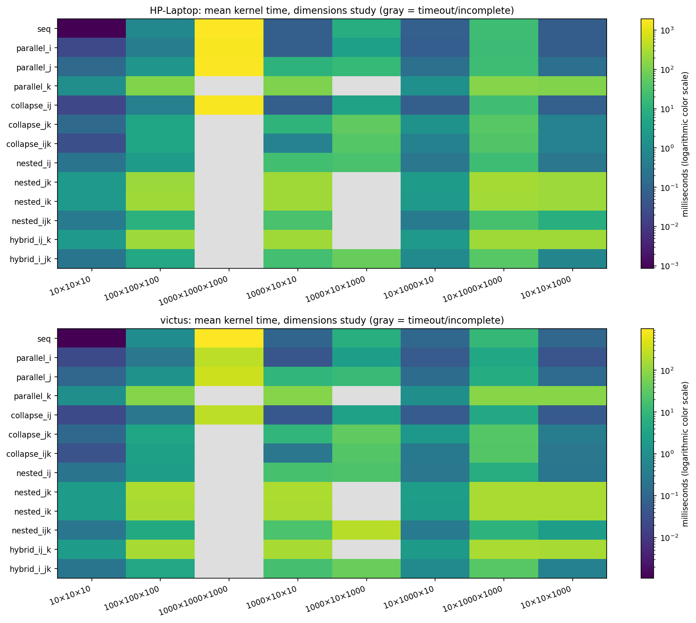
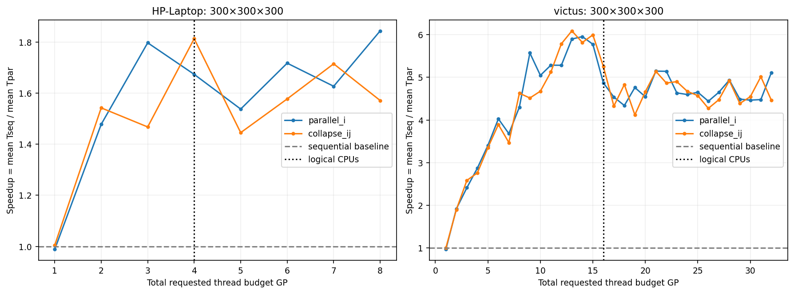
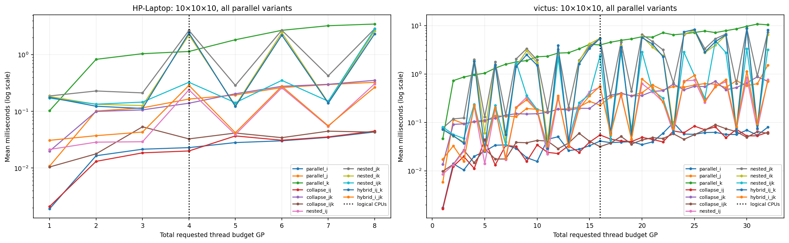
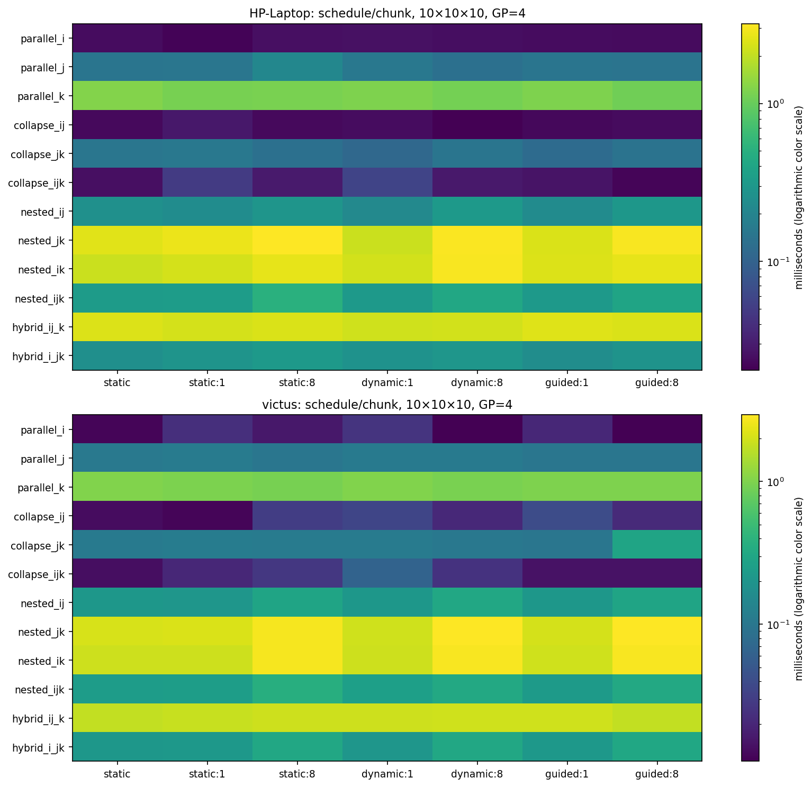
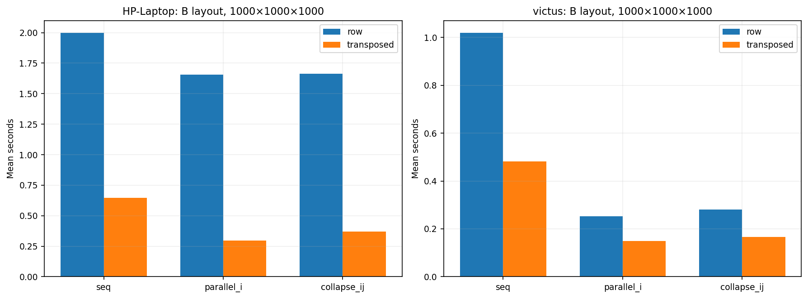
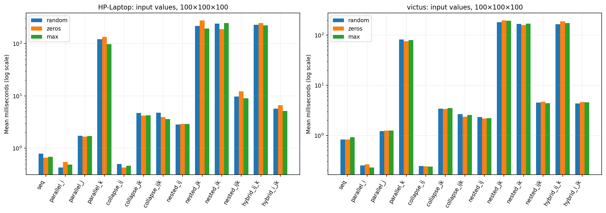
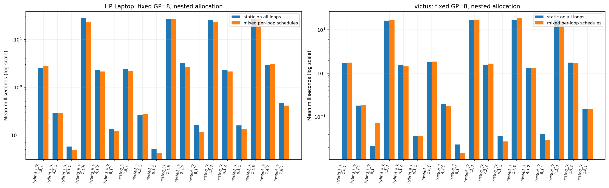

# HW2 — Rezultate experimentale măsurate

Datele provin exclusiv din execuțiile salvate în subdirectoarele fiecărei mașini. Regenerare: `python3 HW2/analyze.py --input HW2/results/study`.

## Platforme și metodologie

| Mașină | CPU | Core-uri fizice | CPU logice disponibile | RAM | Început UTC | Load 1 min început/final |
| --- | --- | --- | --- | --- | --- | --- |
| HP-Laptop | Intel(R) Core(TM) i7-7500U CPU @ 2.70GHz | 2 | 4 | 11.6 GiB | 2026-11-16T12:34:15.192774+00:00 | 0.00 / 2.71 |
| victus | 12th Gen Intel(R) Core(TM) i5-12500H | 12 | 16 | 15.3 GiB | 2026-11-16T12:23:44.912744+00:00 | 0.80 / 3.34 |

GCC 13.3, `-O3 -std=c11 -fopenmp`, Ubuntu 24.04; versiunile exacte, topologia, guvernorii CPU, memoria, mediul OpenMP și hash-urile surselor sunt în `metadata.json`. Victus are un procesor hibrid: numărul de CPU logice nu se deduce prin dublarea tuturor core-urilor fizice.

Măsurăm cu `omp_get_wtime()` numai apelul nucleului, inclusiv crearea echipelor, planificarea și sincronizarea cerute de variantă. Generarea A/B, aranjarea lui B, alocarea, resetarea lui C, referința secvențială și verificarea tuturor elementelor sunt în afara intervalului. O încălzire precedă cele cinci repetări ale aceleiași perechi. Pentru cazul aleator se folosesc cinci seed-uri distincte (1001–1005), identice între variante și calculatoare. Media este întâi calculată pe repetările unui seed, apoi pe seed-uri cu ponderi egale.

`GP` este bugetul total cerut: produsul dimensiunilor echipelor pentru nivelurile nested; un `collapse` folosește o singură echipă. Bugetul este factorizat echilibrat, iar pentru GP prim nivelurile interioare au un fir. Campania `allocation` compară alte repartizări la GP=8. Mediul folosește `OMP_WAIT_POLICY=PASSIVE`, `OMP_DYNAMIC=FALSE`, `OMP_PROC_BIND=FALSE`; dimensiunile realizate în proba de echipe sunt păstrate în fiecare înregistrare.

Profilul `study` separă factorii: dimensiuni (8 forme, toate variantele, GP=4), thread-uri (toate variantele, 10³), scalare (variantele i și collapse(ij), 300³), schedule/chunk (toate variantele, 10³ și suplimentar i/collapse(ij) la 300³), layout B (toate variantele, 100³ și variantele i/collapse(ij) la 1000³), repartizarea nivelurilor și schedule-uri independente (10³). Cazurile zeros și max sunt incluse în campaniile dimensiuni și schedule. Profilul `full` disponibil în script permite produsul cartezian complet ales de utilizator.

## Integritatea datelor și limitele măsurării

| Mașină | Configurații | Repetări verificate | Configurații TIMEOUT | Bugete GP |
| --- | --- | --- | --- | --- |
| HP-Laptop | 2319 | 11120 | 98 | 1–8 |
| victus | 3999 | 19564 | 91 | 1–32 |

Limita este de 3 secunde pentru o invocare completă, respectiv 30 de secunde pentru configurațiile mari seq/i/j/collapse(ij). Include inițializarea, referința, încălzirea și toate repetările; TIMEOUT nu reprezintă un timp măsurat al înmulțirii. Repetările finalizate înaintea întreruperii rămân în datele brute, dar un seed incomplet este exclus integral din medii. Grupurile cu seed-uri lipsă sunt marcate PARTIAL și nu intră în grafice sau clasamente. Nu se înlocuiesc timeout-urile cu zero sau cu durata limită.

Numerele sunt `uint64_t`; operațiile sunt definite modulo 2⁶⁴. Cazul `max` conține UINT64_MAX și are C[i,j]=m modulo 2⁶⁴, fără overflow semnat nedefinit. Cazul aleator [0,100] și zeros au rezultate matematice exacte pentru dimensiunile studiate. Înmulțirea cu numere de precizie arbitrară nu este studiată. Denumirile best/worst din enunț descriu valorile de intrare; nu garantează extrema timpului pentru instrucțiuni întregi de lățime fixă.

Nu am izolat sistemele de toate serviciile și aplicațiile: load-ul observat este în tabel. Frecvența, migrarea pe core-uri și încărcarea concurentă pot afecta mediile. Rulările foarte mici sunt dominate de overhead și de variația măsurării; nu se extrapolează scalarea lor la matrici mari. Numărul de page faults este observat, dar nu dovedește cauzalitatea efectului cache-ului. Nu sunt efectuate comparații Docker/VM ori experimente controlate cu/fără Hyper-Threading.

## Dimensiuni și alegerea variantei

| Mașină | n×m×r | Cea mai rapidă variantă măsurată (inclusiv seq) | Media ms | Speedup | CV repetări |
| --- | --- | --- | --- | --- | --- |
| HP-Laptop | 10×10×10 | seq | 0.00085936 | 1.000 | 13.7% |
| HP-Laptop | 100×100×100 | parallel_i | 0.43014 | 1.837 | 20.9% |
| HP-Laptop | 1000×1000×1000 | parallel_i | 1686.2 | 1.150 | 1.3% |
| HP-Laptop | 1000×10×10 | parallel_i | 0.070319 | 1.045 | 21.9% |
| HP-Laptop | 1000×10×1000 | parallel_i | 3.3604 | 2.276 | 10.4% |
| HP-Laptop | 10×1000×10 | parallel_i | 0.069981 | 1.112 | 18.4% |
| HP-Laptop | 10×1000×1000 | parallel_i | 19.584 | 1.042 | 15.1% |
| HP-Laptop | 10×10×1000 | seq | 0.064552 | 1.000 | 3.8% |
| victus | 10×10×10 | seq | 0.001061 | 1.000 | 8.6% |
| victus | 100×100×100 | collapse_ij | 0.24249 | 3.428 | 8.0% |
| victus | 1000×1000×1000 | parallel_i | 248.99 | 3.996 | 2.5% |
| victus | 1000×10×10 | parallel_i | 0.040999 | 2.251 | 42.6% |
| victus | 1000×10×1000 | parallel_i | 2.4157 | 2.387 | 5.7% |
| victus | 10×1000×10 | parallel_i | 0.054574 | 1.974 | 8.2% |
| victus | 10×1000×1000 | parallel_i | 3.903 | 2.574 | 21.9% |
| victus | 10×10×1000 | parallel_i | 0.039911 | 2.465 | 18.0% |

Varianta i și collapse(ij) oferă celule independente fără sincronizare în bucla k. Paralelizarea k creează o echipă pentru fiecare celulă; variantele nested creează echipe suplimentare pentru fiecare iterație a nivelului exterior. collapse(jk), collapse(ijk) și hibridul i/(jk) execută câte un atomic per contribuție, deoarece iterațiile distincte pot actualiza aceeași celulă. Aceste costuri explică diferențele structurale; tabelul arată care dintre variante câștigă efectiv pe datele măsurate.

## Numărul de thread-uri și factorul de accelerare

| Mașină | Variantă, 300³ | GP optim observat | Media ms | Speedup | Eficiență S/GP | CV |
| --- | --- | --- | --- | --- | --- | --- |
| HP-Laptop | parallel_i | 8 | 11.208 | 1.844 | 0.230 | 14.8% |
| HP-Laptop | collapse_ij | 4 | 11.397 | 1.813 | 0.453 | 17.0% |
| victus | parallel_i | 14 | 2.883 | 5.954 | 0.425 | 14.5% |
| victus | collapse_ij | 13 | 2.8195 | 6.088 | 0.468 | 8.4% |

Speedup = media Tseq / media Tpar pentru același calculator, campanie, formă, layout și distribuție a datelor. Eficiența este speedup/GP. Optimele sunt minime observate pe această grilă, nu garanții sau recomandări universale. Oversubscription nu adaugă unități de execuție fizice; core-urile P/E și SMT ale platformelor nu au performanțe identice. Bugetele consecutive includ GP=1, care păstrează overhead-ul OpenMP.

## Schedule și dimensiunea chunk-ului

| Mașină | Variantă, 300³, GP=4 | Schedule optim observat | Chunk (0=implicit) | Media ms | CV |
| --- | --- | --- | --- | --- | --- |
| HP-Laptop | parallel_i | dynamic | 1 | 9.8327 | 13.4% |
| HP-Laptop | collapse_ij | guided | 8 | 11.421 | 13.1% |
| victus | parallel_i | dynamic | 1 | 5.1029 | 6.7% |
| victus | collapse_ij | guided | 1 | 4.8611 | 8.1% |

Toate celulele fac m produse; lucrul aritmetic este uniform. Un schedule dinamic nu reduce automat timpul: introduce distribuire de task-uri, iar chunk-uri mici pot afecta localitatea sau induce false sharing. Efectul trebuie citit împreună cu mărimea problemei și variabilitatea. schedule(runtime) este setat pentru task-ul care întâlnește fiecare regiune, astfel încât nivelurile nested pot avea politici diferite.

## Memorie și valorile elementelor

| Mașină | Variantă, 1000³ | B pe linii, s | B transpus, s | Trow / Ttransposed |
| --- | --- | --- | --- | --- |
| HP-Laptop | seq | 1.9998 | 0.64607 | 3.095 |
| HP-Laptop | parallel_i | 1.654 | 0.29693 | 5.571 |
| HP-Laptop | collapse_ij | 1.6633 | 0.3683 | 4.516 |
| victus | seq | 1.0201 | 0.48175 | 2.117 |
| victus | parallel_i | 0.25345 | 0.14848 | 1.707 |
| victus | collapse_ij | 0.28066 | 0.16614 | 1.689 |

B transpus permite citiri consecutive pentru ambii operanzi ai unui produs scalar. Generarea/aranjarea lui B este exclusă din timp; comparația evaluează nucleul, nu costul total pentru o singură înmulțire cu o transpunere suplimentară. La 1000³ campania layout folosește un singur seed și cinci repetări; campania layout la 100³ folosește cinci seed-uri.

zeros, random și max parcurg aceleași bucle, fără scurtcircuitări pentru zero. Diferențele observate se raportează cu precauție: pentru uint64_t instrucțiunile nu au un cost proporțional cu numărul de cifre al operandului.

## Repartizarea thread-urilor pe niveluri

La GP=8, (8,1), (4,2) și (1,8) au aceeași limită teoretică de fire, dar numere diferite de regiuni interioare active. Pentru trei niveluri se compară (8,1,1), (2,2,2), (1,1,8). Graficul etichetează efectiv vectorul (Ti,Tj,Tk); la un collapse se folosește numai Ti, respectiv Tj. A doua serie folosește dynamic:1 / guided:2 / static:2 pe i/j/k. Politicile și dimensiunile echipelor pot fi configurate independent din CLI.

## Concluzii și reproducere

- **HP-Laptop:** la 10³ câștigă `seq` (0.00085936 ms); la 1000³ câștigă `parallel_i` dintre variantele finalizate, cu 1686.2 ms și speedup 1.150× la GP=4. Pragul de rentabilitate al paralelizării depinde de mărimea produsului.

- **HP-Laptop, buget:** pe grila 300³, cea mai mică medie este 11.208 ms pentru `parallel_i`, GP=8, speedup 1.844×. Aceasta este alegerea măsurată pentru această sarcină; se verifică CV și se repetă înainte de a generaliza la alte dimensiuni.

- **victus:** la 10³ câștigă `seq` (0.001061 ms); la 1000³ câștigă `parallel_i` dintre variantele finalizate, cu 248.99 ms și speedup 3.996× la GP=4. Pragul de rentabilitate al paralelizării depinde de mărimea produsului.

- **victus, buget:** pe grila 300³, cea mai mică medie este 2.8195 ms pentru `collapse_ij`, GP=13, speedup 6.088×. Aceasta este alegerea măsurată pentru această sarcină; se verifică CV și se repetă înainte de a generaliza la alte dimensiuni.

Pentru fiecare formă, tabelul de dimensiuni identifică varianta eficientă observată; pentru 300³, tabelele identifică bugetul GP și schedule/chunk cu timpul mediu minim în eșantion. Rezultatele trebuie alese în funcție de platformă și dimensiuni: nici adăugarea de fire, nici paralelizarea tuturor buclelor nu garantează accelerare. Pentru decizii apropiate se consultă deviația standard și CV din `summary.csv`, apoi se repetă măsurările într-un mediu mai bine controlat.

Fișiere: `summary.csv` (medii, deviații, speedup, eficiență, timeout-uri), `failures.csv` (evenimentele TIMEOUT/ERROR), `<mașină>/runs.csv` (date brute importabile în LibreOffice/Excel), `<mașină>/runs.jsonl`, `<mașină>/plan.json` și `<mașină>/metadata.json`. Graficele PNG/SVG sunt în `HW2/figures/study/`. Comenzile și acoperirea cerințelor sunt în [README](../../README.md) și [EXPERIMENTS](../../EXPERIMENTS.md).
